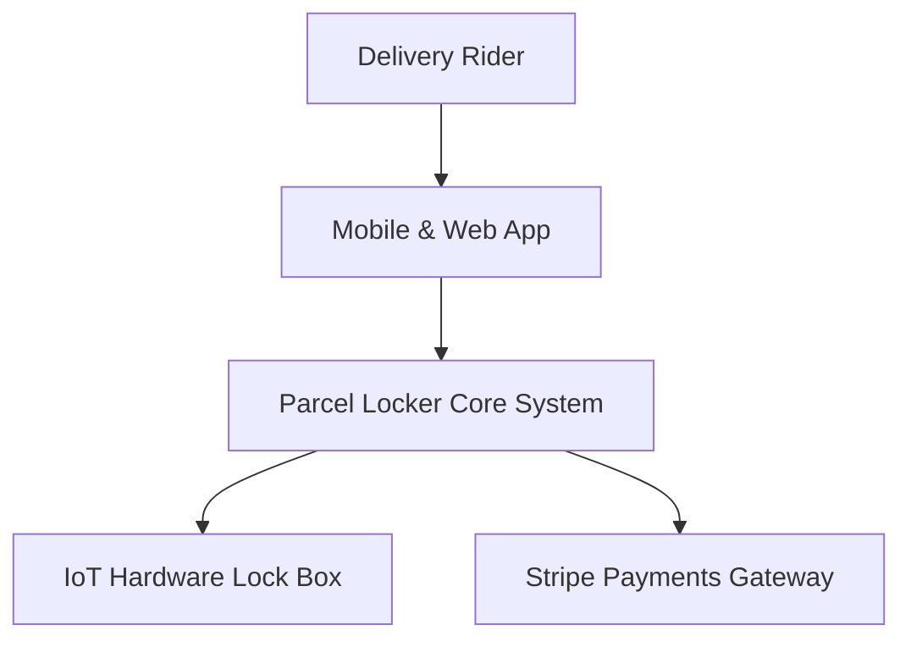
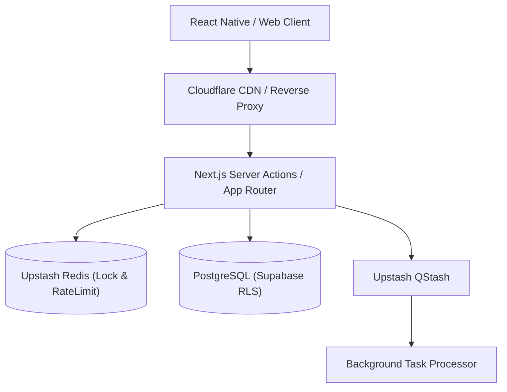

<!-- INVARIANT_START:ANTI_AI_SLOP -->
## 🛑 HARDENED ANTI-AI SLOP MANDATE: NATURAL PROSE & BESPOKE DESIGN CRAFT
All agent communications, architectural plans, reviews, code comments, and frontend implementations MUST strictly adhere to natural human engineering standards. Both corporate AI prose slop and cookie-cutter "vibecoded" UI slop are strictly banned.

### 1. Zero Prose & Grammar Slop (Natural Human Voice)
- **Banned Lexicon:**
  - *Empty Verbs:* delve, embark, foster, resonate, underscore, leverage, elevate, harness, navigate, empower, illuminate, facilitate, tailor, showcase, unveil.
  - *Corporate Buzz-Adjectives:* testament, tapestry, beacon, cornerstone, robust, seamless, pivotal, crucial, paramount, cutting-edge, vibrant, bespoke, game-changer, journey, realm, landscape, holistic, comprehensive, multifaceted, versatile, transformative.
  - *Formulaic Transitions:* furthermore, moreover, in conclusion, it is worth noting, at the end of the day, without further ado, needless to say.
- **Banned Syntactical Patterns:**
  - **Zero Sycophancy / Pleasantries:** NEVER start responses with "Certainly!", "Great question!", "I'd be happy to help!", "Awesome!", or "Let's dive in!".
  - **Zero Summary Outros:** NEVER end answers with a repetitive paragraph restating earlier points using generic corporate filler.
  - **Zero Formulaic "Rule-of-Three" Bullets:** Do not default to 3-bullet lists where each bullet starts with a bold abstract noun followed by a colon and fluff.
  - **Zero Hedging:** Do not write "You might want to potentially consider checking...". Write "Check X, or Y crashes."
- **Natural Voice Standard:** Speak like a systems developer in terminal, Slack, or GitHub issues: blunt, concise, precise, pragmatic. Code and runnable shell commands come first.

### 2. Zero Visual & UI/UX Design Slop (Bespoke Engineering Craft)
- **Banned Color Clichés:**
  - BAN default AI Blue-to-Indigo/Purple gradients (`bg-gradient-to-r from-blue-600 to-indigo-700` or violet hues).
  - BAN colored ambient glowing shadows (`box-shadow` with >= 24px blur matching accent color).
  - BAN washed-out low-contrast gray text (`text-gray-400` / `text-gray-500` failing WCAG AA 4.5:1).
  - BAN gradient headline text (`bg-clip-text text-transparent bg-gradient-to-r` on H1s).
- **Banned Layout & Component Tropes:**
  - BAN cookie-cutter Bento Grid walls filled with fake stats, empty cards, or generic Lucide icon spam.
  - BAN centered hero boilerplate with a floating pill above H1 (`"✨ New: [Feature]"`).
  - BAN unmodified shadcn/ui defaults (`--radius: 0.5rem`, stock button/card exports without brand styling).
  - BAN tinted circular icon containers (`bg-primary/10 text-primary p-3 rounded-full`).
  - BAN static terminal window mockups with red/yellow/green dots in the hero.
  - BAN raw emojis used as icons (`✨`, `🚀`, `⚡`, `🔒`) in production UI markup.
- **Bespoke Design Standard:**
  - Commit to an intentional aesthetic: brutalist, high-density telemetry, refined editorial, or precision dark-mode.
  - High information density (Linear/Stripe standard), micro-borders (`rgba(255,255,255,0.08)`), and tabular numerals (`tabular-nums`).
  - Every component must implement all 7 states: `Default, Hover, Focus-Visible, Active, Loading (Skeleton), Disabled, Error`.
<!-- INVARIANT_END:ANTI_AI_SLOP -->

<!-- INVARIANT_START:GRAPHIFY -->
## 🧠 HARDENED GRAPHIFY KNOWLEDGE ENGINE GATE (AST-FIRST CODE INTELLIGENCE)
Whenever `graphify-out/graph.json` exists in the repository root, agents MUST interact with the AST knowledge graph. Blind directory traversal and unconstrained multi-file context dumping are strictly banned.

1. **Zero-Blind-Grep Invariant:**
   - Running unstructured grep (`grep -r`, `Select-String *.*`, `ripgrep` across entire project) to locate callers or symbol references is FORBIDDEN when `graph.json` is present.
   - Agents must query Graphify first: `graphify query "<symbol_or_concept>"`.

2. **Blast Radius Gate (`graphify explain "<symbol>"`):**
   - Before modifying, refactoring, or deleting any shared interface, model, route, or function, the agent MUST run `graphify explain "<symbol>"`.
   - If incoming edge count > 0, every caller surfaced by Graphify MUST be explicitly enumerated in the task DAG or implementation plan before touching code.

3. **Call-Path Fault Tracing (`graphify path "<source>" "<target>" --undirected`):**
   - When debugging multi-hop failures (e.g. UI -> API -> DB), the agent must run `graphify path` to map the exact shortest call chain between entry point and crash sink before reading source code.

4. **Leiden Community Worktree Partitioning:**
   - When spawning parallel subagents in `ultimate-multi-agent-invoker`, tasks MUST be partitioned by Leiden community clusters (from `graphify-out/graph.json`).
   - If two tasks share a God Node (identified in `graphify-out/GRAPH_REPORT.md`), they CANNOT run concurrently without explicit file-level mutex locks.

5. **Subagent Context Clamp (70% Token Reduction):**
   - Never dump entire raw source files into subagent prompts. Inject only the scoped subgraph from `graphify query "<task_scope>"`.

6. **Post-Commit AST Synchronization (`graphify update .`):**
   - After completing code modifications or merging Git worktrees, the agent MUST run `graphify update .` (local AST delta update, 2s runtime, 0 API tokens) to maintain graph synchronization.
<!-- INVARIANT_END:GRAPHIFY -->

# Ultimate Systems Architecture Workflow (10/10 Master Engine)

This workflow guides the end-to-end design, domain boundary modeling, data flow specification, and architectural documentation of scalable distributed systems.

```
                                      [SYSTEM ARCHITECTURE INITIATIVE]
                                                     │
                          ┌──────────────────────────┴──────────────────────────┐
                          ▼                                                     ▼
              [PHASE 1: DOMAIN-DRIVEN DESIGN (DDD)]                 [PHASE 2: C4 VISUAL ARCHITECTURE]
              ├─ Core vs Subdomain Context Boundaries               ├─ Level 1: System Context Diagram
              ├─ Ubiquitous Language & Invariants                   ├─ Level 2: Container Diagram
              └─ Anti-Corruption Layers (ACL)                       └─ Level 3: Component Flow Diagram
                          │
                          ▼
        ┌─────────────────────────────────────────────────────────────────────────────┐
        │                 PHASE 3: ASYNCHRONOUS EVENT-DRIVEN ARCHITECTURES (EDA)      │
        │  • Transactional Outbox • Idempotent Consumers • QStash / Kafka Pipelines   │
        └──────────────────────────────────────┬──────────────────────────────────────┘
                                               ▼
                                  [PHASE 4: IMMUTABLE ADR RECORDING & GOVERNANCE]
                    ┌──────────────────────────┼──────────────────────────┐
                    ▼                          ▼                          ▼
            ┌──────────────┐           ┌──────────────┐           ┌──────────────┐
            │ 📜 ADR LOG   │           │ 🎯 TRADE-OFF │           │ 🔒 FAILURE   │
            │ docs/adr/    │           │ Pros vs Cons │           │ Bulkheads    │
            └──────────────┘           └──────────────┘           └──────────────┘
```

---

## 🏛️ Iron Laws of Systems Architecture

1. **Explicit Context Boundaries**: Subsystems must define strict boundaries; cross-context communication must use Anti-Corruption Layers (ACL) or published domain events.
2. **Transactional Outbox for Distributed Events**: State mutations and event publishing MUST be written to the same transactional boundary.
3. **Immutable ADR Lifecycle**: Once an Architecture Decision Record is `Accepted`, its content is permanent. Revisions require creating a new ADR that explicitly marks the former `Superseded`.
4. **C4 Model Visual Grounding**: System proposals must provide Mermaid diagrams across C4 Level 1 (Context), Level 2 (Container), and Level 3 (Component).
5. **Defensive Failure Domains (Bulkheads)**: Critical subsystems must not share threadpools, memory partitions, or connection limits with non-critical background jobs.

---

## 🔬 The 4-Phase Architecture Pipeline

### Phase 1: Domain Modeling & Bounded Contexts
- Establish Ubiquitous Language shared between engineering and product.
- Segregate domains:
  - **Core Domain:** Unique competitive differentiator (e.g. smart parcel locker dispatch engine).
  - **Supporting Domain:** Custom capabilities supporting the core (e.g. rider geofence verification).
  - **Generic Domain:** Standard off-the-shelf capabilities (e.g. Stripe billing, Auth0 auth).

### Phase 2: C4 Model Visual Diagrams (Mermaid)

#### Level 1: System Context


#### Level 2: Container Architecture


### Phase 3: Event-Driven Design & Outbox Pattern
```sql
-- Transactional Outbox Table
CREATE TABLE outbox_events (
  id UUID PRIMARY KEY DEFAULT gen_random_uuid(),
  aggregate_type TEXT NOT NULL,
  aggregate_id TEXT NOT NULL,
  event_type TEXT NOT NULL,
  payload JSONB NOT NULL,
  created_at TIMESTAMPTZ NOT NULL DEFAULT now(),
  processed_at TIMESTAMPTZ
);
```

### Phase 4: Architecture Decision Record (ADR) Template
```markdown
# ADR-0004: Adoption of PgBouncer Transaction Pooling on Port 6543

## Status
Accepted

## Context
Serverless Next.js Server Actions open transient connections, exhausting the PostgreSQL connection pool limit.

## Decision
Enforce PgBouncer in transaction mode (port 6543) with `connection_limit=1` for all runtime queries, maintaining port 5432 strictly for Prisma migrations via `DIRECT_URL`.

## Consequences
- **Positive:** Eliminates database connection saturation under high concurrent QPS.
- **Negative:** Prepared statements are disabled in transaction mode.
```
