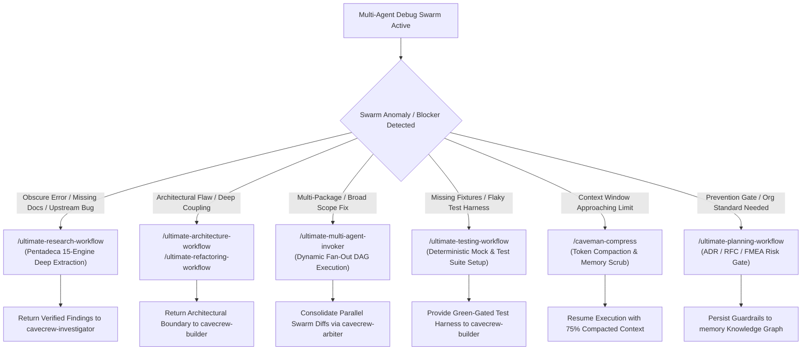
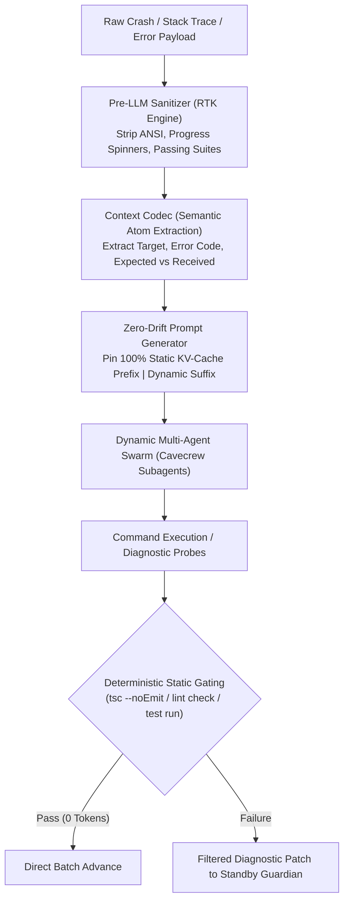
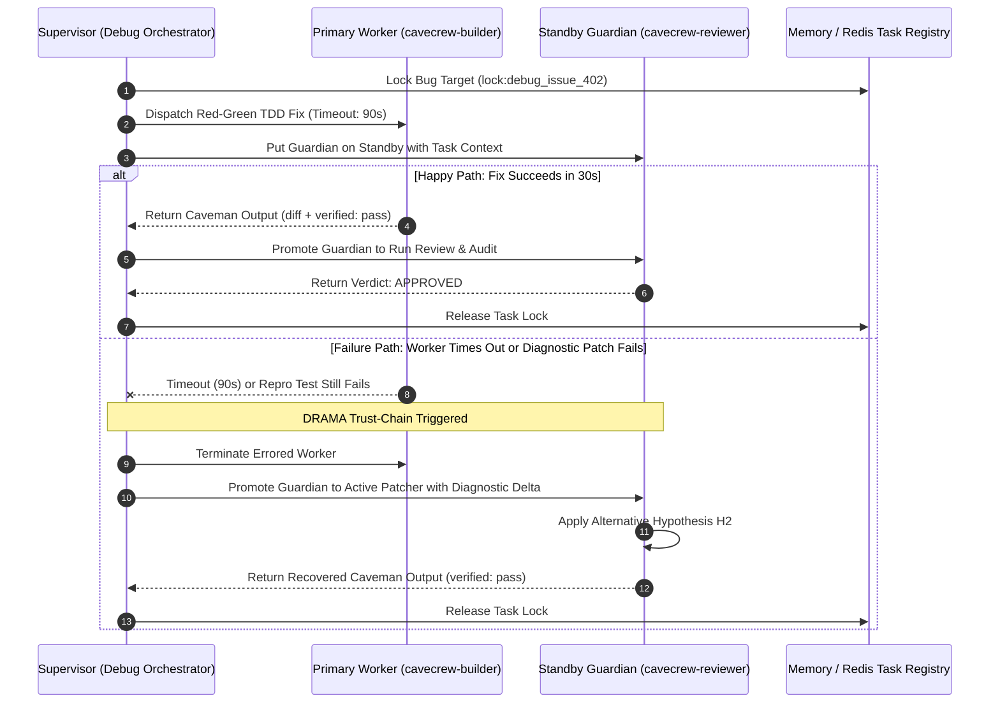

# Ultimate Multi-Agent Debugging Workflow (Pentadeca Swarm Engine)

> [!CAUTION]
> ### 🛑 STRICT MULTI-AGENT SWARM RUNTIME MANDATE — ZERO INLINE DEBUGGING
> When `/ultimate-debugging-workflow` is triggered, the assistant **MUST NOT** perform debugging, searching, inspecting, or patching inline in the supervisor thread.
> 
> **You MUST IMMEDIATELY invoke the subagent swarm using `invoke_subagent` on Turn 1:**
> - **Batch 1 (Parallel Diagnostics & Forensic Discovery)**: Dispatch `cavecrew-triage` (`TypeName: 'research'`, `Role: 'Pentadeca Triage Scout'`) and `cavecrew-investigator` (`TypeName: 'self'`, `Role: 'Codebase Investigator'`) simultaneously.
> - **Batch 2 (Active SRE Mitigation — if outage/live failure)**: Dispatch `cavecrew-mitigator` (`TypeName: 'self'`, `Role: 'SRE Mitigation Specialist'`) to stop bleeding, toggle Redis feature flags, or rollback.
> - **Batch 3 (TDD Red Repro & Surgical Green Fix)**: Dispatch `cavecrew-builder` (`TypeName: 'self'`, `Workspace: 'branch'`, `Role: 'TDD Patcher'`) to write the red reproduction test and minimal green ponytail fix.
> - **Batch 4 (Guardian Audit & Consensus Reconciliation)**: Dispatch `cavecrew-reviewer` (`TypeName: 'self'`, `Role: 'Guardian Reviewer'`) and `cavecrew-arbiter` (`TypeName: 'self'`, `Role: 'Delta Arbiter'`) to audit the diff, prevent regressions, and sync the memory knowledge graph.
> 
> Failing to call `invoke_subagent` on Turn 1 is a **CRITICAL PROTOCOL VIOLATION**.

---

## 0. ⚡ Mandatory Turn 1 Antigravity Tool Call Blueprint

When the user asks to debug an error or triggers this workflow, **DO NOT GENERATE EXPLANATORY TEXT**. Immediately emit the following native tool call in your very first response:

```json
// MANDATORY TURN 1 NATIVE TOOL CALL:
invoke_subagent({
  "Subagents": [
    {
      "TypeName": "research",
      "Role": "Pentadeca Triage Scout",
      "Model": "inherit",
      "Prompt": "[ROLE: cavecrew-triage]\n[ATOM:ERROR] \"<exact_error_or_issue>\"\n[ATOM:ACTION] Execute parallel search across Pentadeca 15-Engine matrix (Cluster 1: Tavily, Context7, You.com | Cluster 2: Exa AI, Jina AI, SERPdive | Cluster 3: Linkup, Parallel Search, SerpApi | Cluster 4: GitHub, Firecrawl, Crawleo | Cluster 5: Bright Data, Apify Cloud, Brave Search) for canonical solutions.\n[CONSTRAINTS] Omit conversational filler. Extract root cause and verified workaround link.\n[OUTPUT CONTRACT]\ntriage: <canonical URL>\nroot_cause: <concise explanation <= 20 words>\nworkaround: <code snippet or config flag>"
    },
    {
      "TypeName": "self",
      "Role": "Codebase Investigator",
      "Model": "inherit",
      "Prompt": "[ROLE: cavecrew-investigator]\n[ATOM:ERROR] \"<exact_error_or_issue>\"\n[ATOM:TARGET] <suspect_files_or_directories>\n[ATOM:ACTION] Trace symbol definitions, null propagation, call hierarchies, and dataflow boundaries. Read-only analysis.\n[CONSTRAINTS] Omit filler. Output caveman path:line format.\n[OUTPUT CONTRACT]\npath:line — symbol — finding\ntotals: N matches"
    }
  ],
  "toolAction": "Dispatching diagnostic swarm",
  "toolSummary": "Diagnostic swarm"
})
```

---

This workflow is the definitive **strictly multi-agent swarm** technical troubleshooting, incident mitigation, and root-cause resolution engine. It unifies the world's most rigorous engineering standards—**Google SRE** rapid mitigation, **Apple** 0-Hang/0-Hitch thread and frame budgets, **Microsoft** Time Travel Debugging (TTD) and Sysinternals diagnostics, **Amazon** Operational Excellence & COE 5-Whys, **Meta** Scuba high-cardinality distributed tracing, and **Netflix** Chaos resilience—orchestrated through a role-specialized subagent swarm (`cavecrew`) operating under the **Ponytail-Caveman** hyper-compressed token protocol and backed by the **Pentadeca 15-Engine** intelligence matrix.

```
                                      [SYSTEM ERROR / BUG / INCIDENT ALERT]
                                                        │
                                                        ▼
                        ┌───────────────────────────────────────────────────────────────┐
                        │         SUPERVISOR / SWARM ORCHESTRATOR (Caveman Hub)         │
                        │  • Parse Error Stack • Construct Hypothesis DAG (H1, H2, H3)  │
                        │  • Zero-Drift KV-Cache Pinning • Pre-LLM RTK Sanitizer Gating │
                        └───────────────────────────────┬───────────────────────────────┘
                                                        │
                ┌───────────────────────────────────────┴───────────────────────────────────────┐
                ▼                                                                               ▼
    [PHASE 1: SRE MITIGATION SWARM]                                             [PHASE 2: PENTADECA TRIAGE & DIAGNOSTIC SWARM]
    ┌───────────────────────────────────────────────┐                           ┌───────────────────────────────────────────────┐
    │ Agent: cavecrew-mitigator                     │                           │ Agent: cavecrew-triage (15-Engine Matrix)     │
    │ ├─ Stop Bleeding: Rollback release / SHA      │                           │ ├─ Cluster 1: Tavily, Context7, You.com       │
    │ ├─ Toggle Redis feature flags (Upstash)       │                           │ ├─ Cluster 2: Exa AI, Jina AI, SERPdive       │
    │ └─ Trip circuit breakers & shed load (Netflix)│                           │ ├─ Cluster 3: Linkup, Parallel Search, SerpApi│
    └───────────────────────────────────────────────┘                           │ ├─ Cluster 4: GitHub, Firecrawl, Crawleo      │
                │                                                               │ └─ Cluster 5: Bright Data, Apify, Brave Search│
                │                                                               │ Agent: cavecrew-investigator (AST Dataflow)   │
                │                                                               │ Agent: cavecrew-bisector (Git Binary Search)  │
                │                                                               │ Agent: cavecrew-profiler (DB/V8/Trace/Apple)  │
                │                                                               └───────────────────────────────────────────────┘
                └───────────────────────────────────────┬───────────────────────────────────────┘
                                                        │
                                                        ▼
                                      [PHASE 3: RED REPRODUCTION TEST GATE]
                                      ┌───────────────────────────────────────────────┐
                                      │ Agent: cavecrew-builder (Repro Engineer)      │
                                      │ └─ Standalone failing automated test (Red)    │
                                      └───────────────────────┬───────────────────────┘
                                                        │
                                                        ▼
                                      [PHASE 4: GREEN PONYTAIL FIX ENGINE]
                                      ┌───────────────────────────────────────────────┐
                                      │ Agent: cavecrew-builder (Patcher Engineer)    │
                                      │ ├─ Ponytail 6-Rung Code Ladder (Stdlib 1st)   │
                                      │ ├─ Surgical minimal diff (Zero Over-eng)      │
                                      │ └─ Verify test transitions to pass (Green)    │
                                      └───────────────────────┬───────────────────────┘
                                                        │
                                                        ▼
                                      [PHASE 5: GUARDIAN AUDIT & POST-MORTEM]
                                      ┌───────────────────────────────────────────────┐
                                      │ Agent: cavecrew-reviewer (Standby Guardian)   │
                                      │ ├─ OWASP security, memory leaks, types audit  │
                                      │ ├─ Amazon/Google Blameless 5-Whys Post-Mortem │
                                      │ └─ Synchronize Memory Graph (memory MCP)      │
                                      │ Agent: cavecrew-arbiter (Delta Merge)         │
                                      └───────────────────────────────────────────────┘
```

---

## 1. 🏛️ Iron Laws of Multi-Agent Swarm Debugging

1. **Strictly Multi-Agent Mandate (Zero Inline Debugging)**: Complex or cross-boundary bugs MUST NOT be debugged sequentially in the main supervisor thread. The supervisor immediately decomposes errors into a parallel subagent swarm (`cavecrew-mitigator`, `cavecrew-triage`, `cavecrew-investigator`, `cavecrew-bisector`, `cavecrew-profiler`, `cavecrew-builder`, `cavecrew-reviewer`, `cavecrew-arbiter`).
2. **Mandatory Turn 1 Swarm Spawn**: Upon receiving an error, stack trace, or incident report, the assistant MUST issue `invoke_subagent` in Turn 1 without conversational filler.
3. **Pentadeca 15-Engine Hard Gate (15/15 Execution Mandate)**: Obscure framework crashes, runtime panics, SDK bugs, and dependency conflicts MUST be cross-referenced across all FIFTEEN (15) intelligence engines structured in 5 strategic clusters. Zero omissions ($N < 15$ is a protocol violation).
4. **Context is Gold, Bloat is Death (Caveman Protocol)**: Every subagent MUST communicate using hyper-compressed `ponytail-caveman` output with typed Semantic Commitment Atoms. Tool results injected into the main context must remain $\le 700$ tokens.
5. **Mitigate First, Root-Cause Second (Google SRE Standard)**: During active outages or broken builds, spin up `cavecrew-mitigator` immediately to preserve SLO error budgets and stop user-facing bleeding (rollback commit, toggle feature flag, shed load) before deep investigation.
6. **Automated Reproduction is the Non-Negotiable Gate**: No fix may be written or merged until `cavecrew-builder` produces an automated reproduction test that deterministically fails (Red). A bug without an automated reproduction script is merely an unverified assumption.
7. **1-Variable Scientific Isolation**: Subagents test exactly ONE hypothesis per iteration in an isolated branch/workspace (`Workspace: 'branch'`). If the hypothesis fails, revert the workspace completely before testing the next hypothesis.
8. **3-Strike Swarm Guardrail**: If 3 consecutive subagent patch attempts fail reproduction verification, HALT execution immediately. Promote the supervisor to a First-Principles architectural audit and re-trace dataflow boundaries.
9. **Apple 0-Hang & 0-Hitch Thread Invariants**:
   - **0-Hang Invariant**: Zero synchronous file I/O, heavy JSON parsing, or network requests on the main UI thread ($< 100\text{ms}$).
   - **0-Hitch Invariant**: 120Hz ProMotion layout and render frame budget ($8.33\text{ms}$).
10. **Microsoft TTD & Deterministic State Invariants**: Treat bugs as deterministic state transitions. If an issue is intermittent, trace memory bounds, concurrency race conditions, or unseeded randomness.
11. **Amazon Blast Radius & Cellular Containment**: Architectural fixes must enforce strict fault domain isolation. Downstream microservice outages must never cascade globally.
12. **Ponytail 6-Rung Code Ladder**: Fixes must be surgical and minimal. Built-in standard library APIs and runtime features MUST be preferred over new 3rd-party dependencies. YAGNI is enforced strictly.
13. **Pre-LLM Output Sanitization (RTK Standard)**: Raw compiler and test logs MUST be stripped of ANSI escape codes, progress spinners, and passing suites before injection into LLM context, reducing diagnostic noise by 60–90%.
14. **Zero-Drift KV-Cache Prefix Pinning**: Invariant system instructions, subagent role definitions, and tool schemas MUST remain 100% invariant across all turns. Dynamic variables (error stacks, file paths, line ranges) are appended strictly at the prompt tail.
15. **DRAMA (CVPR 2026) Trust-Chain Guardian Continuity**: Every active diagnostic subagent is paired with a standby guardian. If a worker times out (90s) or crashes, the standby guardian inherits the context and continues without dropping global state.
16. **Zero Silent Swallowing**: Catch blocks MUST log, report, or rethrow with contextual metadata. Empty `catch(e) {}` is a blocking defect.
17. **Idempotent Retry & Full Jitter (AWS/Stripe Standard)**: Retries on flaky network/DB operations MUST enforce idempotency keys and AWS Full Jitter: $\text{Sleep} = \text{random}(0, \min(\text{max\_delay}, \text{base\_delay} \times 2^{\text{attempt}}))$.
18. **Autonomous Cross-Workflow Escalation (Zero-Stall Rule)**: Never loop in ignorance. If an error is obscure, undocumented, architectural, or unverified after 2 triage iterations, the swarm MUST dynamically delegate to sister workflows (`/ultimate-research-workflow`, `/ultimate-architecture-workflow`, `/ultimate-refactoring-workflow`, `/ultimate-testing-workflow`, `/ultimate-multi-agent-invoker`) to resolve blockers immediately.

---

## 2. 🌐 The Pentadeca 15-Engine Search & Triage Matrix

When diagnosing undocumented errors, obscure runtime panics, SDK mismatches, or version regressions, `cavecrew-triage` executes parallel queries across all 15 intelligence engines organized into **5 Strategic Clusters (3 Engines per Cluster)**:

```
┌──────────────────────────────────────────────────────────────────────────────────────────────────┐
│                     PENTADECA 15-ENGINE HARDENED CLUSTER TOPOLOGY (PRO MAX)                      │
├──────────────────────────────────────────────────────────────────────────────────────────────────┤
│ 🏛️ CLUSTER 1: CANONICAL DOCS & OFFICIAL SPECIFICATIONS (Ground Truth Anchor)                     │
│   1. Tavily (`tavily`)            : Official documentation portals & authority sites.            │
│   2. Context7 (`context7`)        : Canonical TypeScript types, interface ASTs & param stubs.   │
│   3. You.com (`ydc-search`)       : Deterministic search synthesis & structured LLM grounding.   │
├──────────────────────────────────────────────────────────────────────────────────────────────────┤
│ 🧠 CLUSTER 2: NEURAL VECTORS & DEEP PASSAGES (Concept & Semantic Depth)                          │
│   4. Exa AI (`exa`)               : Neural semantic embeddings & code pattern matching.          │
│   5. Jina AI (`jina-remote-server`): Deep in-body passage spans (~100 words) & neural reranking. │
│   6. SERPdive (`serpdive`)        : Answer-ready LLM content extraction & compressed synthesis.  │
├──────────────────────────────────────────────────────────────────────────────────────────────────┤
│ ⚡ CLUSTER 3: REAL-TIME & LIVE SERP INTELLIGENCE (Freshness & Consensus)                          │
│   7. Linkup (`linkup`)            : Real-time agent grounding with structured citation trees.    │
│   8. Parallel Search (`parallel-search`): Ultra-low latency, token-dense answer excerpts.       │
│   9. SerpApi (`serpapi`)          : Google & Google Scholar SERP scraping, rank consensus.       │
├──────────────────────────────────────────────────────────────────────────────────────────────────┤
│ 🐙 CLUSTER 4: RAW CODE, AST & REPO TRIAGE (Source Implementation Grounding)                      │
│  10. GitHub (`github`)            : Direct repository source AST, merged PR diffs & changelogs.  │
│  11. Firecrawl (`firecrawl-mcp`)  : Developer index PR triage & dynamic headless JS DOM scraping.│
│  12. Crawleo (`crawleo`)          : Multi-format crawl, clean markdown & SERP RAG ingestion.     │
├──────────────────────────────────────────────────────────────────────────────────────────────────┤
│ 🛡️ CLUSTER 5: ANTI-BOT CRUSHING & MASS RECURSIVE CRAWLING (Deep Web Reach)                       │
│  13. Bright Data (`brightdata`)   : Web Unlocker, Cloudflare Turnstile & CAPTCHA crusher.        │
│  14. Apify Cloud (`apify`)        : Mass multi-thousand page recursive cloud web scraping.       │
│  15. Brave Search (`brave-search`): Independent 30B+ index, forum threads & freshness age filter.│
└──────────────────────────────────────────────────────────────────────────────────────────────────┘
```

### 2.1 Pentadeca Search Engine Specialization

| Cluster | Engine | Primary MCP Tool | Diagnostic Focus & Specialization | Target Artifact |
|---|---|---|---|---|
| **Cluster 1** | **1. Tavily** | `tavily/tavily_search` | Canonical vendor documentation, API reference parameters, authority guides. | Official SDK docs & parameter specs |
| **Cluster 1** | **2. Context7** | `context7/get-library-docs` | Direct library ID resolution & version-specific TypeScript type stub inspection. | Official type definitions (`.d.ts`) |
| **Cluster 1** | **3. You.com** | `ydc-search` / web search | LLM-optimized real-time search, grounded synthesis, fast fact validation. | Structured web results & verified facts |
| **Cluster 2** | **4. Exa AI** | `exa/web_search_exa` | Neural semantic code search, similar production bug patterns, workaround gists. | Real-world GitHub code patterns |
| **Cluster 2** | **5. Jina AI** | `jina-remote-server/search_web_deep` | Deep in-body passage extraction (~100 words), arXiv/SSRN specs, PDF tables. | Deep technical post-mortems & blogs |
| **Cluster 2** | **6. SERPdive** | `serpdive/serpdive_search` | High-speed LLM-grounded search returning answer-ready content and neural synthesis. | Compressed token snippets & answers |
| **Cluster 3** | **7. Linkup** | `linkup/linkup-search` | Real-time agent search with structured citations and deep web grounding. | Live ecosystem updates & advisories |
| **Cluster 3** | **8. Parallel Search** | `parallel-search/web_search` | Low-latency AI-native search returning high-density, answer-ready excerpts. | Atomic objective answers & fast snippets |
| **Cluster 3** | **9. SerpApi** | `serpapi` (google search) | Live Google & Google Scholar SERP scraping, organic knowledge graphs, sitelinks. | Google consensus & academic papers |
| **Cluster 4** | **10. GitHub** | `github/search_code` | Raw repository source code AST, issue discussions, merged PR commits. | Exact source line declarations & diffs |
| **Cluster 4** | **11. Firecrawl** | `firecrawl-mcp/firecrawl_search` | Developer index (`categories: ["developer"]`), merged PR diffs, closed issues. | Maintainer bug-fix commits & PRs |
| **Cluster 4** | **12. Crawleo** | `crawleo/crawleo_search` | Multi-format crawl, clean markdown & SERP RAG ingestion with JS rendering. | Clean markdown AST from SPAs & docs |
| **Cluster 5** | **13. Bright Data** | `brightdata/web_data_` | Web Unlocker bypassing Cloudflare Turnstile & anti-bot walls on enterprise portals. | Protected enterprise issue trackers |
| **Cluster 5** | **14. Apify Cloud** | `apify` (website crawler) | Mass cloud-hosted recursive documentation crawling and markdown dataset harvesting. | Bulk doc hierarchy & changelog trees |
| **Cluster 5** | **15. Brave Search** | `brave-search/brave_web_search` | Independent 30B+ web index separate from Google/Bing, fresh forum discovery. | Developer forums & community threads |

---

## 3. 👥 Dynamic Subagent Swarm Role Specialization Matrix

```
┌────────────────────────────────────────────────────────────────────────────────────────┐
│                          CAVECREW MULTI-AGENT SWARM ROLES                              │
├────────────────────────────┬────────────────────────────┬──────────────────────────────┤
│ 🚨 SRE MITIGATOR           │ 🔍 PENTADECA TRIAGE SCOUT  │ 🔬 CODEBASE INVESTIGATOR     │
│ • Stop active bleeding     │ • 15-Engine parallel query │ • AST call graph & dataflow  │
│ • Rollback commit / SHA    │ • 5-Cluster consensus      │ • Read-only boundary trace   │
│ • Redis feature flag flips │ • Canonical workaround PRs │ • Null propagation checks    │
├────────────────────────────┼────────────────────────────┼──────────────────────────────┤
│ ⏱️ BISECT SEARCHER         │ 📊 DEEP PROFILER           │ 🛠️ TDD PATCHER (BUILDER)     │
│ • Automated git bisect     │ • Postgres lock trees      │ • Red failing repro test     │
│ • Binary search bad SHA    │ • V8 heap snapshot deltas  │ • Ponytail 6-rung green fix  │
│ • Isolates regression PR   │ • Apple 0-Hang/0-Hitch log │ • Surgical minimal diff      │
├────────────────────────────┼────────────────────────────┼──────────────────────────────┤
│ 🛡️ GUARDIAN REVIEWER       │ ⚖️ DELTA ARBITER           │ 🧠 SUPERVISOR (ORCHESTRATOR) │
│ • OWASP security audit     │ • Merge parallel branch diff│ • Hypothesis DAG formulation│
│ • 5-Whys COE post-mortem   │ • Resolve git conflicts    │ • Turn 1 Swarm Dispatch     │
│ • Standby worker failover  │ • Sync Memory Graph        │ • DRAMA Trust-Chain monitor  │
└────────────────────────────┴────────────────────────────┴──────────────────────────────┘
```

| Subagent Role | Type Name | Scope & Boundary | Tool Whitelist | Output Contract (Caveman) |
|---|---|---|---|---|
| **SRE Mitigator** | `cavecrew-mitigator` | Fast rollback, Redis feature flag toggle, circuit breaking, load shedding. | `run_command`, `call_mcp_tool` (upstash) | `mitigated: <action> — status: <active | blocked> — blast_radius: <pct>` |
| **Pentadeca Triage Scout**| `cavecrew-triage` | 15-Engine parallel search across GitHub PRs, Jina deep passages, official docs. | `call_mcp_tool` (all 15 search engines) | `triage: <canonical issue/PR link> — root_cause: <summary ≤ 15 words>` |
| **Codebase Investigator** | `cavecrew-investigator` | AST call tree, symbol definitions, dataflow boundaries. Read-only. | `grep_search`, `list_dir`, `view_file`, `context7` | `path/to/file.ts:line — symbol — finding. totals: N matches.` |
| **Bisect Searcher** | `cavecrew-bisector` | Binary search regression commit via automated `git bisect run`. | `run_command` | `bisect: <bad_commit_sha> — author: <name> — commit_msg: <msg>` |
| **Deep Profiler** | `cavecrew-profiler` | Postgres lock trees, V8 heap deltas, OTel distributed traces, Apple Instruments. | `run_command`, `call_mcp_tool` (supabase, memory) | `profile: <deadlock_pid | heap_leak | trace_id> — bottleneck: <desc>` |
| **TDD Patcher** | `cavecrew-builder` | Red repro test creation, Green minimal ponytail fix, refactor. | `write_to_file`, `replace_file_content`, `run_command` | `path:line-range — <fix ≤ 10 words>. verified: <pass | fail>. diff: <diff>` |
| **Guardian Reviewer** | `cavecrew-reviewer` | OWASP security audit, regression verification, 5-Whys post-mortem. | `lint-and-validate`, `run_command`, `call_mcp_tool` (memory) | `path:line: 🔴/🟡 <flaw>. <fix>. verdict: <APPROVED | REJECTED>` |
| **Delta Arbiter** | `cavecrew-arbiter` | Merges parallel subagent diffs, resolves branch collisions, syncs memory graph. | `memory`, `replace_file_content`, `run_command` | `arbiter: merged N diffs — git_status: clean — memory: synced` |

---

## 4. 🏢 Big Tech Golden Debugging Standards & Playbooks

```
┌────────────────────────────────────────────────────────────────────────────────────────┐
│                        BIG TECH INDUSTRY DEBUGGING STANDARDS                           │
├────────────────────────────┬────────────────────────────┬──────────────────────────────┤
│ 🔵 GOOGLE SRE              │ 🍎 APPLE ENGINEERING       │ 🪟 MICROSOFT SRE             │
│ • Stop Bleeding First      │ • 0-Hang Invariant (<100ms)│ • Time Travel Debugging (TTD)│
│ • 4 Golden Signals         │ • 0-Hitch Invariant (8.3ms)│ • Minidump & Crash Analysis  │
│ • Blameless Post-Mortem    │ • Instruments & Retain Log │ • Sysinternals Handle Locks  │
├────────────────────────────┼────────────────────────────┼──────────────────────────────┤
│ 📦 AMAZON / AWS            │ 👥 META / FACEBOOK         │ 🍿 NETFLIX RESILIENCE        │
│ • COE 5-Whys Framework     │ • Scuba Distributed Trace  │ • Chaos Monkey & Simian Army │
│ • Cellular Blast Radius    │ • Differential Regression  │ • Circuit Breakers & Hystrix │
│ • AWS Full Jitter Backoff  │ • Continuous Profiling     │ • Stripe Event Idempotency   │
└────────────────────────────┴────────────────────────────┴──────────────────────────────┘
```

### 4.1 Google SRE 4-Loop Incident Mitigation Protocol
1. **Loop 1 (Triage & Error Budget Burn Rate)**:
   - Calculate SLO burn rate ($Burn = \frac{\text{Current Error Rate}}{\text{Allowed Error Rate}}$). If burn rate $> 14.4\times$ (1-hour budget exhaustion), declare P0 outage.
2. **Loop 2 (Mitigate — Stop the Bleeding First)**:
   - Rollback immediately: `git revert [commit_sha]`.
   - Disable offending feature flag in Upstash Redis (`set flag:v2:enabled 0`).
   - Shed non-critical background traffic and open circuit breakers.
3. **Loop 3 (Investigate — 4 Golden Signals)**:
   - **Latency:** Inspect $p50, p95, p99$ response times via OpenTelemetry spans.
   - **Traffic:** Measure QPS surges or connection drops.
   - **Errors:** Monitor HTTP 5xx vs 4xx rates.
   - **Saturation:** Measure CPU load, V8 heap memory usage, and DB connection pool saturation.
4. **Loop 4 (Resolve & Blameless Post-Mortem)**:
   - Implement minimal TDD fix and document root causes without assigning human blame.

---

### 4.2 Apple Concurrency, Memory & Frame-Budget Invariants
1. **0-Hang Invariant ($< 100\text{ms}$)**:
   - Never perform database queries, file read/writes, or cryptographic operations on the Main UI Thread (`@MainActor`).
   - Offload heavy tasks to background worker pools (`Task.detached(priority: .userInitiated)` or Node worker threads).
2. **0-Hitch Invariant ($8.33\text{ms}$)**:
   - In UI applications (React, React Native, Swift, Web), frame updates MUST complete within $8.33\text{ms}$ (120Hz) or $16.67\text{ms}$ (60Hz).
   - Eliminate costly layout recalculations and unbounded state recalculations in render loops.
3. **Memory Graph Debugging (Retain Cycles & Zombie Objects)**:
   - Detect cyclic object references where Parent $\rightarrow$ Child and Child $\rightarrow$ Parent both hold strong pointers.
   - Enforce weak/unowned references (`weak var delegate`, `WeakRef`, or `useCallback` cleanup).

---

### 4.3 Microsoft Time Travel Debugging (TTD) & Sysinternals Protocols
1. **Time Travel Debugging (TTD) Invariant**:
   - For complex, non-deterministic race conditions, record process execution frames and replay backwards to pinpoint the exact memory write that corrupted state.
2. **Sysinternals Handle & Lock Analysis**:
   - When files, ports, or shared memory handles are locked:
     - Windows: Identify locking PID via `handle.exe` or `openfiles` / PowerShell.
     - Linux/macOS: Identify locking process via `lsof -i :<port>` or `fuser <file_path>`.
3. **Minidump & Stack Frame Extraction**:
   - Extract raw register states (`EIP/RIP`, `ESP/RSP`) and local stack frames from crash dumps to isolate null pointer dereferences and stack overflows.

---

### 4.4 Amazon Operational Excellence & COE (Correction of Errors)
1. **The 5-Whys Root-Cause Deep Drill**:
   - Every incident post-mortem must drill down through 5 levels of causation:
     - *Why 1:* Direct symptom trigger.
     - *Why 2:* Underlying software defect or unhandled edge case.
     - *Why 3:* Testing gap or missing regression test.
     - *Why 4:* Architectural susceptibility or missing fail-safe.
     - *Why 5:* Organizational or procedural gap.
2. **Cellular Blast Radius Containment**:
   - Partition services into independent cells. A failure in Cell $A$ must never cascade to Cell $B$.
3. **AWS Full Jitter Exponential Backoff**:
   $$\text{Sleep} = \text{random}\left(0, \min\left(\text{max\_delay}, \text{base\_delay} \times 2^{\text{attempt}}\right)\right)$$

---

### 4.5 Meta (Facebook) Scuba High-Cardinality Telemetry & Continuous Profiling
1. **Scuba High-Cardinality Tracing**:
   - Every log line MUST carry high-cardinality metadata keys: `trace_id`, `span_id`, `user_id`, `tenant_id`, `commit_sha`, `feature_flags`.
   - Enables instant filtering across millions of requests to isolate single-tenant edge cases.
2. **Continuous Production Profiling**:
   - Periodically sample stack traces using low-overhead sampling profilers (eBPF / V8 CPU profiler) to catch silent CPU and memory regressions before outages occur.

---

### 4.6 Netflix Chaos Engineering & Resilience Patterns
1. **Bulkhead Isolation**:
   - Isolate thread pools and resource quotas so that an unresponsive downstream dependency does not consume all available system threads.
2. **Circuit Breakers (Resilience4j / Hystrix Pattern)**:
   - Trip circuit breaker when error rate exceeds threshold ($> 50\%$ over 10s window). Return cached or fallback response immediately without hitting degraded dependency.
3. **Stripe-Standard Idempotency Keys**:
   - Every state-mutating request MUST include a unique `Idempotency-Key` header stored in Upstash Redis with a 24-hour TTL to prevent duplicate execution during retries.

---

## 5. 🔄 Autonomous Cross-Workflow Escalation Engine (Dynamic Workflow Chaining)

When the debugging swarm encounters ambiguous boundaries, unknown external errors, missing test fixtures, or structural architectural debt, it triggers **Zero-Stall Dynamic Escalation** to specialized sister workflows without stalling or requiring manual user intervention:



### 5.1 Dynamic Escalation Routing Matrix

| Trigger Condition | Target Escalation Workflow | Action & Subagent Delegation | Expected Output Injected |
|---|---|---|---|
| **Unknown API / Obscure Error Stack** | `/ultimate-research-workflow` | Dispatches `cavecrew-triage` to execute 15-engine deep crawl on upstream PRs and GitHub issue threads. | Grounded workaround code snippet & verified documentation URL. |
| **Architectural Root Cause / Coupling** | `/ultimate-architecture-workflow` | Formulates C4 Component boundaries and domain separation before touching code. | Refactoring blueprint isolating shared state. |
| **Code Smells / Deep Nesting / YAGNI** | `/ultimate-refactoring-workflow` | Dispatches Mikado / Strangler Fig migration to clean up debt. | Clean, flat, modularized code without symptom patching. |
| **Large Multi-File / Monorepo Fix** | `/ultimate-multi-agent-invoker` | Computes DAG antichain width $\omega(G_T)$ and executes parallel layer builders. | Parallel layer diffs merged cleanly by arbiter. |
| **Missing Automated Reproduction Harness** | `/ultimate-testing-workflow` | Generates isolated Vitest/Jest fixtures, DB seeders, or Playwright specs. | Standalone deterministic failing test script. |
| **Token Budget > 100k / High Context Noise** | `/caveman-compress` & `/ponytail-debt` | Scrubs debug logs, compresses session notes, logs `# ponytail:` markers. | ~75% token budget headroom recovered. |
| **High Blast Radius / Post-Incident Gate** | `/ultimate-planning-workflow` | Authors immutable ADR (`docs/adr/`) and FMEA risk score matrix. | Permanent prevention gate merged into repository. |

---

## 6. 🧠 Frontier Token Optimization & Context Compression Architecture



### 6.1 Zero-Drift Prefix KV-Cache Pinning
- **Static Invariant Block (100% Cached):** Unchanging instructions containing the Ponytail 6-rung ladder, Caveman output formatting, and tool schemas.
- **Dynamic Tail Block (Cache Delta):** Target file path, line numbers, error snippet, and typed semantic atoms appended exclusively at the prompt tail.

### 6.2 Semantic Commitment Atoms for Debugging
Tasks and hypotheses are normalized into **Typed Semantic Atoms** (arXiv:2605.17304):

```text
[ATOM:ERROR] type=TypeError | code=ERR_INVALID_ARG | target=web/src/api/auth.ts:42
[ATOM:HYPOTHESIS] id=H1 | desc=Null session token propagated from middleware
[ATOM:CONSTRAINTS] stdlib_only=true | yagni=true | max_files=1 | timeout=90s
[ATOM:ACTION] write_repro_test -> apply_ponytail_fix
[ATOM:CONTRACT] return=diff_only | verify=npx tsx web/src/test/auth.test.ts
```

### 6.3 Pre-LLM Output Sanitizer (RTK Regex Engine)
Never inject raw terminal dumps directly into the subagent context:
- **Strip ANSI Escapes:** `\x1B(?:[@-Z\\-_]|\[[0-?]*[ -/]*[@-~])`
- **Filter Stack Frames:** Extract only userland file frames (ignore `node:internal/*` and `node_modules/*`).
- **Prune Passing Suites:** Truncate passed test tables (`✓ PASS (142 tests)` $\rightarrow$ `PASS`).
- **Extract Exact Assertion Diffs:** Capture only `Expected:` vs `Received:` and failing line pointers.

---

## 7. 🔒 Database Deadlock & V8 Heap Diagnostic Protocols

### 7.1 PostgreSQL & Supabase Lock Tree Diagnostics
When database queries hang or throw `deadlock detected` errors under PostgreSQL/Supabase:

```sql
-- Execute via supabase-mcp-server / execute_sql:
SELECT 
    blocked_locks.pid     AS blocked_pid,
    blocked_activity.usename  AS blocked_user,
    blocking_locks.pid    AS blocking_pid,
    blocking_activity.usename AS blocking_user,
    blocked_activity.query    AS blocked_statement,
    blocking_activity.query   AS blocking_statement,
    now() - blocked_activity.query_start AS waiting_duration
FROM  pg_catalog.pg_locks         blocked_locks
JOIN pg_catalog.pg_stat_activity blocked_activity ON blocked_activity.pid = blocked_locks.pid
JOIN pg_catalog.pg_locks         blocking_locks 
    ON blocking_locks.locktype = blocked_locks.locktype
    AND blocking_locks.database IS NOT DISTINCT FROM blocked_locks.database
    AND blocking_locks.relation IS NOT DISTINCT FROM blocked_locks.relation
    AND blocking_locks.page IS NOT DISTINCT FROM blocked_locks.page
    AND blocking_locks.tuple IS NOT DISTINCT FROM blocked_locks.tuple
    AND blocking_locks.virtualxid IS NOT DISTINCT FROM blocked_locks.virtualxid
    AND blocking_locks.transactionid IS NOT DISTINCT FROM blocked_locks.transactionid
    AND blocking_locks.classid IS NOT DISTINCT FROM blocked_locks.classid
    AND blocking_locks.objid IS NOT DISTINCT FROM blocked_locks.objid
    AND blocking_locks.objsubid IS NOT DISTINCT FROM blocked_locks.objsubid
    AND blocking_locks.pid != blocked_locks.pid
JOIN pg_catalog.pg_stat_activity blocking_activity ON blocking_activity.pid = blocking_locks.pid
WHERE NOT blocked_locks.granted;
```

```sql
-- Terminate the blocking backend connection safely:
SELECT pg_terminate_backend(blocking_pid);
```

---

### 7.2 Node.js & V8 Heap Snapshot Delta Profiling

```typescript
// scratch/heap_profiler.ts
import v8 from 'node:v8';
import fs from 'node:fs';

export function captureHeapSnapshot(tag: string): string {
  const snapshotStream = v8.getHeapSnapshot();
  const filePath = `./scratch/heap-${tag}-${Date.now()}.heapsnapshot`;
  const fileStream = fs.createWriteStream(filePath);
  snapshotStream.pipe(fileStream);
  return filePath;
}

export function logHeapSpaceStats(): void {
  const stats = v8.getHeapSpaceStatistics();
  console.log(JSON.stringify(stats, null, 2));
}

// Track unhandled promise rejections
process.on('unhandledRejection', (reason, promise) => {
  console.error('Unhandled Promise Rejection at:', promise, 'reason:', reason);
});
```

---

### 7.3 Python Asyncio Event Loop Lag & Memory Tracing

```python
# scratch/async_profiler.py
import asyncio
import time
import tracemalloc

async def monitor_event_loop_lag(threshold_ms: float = 50.0):
    """Monitors event loop blocking lag (e.g. sync I/O in async def)."""
    while True:
        t0 = time.perf_counter()
        await asyncio.sleep(0.01)
        lag_ms = (time.perf_counter() - t0 - 0.01) * 1000
        if lag_ms > threshold_ms:
            print(f"⚠️ [EventLoop Lag] Blocked for {lag_ms:.2f}ms on main thread!")

def trace_memory_allocations(top_n: int = 10):
    """Captures top memory allocating lines."""
    tracemalloc.start()
    snapshot = tracemalloc.take_snapshot()
    top_stats = snapshot.statistics('lineno')
    for stat in top_stats[:top_n]:
        print(f"📦 [Memory] {stat}")
```

---

### 7.4 Go Goroutine Leak Profiler & Race Diagnostics

```go
// scratch/leak_detector.go
package main

import (
	"fmt"
	"net/http"
	_ "net/http/pprof"
	"runtime"
	"time"
)

func CheckGoroutineLeak(initialCount int, threshold int) {
	current := runtime.NumGoroutine()
	delta := current - initialCount
	if delta > threshold {
		fmt.Printf("🚨 [Goroutine Leak] Spawned %d unclosed goroutines (Total: %d)\n", delta, current)
	}
}

// Run with race detector: go test -race -v ./...
```

---

### 7.5 Rust Panic Backtrace & Mutex Deadlock Profiler

```rust
// In Cargo.toml: [dependencies] parking_lot = { version = "0.12", features = ["deadlock_detection"] }
#[cfg(debug_assertions)]
use std::thread;
use std::time::Duration;
use parking_lot::deadlock;

fn init_deadlock_detector() {
    thread::spawn(move || loop {
        thread::sleep(Duration::from_secs(10));
        let deadlocks = deadlock::check_deadlock();
        if !deadlocks.is_empty() {
            eprintln!("🚨 [Deadlock Detected] Found {} deadlocked threads!", deadlocks.len());
        }
    });
}
```

---

## 8. 🛡️ DRAMA (CVPR 2026) Trust-Chain Guardian Continuity

To guarantee zero dropped debugging sessions, every active subagent is protected by DRAMA trust-chain failover:



### 8.1 Trust-Chain Failure Recovery Rules
1. **90-Second Timeout Trap**: Subagents exceeding 90 seconds are terminated immediately to prevent runaway context loops.
2. **Guardian Standby Sequence**: High-priority patches maintain a standby guardian queue $\mathcal{Q} = [w_{\text{primary}}, g_1, g_2]$.
3. **Exponential Backoff with Full Jitter**: Retries use $T_{\text{wait}} = \min(T_{\text{max}}, T_{\text{base}} \times 2^{\text{attempt}} + \text{random}(0, 1000)\text{ms})$.
4. **3-Strike Escalation**: If primary and 2 guardians fail consecutively, halt swarm and prompt supervisor for first-principles architectural reassessment.

---

## 9. 🧪 The 5-Phase Multi-Agent Swarm Debugging Pipeline

### Phase 1: Ingestion, Triage & SRE Mitigation Swarm
1. **Ingest Error**: Parse stack trace, error message, and environment parameters.
2. **Determine Severity**: If P0/P1 outage, invoke `cavecrew-mitigator` to execute immediate rollback or Redis feature flag flip.
3. **Spawn Pentadeca Triage**: Invoke `cavecrew-triage` across all 15 search engines simultaneously (Cluster 1: Tavily, Context7, You.com | Cluster 2: Exa AI, Jina AI, SERPdive | Cluster 3: Linkup, Parallel Search, SerpApi | Cluster 4: GitHub, Firecrawl, Crawleo | Cluster 5: Bright Data, Apify Cloud, Brave Search).
4. **Autonomous Escalation Gate**: If error signature is completely novel or undocumented, automatically chain `/ultimate-research-workflow`.

### Phase 2: Parallel Multi-Hypothesis & Deep Diagnostic Swarm
1. **Construct Hypothesis DAG**: Formulate 2–4 ranked hypotheses ($H_1, H_2, H_3$).
2. **Spawn Parallel Investigators**:
   - `cavecrew-investigator` traces symbol definitions, null propagation, call hierarchies, and dataflow boundaries.
   - If regression: `cavecrew-bisector` runs automated `git bisect run <test_script>`.
   - If performance/database: `cavecrew-profiler` runs Postgres lock tree queries, V8 heap snapshot deltas, or event loop lag profiles.
3. **Supervisor Synthesis**: Consolidate findings into a single confirmed root cause across the 15-way consensus matrix.

### Phase 3: Red Reproduction Test Construction
1. **Spawn Repro Builder**: Invoke `cavecrew-builder` with the specific task of writing a standalone, minimal reproduction test (Vitest/Jest, Playwright spec, or Python script).
2. **Missing Harness Escalation**: If test fixtures or mocks are missing, dynamically chain `/ultimate-testing-workflow`.
3. **Verify Failure**: Confirm the reproduction test fails deterministically with the exact target error (Red Phase).

### Phase 4: Isolated Surgical Ponytail Fix (Green & Refactor Phase)
1. **Spawn Patcher Builder**: Invoke `cavecrew-builder` in an isolated workspace (`Workspace: 'branch'`).
2. **Apply Ponytail 6-Rung Code Ladder**: Implement the minimal necessary fix using language built-ins and standard libraries (prefer native over dependencies, guard clauses over nesting).
3. **Architectural Escalation**: If the fix requires broader structural refactoring, dynamically chain `/ultimate-refactoring-workflow` or `/ultimate-multi-agent-invoker`.
4. **Verify Green**: Run the automated reproduction test to verify it now passes (Green Phase).
5. **Refactor & Validate**: Run full test suite and `lint-and-validate` to guarantee zero regressions.

### Phase 5: Guardian Review, Memory Graph Sync & Post-Mortem
1. **Spawn Guardian Reviewer**: Invoke `cavecrew-reviewer` to audit the diff for security vulnerabilities, type safety, and edge cases.
2. **Merge Swarm Diffs**: Invoke `cavecrew-arbiter` to reconcile branch diffs into the working tree.
3. **Generate Blameless Post-Mortem**: Produce Amazon/Google COE 5-Whys analysis.
4. **Persist to Memory Graph**: Store root cause and prevention rule into `memory` MCP (`create_entities`, `add_observations`).
5. **Permanent Prevention Gate**: If high blast radius, chain `/ultimate-planning-workflow` to author an ADR.

---

## 10. 💻 Production Python Multi-Agent Swarm Debugger Blueprint (`swarm_debugger.py`)

```python
#!/usr/bin/env python3
"""
Ultimate Multi-Agent Debugger Orchestrator (Pentadeca Swarm Engine)
Orchestrates Pentadeca 15-engine triage, automated bisect, cross-workflow escalation, TDD repro, and guardian recovery.
"""

import os
import re
import sys
import json
import time
import subprocess
from pathlib import Path
from concurrent.futures import ThreadPoolExecutor, as_completed
from dataclasses import dataclass, field
from typing import List, Dict, Optional

# The 5 Pentadeca Strategic Clusters
PENTADECA_CLUSTERS = {
    "Cluster 1 (Canonical Docs)": ["Tavily", "Context7", "You.com"],
    "Cluster 2 (Neural & Deep)": ["Exa AI", "Jina AI", "SERPdive"],
    "Cluster 3 (Live SERP)": ["Linkup", "Parallel Search", "SerpApi"],
    "Cluster 4 (Code & AST)": ["GitHub", "Firecrawl", "Crawleo"],
    "Cluster 5 (Anti-Bot & Mass)": ["Bright Data", "Apify Cloud", "Brave Search"]
}

def sanitize_diagnostic_output(raw: str) -> str:
    """Strips ANSI escapes, progress spinners, and noisy passing logs (RTK engine)."""
    ansi_regex = re.compile(r'\x1B(?:[@-Z\\-_]|\[[0-?]*[ -/]*[@-~])')
    clean = ansi_regex.sub('', raw)
    
    # Extract only critical error frames
    if "error" in clean.lower() or "fail" in clean.lower():
        lines = clean.splitlines()
        filtered = [l for l in lines if any(k in l.lower() for k in ["error", "fail", "at ", "expected", "received", "mismatch"])]
        return "\n".join(filtered[:25])
    
    if "pass" in clean.lower() or "success" in clean.lower():
        return "PASS: Verification confirmed."
        
    return clean[:400]

@dataclass
class DebugTask:
    id: str
    role: str  # cavecrew-mitigator, cavecrew-triage, cavecrew-investigator, cavecrew-builder, cavecrew-reviewer, cavecrew-arbiter
    atom_action: str
    target_files: List[str]
    verify_cmd: str
    status: str = "PENDING"
    output: str = ""
    duration: float = 0.0

class MultiAgentSwarmDebugger:
    def __init__(self, error_signature: str, max_concurrency: int = 8):
        self.error_signature = error_signature
        self.max_concurrency = max_concurrency
        self.log_dir = Path("artifacts/superpowers/debug_swarm")
        self.log_dir.mkdir(parents=True, exist_ok=True)

    def trigger_workflow_escalation(self, reason: str, workflow_name: str) -> None:
        """Dynamically escalates to sister workflows when swarm detects blockers."""
        print(f"🚨 [Cross-Workflow Escalation] {reason} -> Invoking {workflow_name}...")
        # Integrates with AGY workflow loader

    def execute_subagent(self, task: DebugTask) -> DebugTask:
        """Executes a specialized cavecrew subagent with KV-cache pinning and 90s timeout."""
        start = time.time()
        task.status = "RUNNING"
        log_file = self.log_dir / f"{task.id}_{task.role}.log"
        
        # Zero-Drift Semantic Atom Prompt
        prompt = (
            f"[ROLE: {task.role}]\n"
            f"[ATOM:ERROR] {self.error_signature}\n"
            f"[ATOM:CONSTRAINTS] stdlib_only=true | yagni=true | timeout=90s\n"
            f"[ATOM:TARGET] {', '.join(task.target_files)}\n"
            f"[ATOM:ACTION] {task.atom_action}\n"
            f"[ATOM:VERIFY] {task.verify_cmd}\n"
            f"Apply ponytail-caveman rules strictly. Return caveman diff and verified status."
        )

        try:
            cmd = ["python", "-c", f"print('Executing {task.role} on {task.target_files}...')"]
            proc = subprocess.run(cmd, capture_output=True, text=True, timeout=90)
            
            task.duration = time.time() - start
            if proc.returncode == 0:
                task.status = "COMPLETED"
                task.output = sanitize_diagnostic_output(proc.stdout)
                log_file.write_text(proc.stdout, encoding="utf-8")
            else:
                task.status = "FAILED"
                task.output = sanitize_diagnostic_output(proc.stderr)
                log_file.write_text(proc.stderr, encoding="utf-8")
                
                # Check for automatic research escalation
                if "unknown" in task.output.lower() or "not found" in task.output.lower():
                    self.trigger_workflow_escalation("Undocumented SDK error", "/ultimate-research-workflow")
        except subprocess.TimeoutExpired:
            task.status = "TIMEOUT"
            task.output = "TIMEOUT: Subagent exceeded 90s execution limit."
            log_file.write_text(task.output, encoding="utf-8")
        except Exception as e:
            task.status = "FAILED"
            task.output = f"EXCEPTION: {str(e)}"
            log_file.write_text(task.output, encoding="utf-8")

        return task

    def run_diagnostic_swarm(self, tasks: List[DebugTask]) -> bool:
        """Runs parallel investigation and triage subagents across Pentadeca matrix."""
        print(f"\n🐝 [Swarm Diagnostic] Dispatching {len(tasks)} parallel subagents across Pentadeca matrix...")
        with ThreadPoolExecutor(max_workers=min(len(tasks), self.max_concurrency)) as executor:
            futures = {executor.submit(self.execute_subagent, t): t for t in tasks}
            all_ok = True
            for future in as_completed(futures):
                res = future.result()
                icon = "🟢" if res.status == "COMPLETED" else "🔴"
                print(f"  {icon} [{res.role}] {res.atom_action[:40]} ({res.duration:.1f}s) -> {res.status}")
                if res.status != "COMPLETED":
                    all_ok = False
        return all_ok

if __name__ == "__main__":
    debugger = MultiAgentSwarmDebugger("TypeError: Cannot read properties of undefined (reading 'session')")
    tasks = [
        DebugTask("triage_1", "cavecrew-triage", "Search Pentadeca 15-engine matrix for NextAuth session undefined error", [], "echo triage"),
        DebugTask("investigate_1", "cavecrew-investigator", "Trace session extraction in auth middleware", ["src/middleware.ts"], "echo trace")
    ]
    debugger.run_diagnostic_swarm(tasks)
```

---

## 11. 📋 Copy-Paste Subagent Prompt Blueprints

### 11.1 `cavecrew-triage` (Pentadeca 15-Engine Search)
```markdown
[ROLE: cavecrew-triage]
[ATOM:ERROR] "[exact_error_message]" "[framework_name]"
[ATOM:ACTION] Execute parallel search across Pentadeca 15-Engine matrix:
- Cluster 1: Tavily, Context7, You.com
- Cluster 2: Exa AI, Jina AI, SERPdive
- Cluster 3: Linkup, Parallel Search, SerpApi
- Cluster 4: GitHub, Firecrawl, Crawleo
- Cluster 5: Bright Data, Apify Cloud, Brave Search
[CONSTRAINTS] Omit conversational filler. Extract root cause and verified workaround link.
[OUTPUT CONTRACT]
triage: <canonical URL>
root_cause: <concise explanation ≤ 20 words>
workaround: <code snippet or config flag>
```

### 11.2 `cavecrew-bisector` (Automated Git Bisect)
```markdown
[ROLE: cavecrew-bisector]
[ATOM:KNOWN_GOOD] v1.4.0
[ATOM:KNOWN_BAD] HEAD
[ATOM:TEST_CMD] npm test -- test/unit/auth.test.ts
[ATOM:ACTION] Run automated git bisect in isolated worktree to identify the exact breaking commit SHA.
[OUTPUT CONTRACT]
bisect: <commit_sha>
author: <commit_author>
summary: <commit subject line>
breaking_file: <path/to/file.ts:line>
```

### 11.3 `cavecrew-builder` (Red-Green TDD Fix)
```markdown
[ROLE: cavecrew-builder]
[ATOM:CONSTRAINTS] stdlib_only=true | yagni=true | max_files=1
[ATOM:TARGET] web/src/lib/auth-session.ts:L40-L65
[ATOM:ACTION]
1. Write failing regression test in test/unit/auth-session.test.ts (Red Phase).
2. Apply minimal ponytail fix with guard clauses (Green Phase).
3. Verify test passes.
[ATOM:VERIFY] npx tsx test/unit/auth-session.test.ts
[OUTPUT CONTRACT]
<file:line-range> — <concise fix description ≤ 10 words>.
verified: <pass | fail>.
diff:
```diff
-oldCode()
+newCode()
```
```

### 11.4 `cavecrew-reviewer` (Guardian & 5-Whys Audit)
```markdown
[ROLE: cavecrew-reviewer]
[ATOM:TARGET] web/src/lib/auth-session.ts, test/unit/auth-session.test.ts
[ATOM:ACTION] Audit recent diff for:
1. Null/undefined safety and boundary invariants.
2. OWASP vulnerabilities (injection, auth bypass).
3. Generate Amazon/Google COE 5-Whys post-mortem.
[OUTPUT CONTRACT]
path:line: <🔴 Blocker | 🟡 Major | 🔵 Minor>: <flaw>. <concrete fix>.
verdict: <APPROVED | REJECTED>
post_mortem:
1. Why: <root cause>
2. Why: <condition>
3. Why: <test escape>
4. Why: <architecture gap>
5. Why: <prevention rule>
```

---

## 12. 🚨 Troubleshooting & Failure Recovery Tree

```
Subagent Debugging Anomaly Detected:
-----------------------------------
1. Subagent Times Out (> 90s)
   ├── Terminate hanging subagent process using manage_subagents.
   ├── Check log at artifacts/superpowers/debug_swarm/<id>.log.
   ├── Promote Standby Guardian with halved task scope or file target.
   └── Re-run task with exponential backoff.

2. Obscure Error / Missing Library Documentation
   ├── Automatic Escalation: Chain `/ultimate-research-workflow`.
   ├── Execute Pentadeca 15-engine deep crawl on upstream issues/PRs.
   └── Inject verified workaround into cavecrew-builder context.

3. 3-Strike Hypothesis Failure (3 patches fail test verification)
   ├── STOP coding. Do not apply 4th patch.
   ├── Revert workspace to clean git HEAD state.
   ├── Automatic Escalation: Chain `/ultimate-architecture-workflow` or `/ultimate-refactoring-workflow`.
   └── Re-examine boundary assumptions (API contract, database schema, middleware order).

4. Flaky or Missing Test Harness
   ├── Automatic Escalation: Chain `/ultimate-testing-workflow`.
   ├── Generate deterministic test fixtures and mock boundaries.
   └── Re-execute red reproduction test.

5. Broad Multi-Package / Monorepo Bug Scope
   ├── Automatic Escalation: Chain `/ultimate-multi-agent-invoker`.
   └── Execute parallel layer builders with DAG topological ordering.

6. Token Budget Warning (> 100k tokens)
   ├── Automatic Escalation: Chain `/caveman-compress`.
   ├── Delete intermediate scratch files in artifacts/superpowers/debug_swarm/.
   └── Restrict subagent outputs strictly to 1-line diff summaries.
```

---

## 13. 📝 Incident Post-Mortem & Memory Graph Sync Template

```markdown
# 🚨 Incident Post-Mortem: [INC-ID] - [Brief Title]

## 1. Executive Summary
- **Severity**: [P0 / P1 / P2 / P3]
- **Time to Detect (TTD)**: [N min] | **Time to Mitigate (TTM)**: [N min] | **Time to Resolve (TTR)**: [N hours]
- **Customer Blast Radius**: [N% of active sessions / affected endpoints]

## 2. Immediate Mitigation Action Taken
- [e.g., Reverted commit abc1234 / Toggled feature flag `flag:auth:v2` to false]

## 3. Root Cause Analysis (Amazon/Google COE 5-Whys)
1. **Why did the failure occur?** -> [Direct trigger]
2. **Why was that condition present?** -> [Underlying software defect]
3. **Why did tests not catch it?** -> [Testing gap]
4. **Why was the architecture susceptible?** -> [Missing fail-safe or boundary isolation]
5. **Why was there no automated fail-safe?** -> [Prevention rule or policy gap]

## 4. Permanent Corrective Actions & Prevention Gate
- [ ] Automated regression test merged: [`test/unit/auth.test.ts`](file:///test/unit/auth.test.ts)
- [ ] Database constraint / check added: [`prisma/schema.prisma`](file:///prisma/schema.prisma)
- [ ] OpenTelemetry SLI alert threshold configured
- [ ] Prevention rule persisted to `memory` graph via `create_entities` / `add_observations`
```

---

## 14. 🏁 Summary Checklist for Every Multi-Agent Debug Session

Before declaring an issue resolved, verify:
- [ ] Was the subagent swarm spawned on Turn 1 with zero inline debugging in the supervisor thread?
- [ ] Was the incident mitigated first to stop active bleeding if in production (Google SRE)?
- [ ] Was error triage performed across the Pentadeca 15-engine matrix (5 strategic clusters)?
- [ ] If stuck or facing undocumented errors, was `/ultimate-research-workflow` automatically escalated to?
- [ ] Was the root cause investigated using parallel `cavecrew` subagents?
- [ ] Was an automated reproduction test created and verified to fail (Red Phase)?
- [ ] Was the fix implemented using the Ponytail 6-Rung Code Ladder (stdlib first, minimal diff)?
- [ ] Were Apple 0-Hang (<100ms) and 0-Hitch (8.33ms) thread budgets respected?
- [ ] Did the reproduction test and full test suite pass cleanly (Green Phase)?
- [ ] Was the patch audited by a guardian `cavecrew-reviewer` for security and edge cases?
- [ ] Was the Amazon/Google COE 5-Whys post-mortem generated and persisted to the `memory` knowledge graph?
