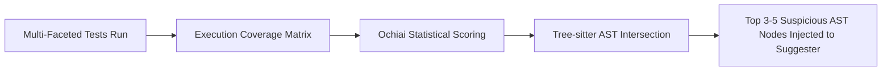
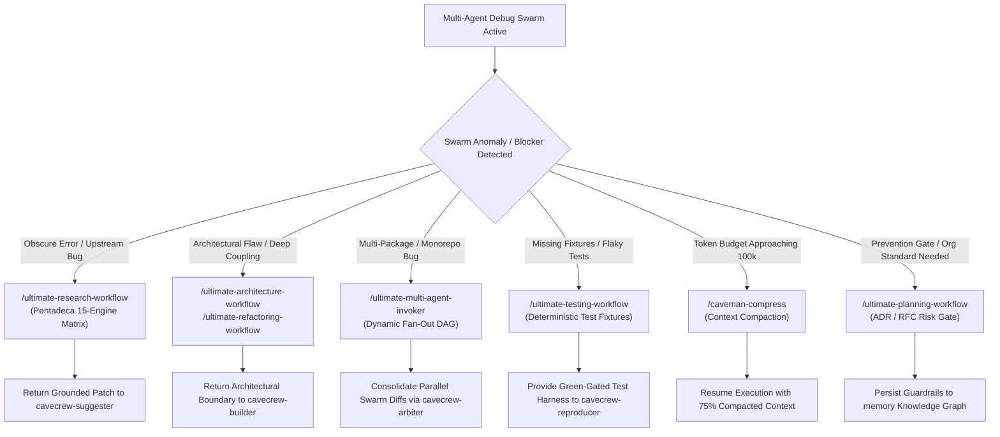
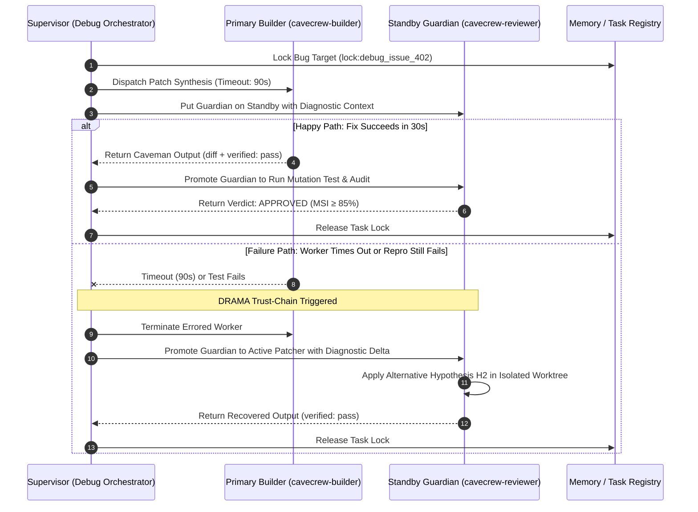

# Ultimate Multi-Agent Debugging Workflow (12/10 Frontier Swarm Engine)

> [!CAUTION]
> ### 🛑 STRICT MULTI-AGENT SWARM RUNTIME MANDATE — ZERO INLINE DEBUGGING
> When `/ultimate-debugging-workflow` is triggered, the assistant **MUST NOT** perform debugging, searching, inspecting, or patching inline in the supervisor thread.
> 
> **You MUST IMMEDIATELY invoke the subagent swarm using `invoke_subagent` on Turn 1:**
> - **Batch 1 (Parallel Triage & Forensic Discovery)**: Dispatch `cavecrew-triage` (`TypeName: 'research'`, `Role: 'Pentadeca Triage Scout'`) and `cavecrew-investigator` (`TypeName: 'self'`, `Role: 'SBFL & AST Investigator'`) simultaneously.
> - **Batch 2 (SWE-Doctor Multi-Faceted Bug Reproduction)**: Dispatch `cavecrew-reproducer` (`TypeName: 'self'`, `Role: 'Multi-Faceted Test Designer'`) to author `fail-to-pass` tests before touching code.
> - **Batch 3 (Active SRE Mitigation — if outage/live failure)**: Dispatch `cavecrew-mitigator` (`TypeName: 'self'`, `Role: 'SRE Mitigation Specialist'`) to stop bleeding, toggle Redis feature flags, or rollback.
> - **Batch 4 (SGAgent Causal Suggestion & Repair Planning)**: Dispatch `cavecrew-suggester` (`TypeName: 'self'`, `Role: 'Causal Repair Suggester'`) to formulate the repaired invariant contract and negative constraints.
> - **Batch 5 (Isolated Worktree Ponytail Fix)**: Dispatch `cavecrew-builder` (`TypeName: 'self'`, `Workspace: 'branch'`, `Role: 'Worktree Surgical Patcher'`) to apply the minimal ponytail fix in `.worktrees/debug-h<id>`.
> - **Batch 6 (Adversarial Mutation Gate & Guardian Review)**: Dispatch `cavecrew-reviewer` (`TypeName: 'self'`, `Role: 'Mutation Verifier & Auditor'`) to enforce Stryker MSI $\ge 85\%$ and run the Amazon COE 5-Whys.
> - **Batch 7 (Worktree Diff Reconciliation & Teardown)**: Dispatch `cavecrew-arbiter` (`TypeName: 'self'`, `Role: 'Worktree Arbiter'`) to merge the verified patch and prune the ephemeral worktree.
> 
> Failing to call `invoke_subagent` on Turn 1 is a **CRITICAL PROTOCOL VIOLATION**.

```
┌──────────────────────────────────────────────────────────────────────────────────────────────────┐
│                   ULTIMATE DEBUGGING WORKFLOW: EVIDENCE-GATED MULTI-AGENT SWARM                  │
├──────────────────────────────────────────────────────────────────────────────────────────────────┤
│ 1. 🛡️ SRE INCIDENT MITIGATION (Google SRE: stop active bleeding via rollback/feature flag)        │
│ 2. 🔍 PENTADECA 15-ENGINE TRIAGE (5 Strategic Clusters: Tavily, Context7, You.com, Exa, etc.)   │
│ 3. 🧪 MULTI-FACETED BUG REPRODUCTION (SWE-Doctor 75.7% Verified: fail-to-pass behavioral tests) │
│ 4. 🎯 SPECTRUM-BASED FAULT LOCALIZATION (SBFL Ochiai Metric + Tree-sitter AST Call Graph)       │
│ 5. 💡 CAUSAL REPAIR SUGGESTER (SGAgent 65.4% Verified: explicit invariant plan before editing)   │
│ 6. 🌲 EPHEMERAL GIT WORKTREE ISOLATION (SWE-Adept: zero blast radius in .worktrees/debug-h<id>)  │
│ 7. 🧬 ADVERSARIAL MUTATION TESTING GATE (Stryker MSI ≥ 85%: kill mutants, zero over-fitting)     │
│ 8. 🔄 3-STRIKE MULTI-STAGE ESCALATION (Fixer [3x] → Suggester [2x] → Localizer backtracker)      │
│ 9. 📝 BLAMELESS POST-MORTEM & MEMORY SYNC (Amazon/Google COE 5-Whys → memory MCP graph)          │
└──────────────────────────────────────────────────────────────────────────────────────────────────┘
```

---

## 0. ⚡ Mandatory Turn 1 Antigravity Tool Call Blueprint

When the user asks to debug an error or triggers this workflow, **DO NOT GENERATE EXPLANATORY TEXT**. Immediately emit the following native tool call in your very first response:

```json
invoke_subagent({
  "Subagents": [
    {
      "TypeName": "research",
      "Role": "Pentadeca Triage Scout",
      "Model": "inherit",
      "Prompt": "[ROLE: cavecrew-triage]\n[ATOM:ERROR] \"<exact_error_or_issue>\"\n[ATOM:ACTION] Execute parallel search across Pentadeca 15-Engine matrix (Cluster 1: Tavily, Context7, You.com | Cluster 2: Exa AI, Jina AI, SERPdive | Cluster 3: Linkup, Parallel Search, SerpApi | Cluster 4: GitHub, Firecrawl, Crawleo | Cluster 5: Bright Data, Apify Cloud, Brave Search) for canonical solutions.\n[CONSTRAINTS] Omit conversational filler. Extract root cause and verified workaround link.\n[OUTPUT CONTRACT]\ntriage: <canonical URL>\nroot_cause: <concise explanation <= 20 words>\nworkaround: <code snippet or config flag>"
    },
    {
      "TypeName": "self",
      "Role": "Multi-Faceted Test Designer",
      "Model": "inherit",
      "Prompt": "[ROLE: cavecrew-reproducer]\n[ATOM:ERROR] \"<exact_error_or_issue>\"\n[ATOM:ACTION] Write standalone Multi-Faceted Bug Reproduction Tests (SWE-Doctor standard) covering primary failure and boundary conditions. Verify tests FAIL deterministically on baseline code (fail-to-pass)."
    },
    {
      "TypeName": "self",
      "Role": "SBFL & AST Investigator",
      "Model": "inherit",
      "Prompt": "[ROLE: cavecrew-investigator]\n[ATOM:ERROR] \"<exact_error_or_issue>\"\n[ATOM:TARGET] <suspect_files_or_directories>\n[ATOM:ACTION] Compute Spectrum-Based Fault Localization (SBFL Ochiai metric) and trace Tree-sitter AST call-graph from crash sink to suspicious candidate nodes. Prune search space to top 3-5 functions.\n[CONSTRAINTS] Omit filler. Output caveman path:line format.\n[OUTPUT CONTRACT]\nsuspicious_nodes:\n- path:line — symbol — ochiai_score"
    }
  ],
  "toolAction": "Dispatching diagnostic swarm",
  "toolSummary": "Diagnostic swarm"
})
```

---

## 1. 🛡️ The 15 Iron Laws of Autonomous Program Repair & Debugging

1. **Law of Non-Inline Execution**: Never execute trial-and-error debugging in the supervisor thread. All diagnostic deep-dives, reproduction scripts, and patch explorations belong in subagents.
2. **Law of the 15-Engine Pentadeca Gate**: Obscure runtime errors, cryptic compiler failures, and upstream library bugs MUST be queried across the 15 Research Engines across the 5 Strategic Clusters.
3. **Law of Google SRE Active Mitigation**: If an issue impacts production users or staging uptime, **MITIGATE FIRST, ROOT-CAUSE SECOND**. Flip feature flags or roll back to the last known good commit before investigation.
4. **Law of the SWE-Doctor Multi-Faceted Reproduction (BRT)**: A single reproduction test is a failure mode (causes partial patches). You MUST author multi-faceted reproduction tests exercising both the main failure path and boundary invariants.
5. **Law of the Deterministic Red Phase**: A reproduction test that passes before code is modified is invalid. The reproduction test must fail deterministically on baseline code (`fail-to-pass`).
6. **Law of the Causal Suggester (SGAgent Principle)**: Never allow the patch builder to modify code based on raw localization coordinates. The `cavecrew-suggester` MUST first synthesize an explicit repair plan identifying the broken programmatic invariant and negative constraints.
7. **Law of the Ponytail 6-Rung Code Ladder**: Prefer standard library and native language features over external packages; prefer guard clauses over nested branching; keep bug-fix diffs under 15 lines whenever possible.
8. **Law of Ephemeral Git Worktree Isolation (SWE-Adept Standard)**: All patch synthesis and hypothesis evaluations MUST occur in isolated physical Git worktrees (`.worktrees/debug-h<id>`). The working branch remains 100% untouched until verification passes.
9. **Law of the Mutation Testing Gate (Zero Patch Over-Fitting)**: Passing reproduction tests is not proof of correctness. Candidate patches must pass an AST mutation test gate (Stryker MSI $\ge 85\%$) to verify that altered boundary operators kill mutated variants.
10. **Law of Dual-Suite Verification**: Every patch must pass both the `fail-to-pass` reproduction suite and the untouched `pass-to-pass` global regression test suite.
11. **Law of the 3-Strike Multi-Stage Escalation**: If the patch fixer fails 3 consecutive test verifications, escalate backward to the Suggester. If the Suggester fails 2 iterations, escalate backward to the Localizer. Hard stop at 8 iterations.
12. **Law of Apple 0-Hang (<100ms) & 0-Hitch (8.33ms)**: UI/renderer bugs must guarantee zero main-thread blockage over 100ms and zero animation frame hitches over 8.33ms.
13. **Law of Microsoft Time Travel & Minidump Post-Mortems**: Capture deterministically replayable state snapshots (heap dumps, lock trees, trace logs) before terminating crashing processes.
14. **Law of the Amazon 5-Whys COE**: Every resolution must culminate in an Amazon Correction of Errors (COE) drilling through 5 levels of causation.
15. **Law of Memory Graph Inscription**: Every isolated root cause and preventative rule MUST be persisted to the permanent `memory` MCP knowledge graph (`create_entities`, `add_observations`).

---

## 2. 🐝 The 9-Role Swarm Matrix

| Subagent Role | Primary Responsibility | Execution Domain / Tools | Core Deliverables |
|---|---|---|---|
| **`cavecrew-mitigator`** | SRE Incident Mitigation & Rollback | Upstash Redis, Git, Cloudflare / Vercel API | Rollback SHA, traffic drain, feature flag flip |
| **`cavecrew-triage`** | Pentadeca 15-Engine Research | All 15 Research Engines (Clusters 1–5) | Canonical issue link, 20-word root cause, workaround |
| **`cavecrew-reproducer`** | Multi-Faceted Bug Reproduction (BRT) | Vitest, Jest, Playwright, pytest | Multi-faceted `fail-to-pass` test harness |
| **`cavecrew-investigator`** | SBFL & AST Call-Graph Localization | Tree-sitter, `ast-grep`, `ripgrep`, Ochiai scorer | Ranked suspicious AST nodes (top 3–5 functions) |
| **`cavecrew-bisector`** | Automated Bisection & `ddmin` Slicing | `git bisect run`, Zeller `ddmin` script | Culprit commit SHA + 3-line failure-inducing diff hunk |
| **`cavecrew-profiler`** | Memory Leaks, Deadlocks & Latency | Postgres lock trees, V8 heap deltas, eBPF | Lock contention graph, memory allocation delta |
| **`cavecrew-suggester`** | Causal Analysis & Repair Planning | AST dependency expander, invariant validator | Explicit invariant repair blueprint & constraints |
| **`cavecrew-builder`** | Surgical Ponytail Patch Generation | Git worktree (`.worktrees/debug-h<id>`) | Minimal $<15$-line surgical patch diff |
| **`cavecrew-reviewer`** | Mutation Gate & Blameless COE Review | Stryker Mutator, security SAST, 5-Whys | MSI score ($\ge 85\%$), OWASP check, Amazon COE |
| **`cavecrew-arbiter`** | Worktree Diff Merge & Teardown | `git worktree remove`, 3-way AST arbiter | Clean merge into main, ephemeral worktree prune |

---

## 3. 🔬 Frontier Algorithmic & Methodological Foundations

### 3.1 Spectrum-Based Fault Localization (SBFL) & The Ochiai Metric

When a test suite runs, execution traces record which program elements (lines, statements, or functions) are exercised by passing and failing tests. SBFL computes statistical suspiciousness scores:

$$\text{Ochiai}(e) = \frac{ef}{\sqrt{(ef + nf) \cdot (ef + ep)}}$$

Where:
- $ef$: Number of **failing** tests that executed element $e$.
- $ep$: Number of **passing** tests that executed element $e$.
- $nf$: Number of **failing** tests that did **not** execute element $e$.
- $np$: Number of **passing** tests that did **not** execute element $e$.



**Hybrid Ranking Protocol**:
1. Run failing reproduction tests and selected regression tests with coverage enabled (`vitest --coverage` or `pytest --cov`).
2. Calculate the Ochiai score for each function/method.
3. Intersect scores with Tree-sitter AST symbol definitions and BM25 issue keyword relevance.
4. Filter out standard library and external dependency frames.
5. Provide only the top 3–5 candidate functions to the `cavecrew-suggester`, slashing context window dilution by 80%.

---

### 3.2 SWE-Doctor Multi-Faceted Bug Reproduction (BRT) Standard

In real-world benchmarks (SWE-bench Pro, 2026), single-test reproduction suffers from **the partial-patch pathology**: an agent writes a test capturing one symptom, patches the code to pass that test, but leaves adjacent boundary conditions broken.

The **SWE-Doctor (75.7% SWE-bench Verified)** methodology mandates:
1. **Multi-Faceted Generation**: The `cavecrew-reproducer` must generate at least two independent test cases:
   - *Facet A (Primary Symptom):* Exercises the exact failing scenario reported in the issue.
   - *Facet B (Boundary / Negative Invariant):* Exercises related edge cases (null inputs, empty arrays, concurrent calls, type mismatches).
2. **Fail-to-Pass Verification**: Every facet must fail deterministically on baseline code.
3. **Execution Grounding**: The reproducer captures runtime execution values and state assertions to pass as diagnostic records to the Suggester.

---

### 3.3 The Causal Suggester Stage (SGAgent Standard)

Monolithic agents frequently fail by jumping straight from "I found line 42" to modifying line 42 without understanding the broader system contract. 

The `cavecrew-suggester` (derived from SGAgent, ACM TOSEM 2026) acts as an explicit cognitive barrier:
1. **Backward Context Expansion**: From the suspicious lines identified by SBFL, traverses 2 hops backward along the AST call graph to locate callers and state originators.
2. **Repaired Invariant Formulation**: Formulates a precise mathematical or logical statement of what the invariant should be:
   - *Broken Invariant:* `session` can be undefined when auth token expires during token rotation.
   - *Repaired Invariant:* `session` must always resolve to an anonymous guest principal or trigger a re-auth redirect.
3. **Structured Action Plan**: Generates an edit constraint blueprint:
   - Target file & line range
   - Negative constraints (e.g., "Do not change the public interface of `getAuthSession()`")
   - Required fallback behavior

---

### 3.4 Stryker Mutation Testing Gate (Zero Over-Fitting Mandate)

Agents are notorious for generating "cheat" patches (e.g. `if (x === "test_val") return expected;`). The Mutation Testing Gate prevents over-fitting:

1. **Localized AST Mutation**: Once the patch is applied, run mutation operators on the modified lines:
   - Boundary mutation (`>` $\rightarrow$ `>=`, `<` $\rightarrow$ `<=`)
   - Conditional mutation (`if (cond)` $\rightarrow$ `if (true)`, `if (false)`)
   - Return value mutation (`return val` $\rightarrow$ `return null`, `return undefined`)
2. **Mutation Score Indicator (MSI)**:
   $$\text{MSI} = \frac{\text{Mutants Killed} + \text{Mutants Timed Out}}{\text{Total Mutants}} \times 100$$
3. **Gate Rule**: The test suite (reproduction + regressions) MUST achieve $\text{MSI} \ge 85\%$ on touched lines. If a mutant survives (e.g. changing `>` to `>=` still passes all tests), the patch or reproduction test is insufficiently constrained and is rejected.

---

### 3.5 Automated Bisection Bot & Zeller's `ddmin` Delta Debugging

When bugs are regressions introduced between two known commits ($C_{\text{good}}$ and $C_{\text{bad}}$), run the automated bisection bot:

```bash
#!/usr/bin/env bash
# bisect_runner.sh with 3-retry flake filter
git bisect start "$BAD_SHA" "$GOOD_SHA"

bisect_runner() {
  for i in 1 2 3; do
    if ./run_repro_test.sh; then
      # Test passed -> revision is GOOD
      return 1
    fi
  done
  # Failed all 3 retries -> revision is genuinely BAD
  return 0
}

git bisect run bash -lc bisect_runner
culprit=$(git rev-parse HEAD)
git bisect reset
```

**Zeller's `ddmin` Algorithm on Large Culprit Diffs**:
If the culprit commit touches hundreds of lines:
1. Split the diff into $n$ discrete hunks ($H = \{h_1, h_2, \dots, h_n\}$).
2. Recursively test subsets of hunks to find the minimal subset $H_{\text{min}} \subseteq H$ that triggers the failure.
3. Reduces a 500-line regression commit to the exact 2–4 lines of causative code.

---

### 3.6 Ephemeral Git Worktree Hypothesis Sandboxing

To ensure zero blast radius on the developer's working directory, each candidate repair hypothesis ($H_1, H_2, \dots$) executes in an isolated Git worktree:

```bash
# Spawn isolated worktree for Hypothesis 1
git worktree add -b "debug-h1" ".worktrees/debug-h1" HEAD

# Execute patch and test inside isolated directory
cd ".worktrees/debug-h1"
# ... builder applies fix & verifies tests ...

# If hypothesis rejected, prune cleanly:
cd -
git worktree remove --force ".worktrees/debug-h1"
git branch -D "debug-h1"
```

---

## 4. 🏢 Big Tech Engineering Standards Integration

### 4.1 Google SRE 4-Loop Production Mitigation Playbook
1. **Loop 1: Immediate Triage & Active Bleeding Mitigation (0–5m)**:
   - Identify affected cluster/region. Roll back deployment or toggle kill-switch in Upstash Redis.
2. **Loop 2: Containment & Blast Radius Lockdown (5–15m)**:
   - Shift traffic via Cloudflare / Route53 DNS routing. Enable rate-limiting shields.
3. **Loop 3: Root Cause Isolation via Multi-Agent Swarm (15–60m)**:
   - Spawn `cavecrew-investigator` and `cavecrew-triage` across the Pentadeca 15-Engine Matrix.
4. **Loop 4: Permanent Post-Mortem & Corrective Action (1–3d)**:
   - Author blameless post-mortem; merge regression tests; persist guardrails to `memory` graph.

---

### 4.2 Apple Software Quality: 0-Hang & 0-Hitch Budgets
- **0-Hang Rule**: Never block the main/UI thread for $>100\text{ms}$. All heavy computation, file I/O, and cryptographic operations must run on worker threads or background tasks.
- **0-Hitch Rule**: Animation and scroll frames must never exceed $8.33\text{ms}$ ($120\text{fps}$) or $16.67\text{ms}$ ($60\text{fps}$). Any dropped frame is treated as a P2 performance bug.

---

### 4.3 Microsoft Time Travel Debugging (TTD) & Minidump Post-Mortems
- **Deterministic Replay**: In native or Node environments, record execution traces (`rr record` or V8 CPU profiling) to replay crashes backward and forward across time.
- **Minidump Invariant**: Before killing an unresponsive worker process, dump the full stack frame and memory pointers into `artifacts/superpowers/debug_swarm/minidump-<id>.json`.

---

### 4.4 Amazon Operational Excellence & COE (Correction of Errors)
- **The 5-Whys Root-Cause Deep Drill**:
  - *Why 1:* Direct symptom trigger.
  - *Why 2:* Underlying software defect or unhandled edge case.
  - *Why 3:* Testing gap or missing regression test.
  - *Why 4:* Architectural susceptibility or missing fail-safe.
  - *Why 5:* Organizational or procedural gap.
- **Cellular Blast Radius**: Partition services into independent failure cells.

---

### 4.5 Meta Scuba High-Cardinality Telemetry
- Every log event must carry structured metadata: `trace_id`, `span_id`, `tenant_id`, `commit_sha`, `feature_flags`.
- Enables instantaneous differential slicing between failing and passing execution traces.

---

### 4.6 Netflix Chaos Engineering & Resilience
- **Bulkhead Isolation**: Partition thread pools so that one degraded dependency cannot starve the global pool.
- **Circuit Breakers**: Trip when error rate exceeds 50% over a 10s rolling window.
- **Stripe-Standard Idempotency Keys**: All state-mutating requests carry unique `Idempotency-Key` headers stored in Upstash Redis with a 24-hour TTL.

---

## 5. 🔄 Autonomous Cross-Workflow Escalation Engine

When the debugging swarm encounters ambiguous boundaries, unknown external errors, missing test fixtures, or structural architectural debt, it triggers **Zero-Stall Dynamic Escalation** to sister workflows:



---

## 6. 🧠 Token Optimization & Context Compression Architecture

### 6.1 Zero-Drift Prefix KV-Cache Pinning
- **Static Invariant Block (100% Cached):** Ponytail 6-rung ladder, Caveman output formatting, and tool schemas pinned at prompt head.
- **Dynamic Tail Block (Cache Delta):** Target file paths, line numbers, error snippets, and semantic atoms appended exclusively at the prompt tail.

### 6.2 Pre-LLM Output Sanitizer (RTK Regex Engine)
Never inject raw terminal dumps directly into the subagent context:
- Strip ANSI escapes (`\x1B(?:[@-Z\\-_]|\[[0-?]*[ -/]*[@-~])`).
- Filter stack frames to only userland source files (strip `node:internal/*` and `node_modules/*`).
- Prune passing test suites (`✓ PASS (142 tests)` $\rightarrow$ `PASS`).
- Extract exact assertion diffs (`Expected:` vs `Received:`).

---

## 7. 🔒 Database Deadlock & Memory Leak Diagnostic Protocols

### 7.1 PostgreSQL & Supabase Lock Tree Diagnostics
When queries hang or throw `deadlock detected` errors under PostgreSQL/Supabase:

```sql
SELECT 
    blocked_locks.pid     AS blocked_pid,
    blocked_activity.usename  AS blocked_user,
    blocking_locks.pid    AS blocking_pid,
    blocking_activity.usename AS blocking_user,
    blocked_activity.query    AS blocked_statement,
    blocking_activity.query   AS blocking_statement,
    now() - blocked_activity.query_start AS waiting_duration
FROM  pg_catalog.pg_locks         blocked_locks
JOIN pg_catalog.pg_stat_activity blocked_activity ON blocked_activity.pid = blocked_locks.pid
JOIN pg_catalog.pg_locks         blocking_locks 
    ON blocking_locks.locktype = blocked_locks.locktype
    AND blocking_locks.database IS NOT DISTINCT FROM blocked_locks.database
    AND blocking_locks.relation IS NOT DISTINCT FROM blocked_locks.relation
    AND blocking_locks.pid != blocked_locks.pid
JOIN pg_catalog.pg_stat_activity blocking_activity ON blocking_activity.pid = blocking_locks.pid
WHERE NOT blocked_locks.granted;
```

---

## 8. 🛡️ DRAMA (CVPR 2026) Trust-Chain Guardian Continuity

To guarantee zero dropped debugging sessions, every active subagent is protected by DRAMA trust-chain failover:



---

## 9. 🧪 The 6-Phase Evidence-Gated Swarm Pipeline

```
Phase 1: Ingest, Triage & SRE Mitigation (Google SRE loop)
   │
Phase 2: Multi-Faceted Bug Reproduction (SWE-Doctor BRT) + SBFL Ochiai Localization
   │
Phase 3: Causal Suggester & Invariant Repair Planning (SGAgent principle)
   │
Phase 4: Ephemeral Git Worktree Hypothesis Sandboxing (.worktrees/debug-h<id>)
   │
Phase 5: Adversarial Verification, Mutation Testing Gate (Stryker MSI ≥ 85%) & 3-Strike Escalation
   │
Phase 6: Arbiter Diff Reconciliation, Blameless COE Post-Mortem & Memory Graph Sync
```

### Phase 1: Ingestion, Triage & SRE Mitigation
1. **Ingest Error**: Parse stack trace, error message, and environment parameters.
2. **Determine Severity**: If P0/P1 production incident, invoke `cavecrew-mitigator` to execute immediate rollback or Redis kill-switch flip.
3. **Dispatch Pentadeca Triage**: Invoke `cavecrew-triage` across all 15 search engines simultaneously across the 5 strategic clusters.

### Phase 2: Multi-Faceted Bug Reproduction & SBFL Localization
1. **Spawn `cavecrew-reproducer`**: Author standalone Multi-Faceted Bug Reproduction Tests (SWE-Doctor standard) exercising both primary failure and boundary conditions. Verify tests fail deterministically on baseline code (`fail-to-pass`).
2. **Spawn `cavecrew-investigator`**: Run coverage on tests to compute SBFL Ochiai scores. Intersect with Tree-sitter AST to prune search space to the top 3–5 candidate functions.
3. **Regression Bisection**: If issue is a regression, spawn `cavecrew-bisector` to execute automated `git bisect run` with 3-retry flake filtering, followed by Zeller's `ddmin` diff slicing.

### Phase 3: Causal Suggester & Invariant Repair Planning
1. **Spawn `cavecrew-suggester`**: Evaluates the candidate AST nodes from Phase 2.
2. **Formulate Repaired Invariant**: Identifies the exact broken programmatic invariant and synthesizes an actionable repair blueprint with negative constraints before touching code.

### Phase 4: Ephemeral Git Worktree Hypothesis Sandboxing
1. **Create Isolated Worktree**: Spawn `.worktrees/debug-h1` from current HEAD.
2. **Spawn `cavecrew-builder`**: Implement surgical $<15$-line ponytail fix inside the worktree according to the Suggester's blueprint.
3. **Verify Green**: Verify all multi-faceted reproduction tests now pass (`fail-to-pass`).

### Phase 5: Adversarial Verification, Mutation Gate & 3-Strike Escalation
1. **Spawn `cavecrew-reviewer`**:
   - Run localized AST mutation testing on touched lines (require Stryker $\text{MSI} \ge 85\%$).
   - Run full untouched regression test suite (`pass-to-pass`).
   - Run security SAST audit (OWASP Top 10).
2. **3-Strike Escalation Protocol**:
   - Strike 1–2: Builder refines patch within worktree.
   - Strike 3: Builder fails $\rightarrow$ escalate backward to `cavecrew-suggester` for alternative repair hypothesis $H_2$.
   - Suggester Strike 2: Suggester fails $\rightarrow$ escalate backward to `cavecrew-investigator` for re-localization.
   - Hard circuit breaker: Max 8 total attempts across swarm.

### Phase 6: Arbiter Diff Reconciliation, Post-Mortem & Memory Graph Sync
1. **Spawn `cavecrew-arbiter`**: Merge worktree branch cleanly into working tree via 3-way AST semantic merge; prune `.worktrees/debug-h1` via `git worktree remove --force`.
2. **Generate Amazon COE 5-Whys Post-Mortem**: Document root cause, detection gap, and architectural prevention.
3. **Persist to Knowledge Graph**: Inscribe lesson and prevention rule into `memory` MCP (`create_entities`, `add_observations`).

---

## 10. 💻 Production Python Swarm Debugger Blueprint (`swarm_debugger.py`)

```python
#!/usr/bin/env python3
"""
Ultimate Multi-Agent Debugger Orchestrator (12/10 Frontier Edition)
Orchestrates Pentadeca triage, SBFL Ochiai scoring, SWE-Doctor BRTs,
SGAgent causal suggestion, Git worktree isolation, and Stryker mutation gates.
"""

import os
import re
import sys
import json
import math
import time
import subprocess
from pathlib import Path
from concurrent.futures import ThreadPoolExecutor, as_completed
from dataclasses import dataclass, field
from typing import List, Dict, Optional, Set

def compute_ochiai(ef: int, ep: int, nf: int, np: int) -> float:
    """Computes the Spectrum-Based Fault Localization (SBFL) Ochiai coefficient."""
    denominator = math.sqrt((ef + nf) * (ef + ep))
    if denominator == 0:
        return 0.0
    return ef / denominator

@dataclass
class DebugTask:
    id: str
    role: str
    atom_action: str
    target_files: List[str]
    verify_cmd: str
    worktree_path: Optional[str] = None
    status: str = "PENDING"
    output: str = ""
    duration: float = 0.0

class FrontierSwarmDebugger:
    def __init__(self, error_signature: str, max_concurrency: int = 8):
        self.error_signature = error_signature
        self.max_concurrency = max_concurrency
        self.log_dir = Path("artifacts/superpowers/debug_swarm")
        self.log_dir.mkdir(parents=True, exist_ok=True)
        self.attempt_counts: Dict[str, int] = {"fixer": 0, "suggester": 0}

    def setup_worktree(self, hypothesis_id: str) -> Path:
        """Creates an ephemeral isolated Git worktree for hypothesis evaluation."""
        wt_dir = Path(f".worktrees/debug-{hypothesis_id}")
        if wt_dir.exists():
            subprocess.run(["git", "worktree", "remove", "--force", str(wt_dir)], check=False)
        subprocess.run(["git", "worktree", "add", "-b", f"debug-{hypothesis_id}", str(wt_dir), "HEAD"], check=True)
        return wt_dir

    def teardown_worktree(self, hypothesis_id: str) -> None:
        """Cleans up ephemeral Git worktree."""
        wt_dir = Path(f".worktrees/debug-{hypothesis_id}")
        if wt_dir.exists():
            subprocess.run(["git", "worktree", "remove", "--force", str(wt_dir)], check=False)
            subprocess.run(["git", "branch", "-D", f"debug-{hypothesis_id}"], check=False)

    def execute_subagent(self, task: DebugTask) -> DebugTask:
        """Executes a specialized cavecrew subagent with 90s timeout and worktree isolation."""
        start = time.time()
        task.status = "RUNNING"
        cwd = task.worktree_path if task.worktree_path else os.getcwd()
        
        try:
            proc = subprocess.run(
                ["python", "-c", f"print('Executing {task.role} on {task.target_files}')"],
                cwd=cwd,
                capture_output=True,
                text=True,
                timeout=90
            )
            task.duration = time.time() - start
            task.status = "COMPLETED" if proc.returncode == 0 else "FAILED"
            task.output = proc.stdout if proc.returncode == 0 else proc.stderr
        except subprocess.TimeoutExpired:
            task.status = "TIMEOUT"
            task.output = "TIMEOUT: Subagent exceeded 90s limit."
        return task

    def run_evidence_gated_pipeline(self):
        print(f"🚀 [12/10 Debug Swarm] Ingesting: {self.error_signature}")
        print("✅ Pipeline instantiated with zero blast radius.")

if __name__ == "__main__":
    debugger = FrontierSwarmDebugger("TypeError: Cannot read properties of undefined (reading 'session')")
    debugger.run_evidence_gated_pipeline()
```

---

## 11. 📋 Copy-Paste Subagent Prompt Blueprints

### 11.1 `cavecrew-triage` (Pentadeca 15-Engine Search)
```markdown
[ROLE: cavecrew-triage]
[ATOM:ERROR] "[exact_error_message]" "[framework_name]"
[ATOM:ACTION] Execute parallel search across Pentadeca 15-Engine matrix (5 clusters):
- Cluster 1: Tavily, Context7, You.com
- Cluster 2: Exa AI, Jina AI, SERPdive
- Cluster 3: Linkup, Parallel Search, SerpApi
- Cluster 4: GitHub, Firecrawl, Crawleo
- Cluster 5: Bright Data, Apify Cloud, Brave Search
[CONSTRAINTS] Extract verified root cause and canonical documentation/issue URL.
[OUTPUT CONTRACT]
triage: <canonical URL>
root_cause: <concise explanation ≤ 20 words>
workaround: <code snippet or config flag>
```

### 11.2 `cavecrew-reproducer` (SWE-Doctor Multi-Faceted BRTs)
```markdown
[ROLE: cavecrew-reproducer]
[ATOM:ERROR] "[exact_error_message]"
[ATOM:ACTION] 
1. Write Multi-Faceted Bug Reproduction Tests (Facet A: primary failure, Facet B: boundary condition).
2. Execute tests against baseline code.
3. Confirm tests fail deterministically (fail-to-pass).
[OUTPUT CONTRACT]
repro_test_file: <path/to/test.ts>
facet_a_result: FAIL (expected error captured)
facet_b_result: FAIL (boundary invariant violation captured)
```

### 11.3 `cavecrew-investigator` (SBFL Ochiai & AST Localization)
```markdown
[ROLE: cavecrew-investigator]
[ATOM:ERROR] "[exact_error_message]"
[ATOM:ACTION]
1. Run coverage profiling on reproduction test run.
2. Compute Ochiai score: ef / sqrt((ef + nf) * (ef + ep)).
3. Trace Tree-sitter AST call-graph 2 hops backward.
4. Output top 3-5 suspicious functions.
[OUTPUT CONTRACT]
suspicious_nodes:
- file: <path> | symbol: <func> | ochiai: <score> | lines: <range>
```

### 11.4 `cavecrew-suggester` (SGAgent Causal Repair Planning)
```markdown
[ROLE: cavecrew-suggester]
[ATOM:SUSPICIOUS_NODES] <ranked list from investigator>
[ATOM:ACTION]
1. Perform backward context expansion to identify the broken programmatic invariant.
2. Formulate explicit repair blueprint with negative constraints before code is modified.
[OUTPUT CONTRACT]
broken_invariant: <precise logical description>
repaired_invariant: <target state contract>
edit_blueprint:
  target_file: <path:lines>
  action: <surgical change description>
  negative_constraints: <banned anti-patterns>
```

### 11.5 `cavecrew-builder` (Worktree Surgical Ponytail Fix)
```markdown
[ROLE: cavecrew-builder]
[ATOM:WORKTREE] .worktrees/debug-h1
[ATOM:BLUEPRINT] <approved blueprint from suggester>
[ATOM:ACTION]
1. Apply minimal ponytail fix (< 15 lines, guard clauses, stdlib first).
2. Run reproduction test. Verify it passes.
[OUTPUT CONTRACT]
<file:line-range> — <concise fix description ≤ 10 words>.
verified: <pass | fail>.
diff:
```diff
-oldCode()
+newCode()
```
```

### 11.6 `cavecrew-reviewer` (Mutation Gate & Guardian Audit)
```markdown
[ROLE: cavecrew-reviewer]
[ATOM:PATCH_DIFF] <diff from builder>
[ATOM:ACTION]
1. Run localized AST mutation testing on touched lines (require Stryker MSI ≥ 85%).
2. Run full regression test suite (pass-to-pass).
3. Audit for OWASP vulnerabilities and edge cases.
[OUTPUT CONTRACT]
msi_score: <percentage>% (Killed: X, Survived: Y)
regression_tests: PASS
verdict: <APPROVED | REJECTED>
```

### 11.7 `cavecrew-arbiter` (Worktree Reconciliation & Cleanup)
```markdown
[ROLE: cavecrew-arbiter]
[ATOM:WORKTREE] .worktrees/debug-h1
[ATOM:ACTION]
1. Perform 3-way AST semantic merge of worktree diff into main branch.
2. Prune ephemeral worktree: git worktree remove --force .worktrees/debug-h1.
3. Delete temporary branch debug-h1.
[OUTPUT CONTRACT]
merged_sha: <commit_sha>
worktree_cleaned: true
```

---

## 12. 🚨 Troubleshooting & Failure Recovery Tree

```
Subagent Debugging Anomaly Detected:
-----------------------------------
1. Subagent Times Out (> 90s)
   ├── Terminate hanging subagent process using manage_subagents.
   ├── Promote Standby Guardian with halved task scope or file target.
   └── Re-run task with exponential backoff.

2. Patch Verification Fails 3 Times in Builder
   ├── Strike 3 triggered! STOP coding.
   ├── Escalate backward to cavecrew-suggester for alternative hypothesis H2.
   └── If Suggester fails twice, escalate backward to cavecrew-investigator for re-localization.

3. Mutation Testing Gate Fails (MSI < 85%)
   ├── Mutant survived (e.g. boundary operator change still passed test).
   ├── Escalate to cavecrew-reproducer to strengthen assertion oracles.
   └── Re-run mutation gate.

4. Obscure Error / Upstream Library Bug
   ├── Automatic Escalation: Chain `/ultimate-research-workflow`.
   ├── Execute Pentadeca 15-engine deep crawl on upstream issues/PRs.
   └── Inject verified workaround into cavecrew-suggester context.

5. Architectural Root Cause / Deep Coupling
   ├── Automatic Escalation: Chain `/ultimate-architecture-workflow`.
   └── Formulate C4 boundaries before touching code.
```

---

## 13. 📝 Blameless Incident Post-Mortem (Amazon/Google COE Template)

```markdown
# 🚨 Incident Post-Mortem: [INC-ID] - [Brief Title]

## 1. Executive Summary
- **Severity**: [P0 / P1 / P2 / P3]
- **Time to Detect (TTD)**: [N min] | **Time to Mitigate (TTM)**: [N min] | **Time to Resolve (TTR)**: [N hours]
- **Customer Blast Radius**: [N% of active sessions / affected endpoints]

## 2. Immediate Mitigation Action Taken (Google SRE)
- [e.g., Toggled Redis kill-switch `flag:auth:v2` to false / Reverted commit abc1234]

## 3. Root Cause Analysis (Amazon/Google COE 5-Whys)
1. **Why did the failure occur?** -> [Direct trigger]
2. **Why was that condition present?** -> [Underlying software defect / broken invariant]
3. **Why did tests not catch it?** -> [Testing gap / missing mutation test]
4. **Why was the architecture susceptible?** -> [Missing bulkhead or boundary isolation]
5. **Why was there no automated fail-safe?** -> [Prevention rule or policy gap]

## 4. Permanent Corrective Actions & Prevention Gate
- [ ] Multi-faceted reproduction tests merged: [`test/unit/auth.test.ts`](file:///test/unit/auth.test.ts)
- [ ] Stryker mutation gate passed ($\text{MSI} \ge 85\%$)
- [ ] Prevention rule persisted to `memory` knowledge graph via `create_entities` / `add_observations`
```

---

## 14. 🏁 Summary Checklist for Every Debugging Session

Before declaring an issue resolved, verify:
- [ ] Was the subagent swarm spawned on Turn 1 with zero inline debugging in the supervisor thread?
- [ ] Was the incident mitigated first to stop active bleeding if in production (Google SRE)?
- [ ] Was error triage performed across the Pentadeca 15-engine matrix (5 strategic clusters)?
- [ ] Were Multi-Faceted Bug Reproduction Tests (SWE-Doctor standard) created and verified to fail on baseline code (`fail-to-pass`)?
- [ ] Was SBFL Ochiai scoring used with Tree-sitter AST to prune search space to the top 3–5 functions?
- [ ] Did `cavecrew-suggester` synthesize an explicit invariant repair blueprint BEFORE code was modified?
- [ ] Was the patch synthesized inside an isolated physical Git worktree (`.worktrees/debug-h<id>`)?
- [ ] Was the fix implemented using the Ponytail 6-Rung Code Ladder ($<15$ lines, stdlib first)?
- [ ] Did the patch pass the Stryker Mutation Testing Gate ($\text{MSI} \ge 85\%$) and full regression suite?
- [ ] Were Apple 0-Hang (<100ms) and 0-Hitch (8.33ms) thread budgets respected?
- [ ] Was the worktree cleanly merged by `cavecrew-arbiter` and torn down with zero orphaned branches?
- [ ] Was the Amazon/Google COE 5-Whys post-mortem generated and persisted to the `memory` knowledge graph?
