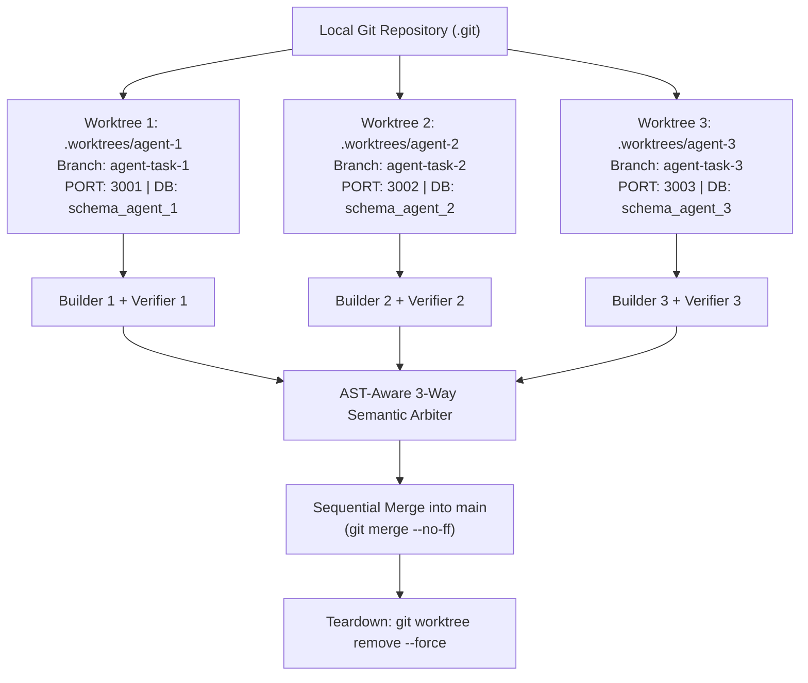
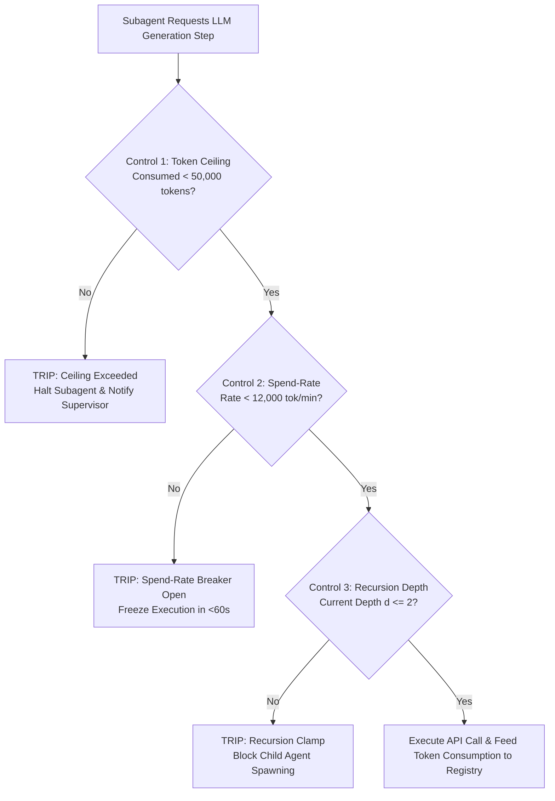

<!-- INVARIANT_START:ANTI_AI_SLOP -->
## 🛑 HARDENED ANTI-AI SLOP MANDATE: NATURAL PROSE & BESPOKE DESIGN CRAFT
All agent communications, architectural plans, reviews, code comments, and frontend implementations MUST strictly adhere to natural human engineering standards. Both corporate AI prose slop and cookie-cutter "vibecoded" UI slop are strictly banned.

### 1. Zero Prose & Grammar Slop (Natural Human Voice)
- **Banned Lexicon:**
  - *Empty Verbs:* delve, embark, foster, resonate, underscore, leverage, elevate, harness, navigate, empower, illuminate, facilitate, tailor, showcase, unveil.
  - *Corporate Buzz-Adjectives:* testament, tapestry, beacon, cornerstone, robust, seamless, pivotal, crucial, paramount, cutting-edge, vibrant, bespoke, game-changer, journey, realm, landscape, holistic, comprehensive, multifaceted, versatile, transformative.
  - *Formulaic Transitions:* furthermore, moreover, in conclusion, it is worth noting, at the end of the day, without further ado, needless to say.
- **Banned Syntactical Patterns:**
  - **Zero Sycophancy / Pleasantries:** NEVER start responses with "Certainly!", "Great question!", "I'd be happy to help!", "Awesome!", or "Let's dive in!".
  - **Zero Summary Outros:** NEVER end answers with a repetitive paragraph restating earlier points using generic corporate filler.
  - **Zero Formulaic "Rule-of-Three" Bullets:** Do not default to 3-bullet lists where each bullet starts with a bold abstract noun followed by a colon and fluff.
  - **Zero Hedging:** Do not write "You might want to potentially consider checking...". Write "Check X, or Y crashes."
- **Natural Voice Standard:** Speak like a systems developer in terminal, Slack, or GitHub issues: blunt, concise, precise, pragmatic. Code and runnable shell commands come first.

### 2. Zero Visual & UI/UX Design Slop (Bespoke Engineering Craft)
- **Banned Color Clichés:**
  - BAN default AI Blue-to-Indigo/Purple gradients (`bg-gradient-to-r from-blue-600 to-indigo-700` or violet hues).
  - BAN colored ambient glowing shadows (`box-shadow` with >= 24px blur matching accent color).
  - BAN washed-out low-contrast gray text (`text-gray-400` / `text-gray-500` failing WCAG AA 4.5:1).
  - BAN gradient headline text (`bg-clip-text text-transparent bg-gradient-to-r` on H1s).
- **Banned Layout & Component Tropes:**
  - BAN cookie-cutter Bento Grid walls filled with fake stats, empty cards, or generic Lucide icon spam.
  - BAN centered hero boilerplate with a floating pill above H1 (`"✨ New: [Feature]"`).
  - BAN unmodified shadcn/ui defaults (`--radius: 0.5rem`, stock button/card exports without brand styling).
  - BAN tinted circular icon containers (`bg-primary/10 text-primary p-3 rounded-full`).
  - BAN static terminal window mockups with red/yellow/green dots in the hero.
  - BAN raw emojis used as icons (`✨`, `🚀`, `⚡`, `🔒`) in production UI markup.
- **Bespoke Design Standard:**
  - Commit to an intentional aesthetic: brutalist, high-density telemetry, refined editorial, or precision dark-mode.
  - High information density (Linear/Stripe standard), micro-borders (`rgba(255,255,255,0.08)`), and tabular numerals (`tabular-nums`).
  - Every component must implement all 7 states: `Default, Hover, Focus-Visible, Active, Loading (Skeleton), Disabled, Error`.
<!-- INVARIANT_END:ANTI_AI_SLOP -->

<!-- INVARIANT_START:GRAPHIFY -->
## 🧠 HARDENED GRAPHIFY KNOWLEDGE ENGINE GATE (AST-FIRST CODE INTELLIGENCE)
Whenever `graphify-out/graph.json` exists in the repository root, agents MUST interact with the AST knowledge graph. Blind directory traversal and unconstrained multi-file context dumping are strictly banned.

1. **Zero-Blind-Grep Invariant:**
   - Running unstructured grep (`grep -r`, `Select-String *.*`, `ripgrep` across entire project) to locate callers or symbol references is FORBIDDEN when `graph.json` is present.
   - Agents must query Graphify first: `graphify query "<symbol_or_concept>"`.

2. **Blast Radius Gate (`graphify explain "<symbol>"`):**
   - Before modifying, refactoring, or deleting any shared interface, model, route, or function, the agent MUST run `graphify explain "<symbol>"`.
   - If incoming edge count > 0, every caller surfaced by Graphify MUST be explicitly enumerated in the task DAG or implementation plan before touching code.

3. **Call-Path Fault Tracing (`graphify path "<source>" "<target>" --undirected`):**
   - When debugging multi-hop failures (e.g. UI -> API -> DB), the agent must run `graphify path` to map the exact shortest call chain between entry point and crash sink before reading source code.

4. **Leiden Community Worktree Partitioning:**
   - When spawning parallel subagents in `ultimate-multi-agent-invoker`, tasks MUST be partitioned by Leiden community clusters (from `graphify-out/graph.json`).
   - If two tasks share a God Node (identified in `graphify-out/GRAPH_REPORT.md`), they CANNOT run concurrently without explicit file-level mutex locks.

5. **Subagent Context Clamp (70% Token Reduction):**
   - Never dump entire raw source files into subagent prompts. Inject only the scoped subgraph from `graphify query "<task_scope>"`.

6. **Post-Commit AST Synchronization (`graphify update .`):**
   - After completing code modifications or merging Git worktrees, the agent MUST run `graphify update .` (local AST delta update, 2s runtime, 0 API tokens) to maintain graph synchronization.
<!-- INVARIANT_END:GRAPHIFY -->

# Ultimate Multi-Agent Invoker Workflow (12/10 Frontier Swarm Orchestrator & Isolation Runtime)

> [!CAUTION]
> ### 🛑 THE PHYSICAL WORKSPACE ISOLATION & TOKEN CIRCUIT BREAKER MANDATES
> This workflow enforces two non-negotiable execution invariants:
> 1. **The Physical Worktree Isolation Mandate (CMU CAID Standard):** Never rely on "soft prompt isolation" (instructing agents not to touch specific files). Empirical research proves soft isolation performs worse than a single agent. All parallel builders MUST execute in physically isolated Git worktrees (`Workspace: 'branch'` or `git worktree add .worktrees/agent-<id>`).
> 2. **The 3-Tier Token Circuit Breaker Mandate (Prefactor & Incident #68619 Standard):** Every subagent swarm MUST enforce: (a) a 50,000 token ceiling per subtask, (b) a spend-rate trip (halt if consumption $> 12,000\text{ tokens/min}$), and (c) a rigid recursion depth clamp ($d_{\text{max}} \le 2$) to eliminate runaway recursive loops.

This master workflow executes approved implementation plans by dynamically analyzing task dependency Directed Acyclic Graphs (DAGs), calculating optimal subagent fan-out width ($\omega(G_T)$), spawning role-specialized subagents in **physically isolated Git worktrees** (`CAID` standard), enforcing **3-tier token circuit breakers** (preventing the \$47k loop catastrophe), arbitrating parallel diffs via **AST-aware 3-way semantic merge** (ATM alphaXiv:2607.00041 / STORM), pairing builders with **Adversarial Verifiers**, guaranteeing **DRAMA CVPR 2026 trust-chain recovery**, pinning **zero-drift KV-caches** (arXiv:2601.06007), encoding typed **semantic commitment atoms** (Context Codec), and consolidating delta diffs with zero context window blowout.

```
                           [APPROVED IMPLEMENTATION PLAN]
                                         │
                    ┌────────────────────┴────────────────────┐
                    ▼                                         ▼
       [DAG TASK DECOMPOSITION]                  [TOKEN CIRCUIT BREAKER GUARD]
       ├─ Antichain Width ω(GT) Sizing           ├─ Per-Agent Ceiling (50k tokens)
       ├─ Critical Path Depth δ(GT)              ├─ Spend-Rate Trip (>12k tok/min)
       └─ Topology Selection (τP, τS, τH, τX)    └─ Recursion Depth Clamp (d_max <= 2)
                    │                                         │
                    └────────────────────┬────────────────────┘
                                         ▼
                 [PHYSICAL GIT WORKTREE ISOLATION HARNESS (CAID)]
        ├─ Worker 1: `git worktree add .worktrees/agent-1` (Port 3001, Branch: agent-1)
        ├─ Worker 2: `git worktree add .worktrees/agent-2` (Port 3002, Branch: agent-2)
        └─ Worker N: `git worktree add .worktrees/agent-N` (Port 300N, Branch: agent-N)
                                         │
                                         ▼
                    ┌───────────────────────────────────────────┐
                    │       BUILDER + ADVERSARIAL VERIFIER      │
                    │   Builder Agent ──► Adversarial Verifier  │
                    │   (Writes Diff)     (Fuzzes & Tests Code) │
                    └────────────────────┬──────────────────────┘
                                         ▼
                 [AST-AWARE 3-WAY SEMANTIC DIFF ARBITER (ATM / STORM)]
        ├─ Additive AST Nodes (Imports, Types, Route Arrays) ──► Automatic Union
        ├─ Independent AST Subtrees ────────────────────────────► 3-Way Semantic Splice
        └─ Overlapping Symbol Collisions ───────────────────────► Dynamic Re-Planner
                                         │
                                         ▼
                 [SEQUENTIAL INTEGRATION & AUTOMATED TEARDOWN]
        git merge --no-ff ──► Run Full Test Suite ──► git worktree remove --force
```

---

## 1. Iron Laws of Multi-Agent Orchestration

1. **Plan Approval is the Non-Negotiable Gate.** Never spawn execution subagents without explicit user approval on `implementation_plan.md`. Unapproved execution is strictly banned.
2. **Physical Worktree Isolation Over Soft Prompt Constraints.** Never instruct agents via text not to touch files in a shared filesystem. Every parallel builder MUST be assigned a dedicated physical `git worktree` (`Workspace: 'branch'`).
3. **3-Tier Token Circuit Breaker.** Every subagent operates under a hard token ceiling (50,000 tokens), a spend-rate trip ($> 12,000\text{ tokens/min}$), and a recursion depth clamp ($d_{\text{max}} \le 2$). Runaway loops must be terminated in $< 60$ seconds.
4. **Never Validate Your Own Code.** A builder subagent cannot self-verify. Every builder is paired with an independent **Adversarial Verifier** subagent with opposing goals before merging.
5. **AST-Aware Semantic Diff Arbitration.** Line-based git conflicts on additive structures (imports, type definitions, route lists) MUST be mechanically resolved by AST unioning, eliminating 80%+ of multi-agent merge conflicts.
6. **Dynamic Fan-Out over Static Allocation.** The concurrent subagent pool $N$ is mathematically bounded by the task DAG's antichain width $\omega(G_T)$ and system concurrency limits: $N = \min(\omega(G_T), C_{\text{max}})$.
7. **Ponytail 6-Rung Code Ladder.** Subagents must write the minimum necessary code. Built-in standard libraries and language engines MUST be preferred over new 3rd-party dependencies. YAGNI is enforced relentlessly.
8. **Trust-Chain Guardian Continuity (DRAMA Standard).** Every active executor subagent is paired with a standby guardian. If a worker times out (90s) or crashes, its guardian takes over immediately without dropping global execution state.
9. **Zero-Drift KV-Cache Prefix Pinning.** Static prompt headers (rules, tools, schemas) MUST remain 100% invariant across all turns. Dynamic variables (file targets, line ranges) MUST be placed strictly at the prompt tail/suffix.
10. **Pre-LLM Output Sanitization (RTK Standard).** Raw command outputs MUST be stripped of ANSI codes, progress spinners, and passing logs before injection into LLM context, reducing token noise by 60–90%.
11. **Stateful Resource Mutex Locks.** Shared stateful files (`package.json`, `schema.prisma`, migrations) and database connections MUST be guarded by exclusive mutex locks.
12. **Automated Teardown Hygiene.** Once an agent's branch is merged and verified, its worktree MUST be pruned immediately (`git worktree remove --force`), ensuring zero orphaned branches and zero disk bloat.

---

## 2. Physical Git Worktree Workspace Isolation Harness (CMU CAID Standard)

Carnegie Mellon research (CAID, March 2026) revealed that "soft isolation" performs worse than a single agent because agents generate silent semantic contradictions. Physical worktrees provide the necessary isolation:



### Worktree Provisioning & Teardown Protocol:
```bash
# 1. Supervisor Provisions Isolated Worktree for Subagent
git worktree add -b agent-auth .worktrees/agent-auth main

# 2. Subagent Operates Entirely Inside .worktrees/agent-auth
cd .worktrees/agent-auth
export PORT=3001
export DATABASE_URL="postgresql://localhost:5432/app?schema=agent_auth"

# 3. Subagent Executes Atomic Changes & Runs Verification
npm test -- test/auth.test.ts

# 4. Supervisor Merges Verified Branch & Prunes Worktree
cd ../..
git merge --no-ff agent-auth -m "feat(auth): integrate verified subagent changes"
git worktree remove --force .worktrees/agent-auth
git branch -d agent-auth
```

---

## 3. 3-Tier Token Circuit Breaker & Runaway Loop Interceptor

In production agent swarms, recursive retries can burn millions of tokens in minutes ($47k runaway incident). The 3-tier circuit breaker stops loops in $< 60$ seconds:



### The 3 Circuit Breaker Controls:
1. **Control 1: Per-Agent Numeric Token Ceiling (50,000 Tokens):** Hard cap per subtask. If an agent hits 50k tokens without completing its verification contract, execution halts and its task snapshot is saved to `artifacts/superpowers/subagents/failed_<id>.json`.
2. **Control 2: Spend-Rate Circuit Breaker (12,000 Tokens/Min):** Evaluates token velocity over rolling 60-second windows. If an Analyzer-Verifier ping-pong loop begins consuming $> 12\text{k tokens/min}$, the circuit transitions from `CLOSED` to `OPEN`, immediately cutting API access.
3. **Control 3: Recursion Depth Clamp ($d_{\text{max}} \le 2$):** Root supervisor is depth $d=0$; spawned builders/investigators are $d=1$; verifiers or sub-tools are $d=2$. Subagents at $d=2$ are strictly forbidden from spawning child agents (`enable_subagent_tools: false`).

---

## 4. AST-Aware 3-Way Semantic Diff Arbiter (ATM & STORM Architecture)

On the AgenticFlict benchmark (142k agent PRs), line-based git merge fails 27.67% of the time. The AST-Aware Semantic Arbiter resolves concurrent edits at the abstract syntax tree level:

```
                  [CONCURRENT SUBAGENT DIFFS]
                  ├─ Agent A: Added `import { AuthToken } from '@/types'`
                  └─ Agent B: Added `import { UserProfile } from '@/types'`
                               │
                               ▼
            [AST-AWARE 3-WAY SEMANTIC ARBITER]
    ┌──────────────────────────┼──────────────────────────┐
    ▼                          ▼                          ▼
[Additive Nodes]       [Independent Subtrees]     [Conflicting Mutations]
• Import statements    • Function A in file       • Both edited body of
• Type union members   • Function B in file         `calculateFee()`
• Route array entries  • Different JSX blocks     • Conflicting renames
        │                      │                          │
        ▼                      ▼                          ▼
 [Automatic Union]     [Semantic 3-Way Splice]    [Trigger Dynamic Re-Plan]
 `import { AuthToken,   Both functions merged     Freeze batch, isolate
  UserProfile } ...`    cleanly without conflicts diff, re-sequence in DAG
```

---

## 5. Dual-Agent Builder + Adversarial Verifier Pairing

Never allow an agent to grade its own work. Every Builder subagent is paired with an independent **Adversarial Verifier** subagent with opposing optimization goals:

| Agent Role | Primary Objective | Mindset & Prompt Persona | Tool Capabilities |
|---|---|---|---|
| **Builder Agent** (`cavecrew-builder`) | Deliver the feature with minimal diff and maximum speed. | Optimistic, creative, surgical, YAGNI-compliant. | File editing (`replace_file_content`, `write_to_file`). |
| **Adversarial Verifier** (`cavecrew-verifier`) | Find bugs, broken invariants, unhandled edge cases, and spec violations. | Skeptical, adversarial, thorough, security-conscious. | Execution & Testing (`run_command`, `ast-grep`, `lint-and-validate`). |

### Verification Handshake:
1. Builder finishes edits in its isolated worktree and signals: `verified: pending_adversarial_check`.
2. Adversarial Verifier injects fuzzing payloads, boundary conditions (zero, negative, null, timeout), and runs typecheck/lint.
3. Only when Verifier returns `verdict: APPROVED` does the supervisor admit the branch into the sequential merge pipeline.

---

## 6. Formal DAG Task Decomposition & Dynamic Fan-Out Math

A plan $P$ is formally decomposed into a directed acyclic graph $G_T = (V, E, w, c)$:
- $V = \{v_1, v_2, \dots, v_n\}$: Atomic subtasks derived from the approved implementation plan.
- $E \subseteq V \times V$: Directed dependency edges.
- $w: V \rightarrow \mathbb{R}^+$: Estimated complexity/token weight.
- $c: E \rightarrow [0, 1]$: Coupling density representing shared files/contracts.

$$\text{Antichain Width: } \omega(G_T) = \max_{A \subseteq V} |A| \quad \text{s.t. } \forall u, v \in A, (u, v) \notin E^*$$

$$\text{Optimal Dynamic Fan-Out: } N^* = \operatorname{clamp}\left(\omega(G_T), 1, C_{\text{max}}\right) \quad (\text{where } C_{\text{max}} = 8 \text{ concurrent worktrees})$$

---

## 7. Canonical Topology Routing Engine (AdaptOrch 2026)

| Canonical Topology | When to Select | Execution Mechanics | Isolation Mode |
|---|---|---|---|
| **$\tau_P$ Parallel** | Antichain width $\omega \ge 0.5|V|$, coupling $\gamma < 0.6$, zero shared file writes. | Dispatches subtasks simultaneously across worktrees; merged via AST Arbiter. | Physical worktrees per task (`.worktrees/agent-<id>`). |
| **$\tau_S$ Sequential** | Strict linear chain ($|E| \approx |V|-1$), shared state mutations, single file edits. | Executes subtasks in topological sequence on a single branch. | Single worktree; rolling context. |
| **$\tau_H$ Hierarchical** | Large multi-package scope ($|V| \ge 6$, critical path $\delta \ge 5$). | Supervisor manages domain coordinators (Frontend, Backend, QA). | Worktrees partitioned by package/domain. |
| **$\tau_X$ Hybrid (Default)** | Realistic software plans with independent features and shared contracts. | Partitions DAG into topological layers $S_1, S_2, \dots, S_m$. Parallel within layers, sequential between layers. | Ephemeral worktrees per layer, pruned after layer merge. |

---

## 8. Concrete Swarm Orchestrator with Worktrees & Circuit Breaker (`swarm_orchestrator.py`)

```python
#!/usr/bin/env python3
"""
Ultimate Multi-Agent Swarm Orchestrator (12/10 Frontier Edition)
Features Git Worktree Physical Isolation, 3-Tier Token Circuit Breakers, and Pre-LLM Sanitization.
"""

import os
import re
import sys
import json
import time
import subprocess
from pathlib import Path
from concurrent.futures import ThreadPoolExecutor, as_completed
from dataclasses import dataclass, field
from typing import List, Dict, Set, Optional

# --- Token Circuit Breaker Constants ---
MAX_TOKENS_PER_TASK = 50000
MAX_SPEND_RATE_PER_MINUTE = 12000
MAX_RECURSION_DEPTH = 2

@dataclass
class TokenTracker:
    consumed_tokens: int = 0
    window_start: float = field(default_factory=time.time)
    window_tokens: int = 0

    def record_usage(self, tokens: int) -> bool:
        """Records tokens and checks if spend-rate or ceiling circuit breaker trips."""
        self.consumed_tokens += tokens
        now = time.time()
        
        # Rolling 60-second window
        if now - self.window_start > 60:
            self.window_start = now
            self.window_tokens = tokens
        else:
            self.window_tokens += tokens

        if self.consumed_tokens > MAX_TOKENS_PER_TASK:
            print(f"🚨 [Circuit Breaker] Ceiling tripped! Consumed {self.consumed_tokens} > {MAX_TOKENS_PER_TASK}")
            return False

        if self.window_tokens > MAX_SPEND_RATE_PER_MINUTE:
            print(f"🚨 [Circuit Breaker] Spend-rate tripped! Rate {self.window_tokens} tok/min > {MAX_SPEND_RATE_PER_MINUTE}")
            return False

        return True

def sanitize_command_output(raw_output: str) -> str:
    """Strips ANSI escapes, spinners, and passing test noise (RTK engine)."""
    ansi_regex = re.compile(r'\x1B(?:[@-Z\\-_]|\[[0-?]*[ -/]*[@-~])')
    cleaned = ansi_regex.sub('', raw_output)
    if "FAIL" in cleaned or "error" in cleaned.lower():
        lines = cleaned.splitlines()
        relevant = [line for line in lines if any(k in line.lower() for k in ["fail", "error", "at ", "mismatch", "expected", "received"])]
        return "\n".join(relevant[:30])
    if "pass" in cleaned.lower() or "success" in cleaned.lower():
        return "PASS: Verification command completed successfully."
    return cleaned[:500]

@dataclass
class SubTask:
    id: str
    title: str
    target_files: List[str]
    verification_cmd: str
    dependencies: Set[str] = field(default_factory=set)
    worktree_path: Optional[Path] = None
    branch_name: Optional[str] = None
    status: str = "PENDING"
    duration: float = 0.0

class MultiAgentWorktreeOrchestrator:
    def __init__(self, plan_path: Path, max_concurrency: int = 6):
        self.plan_path = plan_path
        self.max_concurrency = max_concurrency
        self.worktrees_root = Path(".worktrees")
        self.worktrees_root.mkdir(parents=True, exist_ok=True)
        self.tracker = TokenTracker()

    def create_worktree(self, task: SubTask) -> Path:
        """Provisions an isolated physical git worktree for a builder subagent."""
        task.branch_name = f"agent-task-{task.id}"
        task.worktree_path = self.worktrees_root / task.id
        
        # Git worktree add command (CAID physical isolation standard)
        cmd = ["git", "worktree", "add", "-b", task.branch_name, str(task.worktree_path), "HEAD"]
        subprocess.run(cmd, check=True, capture_output=True, text=True)
        print(f"🌲 [Worktree Provisioned] {task.worktree_path} on branch {task.branch_name}")
        return task.worktree_path

    def prune_worktree(self, task: SubTask, merge_into_main: bool = True) -> None:
        """Merges verified worktree branch and prunes filesystem worktree cleanly."""
        if not task.worktree_path or not task.worktree_path.exists():
            return
        
        if merge_into_main:
            # Sequential merge into parent branch
            subprocess.run(["git", "merge", "--no-ff", task.branch_name, "-m", f"feat({task.id}): merge verified subagent work"], check=True)
            print(f"🔀 [Merged] Branch {task.branch_name} merged into main.")
        
        # Clean teardown
        subprocess.run(["git", "worktree", "remove", "--force", str(task.worktree_path)], check=True)
        subprocess.run(["git", "branch", "-D", task.branch_name], capture_output=True)
        print(f"🧹 [Teardown Clean] Pruned worktree {task.worktree_path}")
```

---

## 9. Google Antigravity SDK & Subagent Harness

```typescript
// Subagent Spawning with Physical Worktree Isolation & Circuit Breakers
import { invoke_subagent } from './subagent_runtime';

export async function spawnIsolatedSubagentSwarm(tasks: SubTask[]) {
  const subagentPayloads = tasks.map(task => ({
    TypeName: 'self',
    Role: `Builder-${task.id}`,
    Workspace: 'branch', // Maps to Antigravity native Git Worktree branch isolation
    Prompt: `
[ROLE: cavecrew-builder]
[ATOM:CONSTRAINTS] stdlib_only | yagni=true | max_files=${task.target_files.length} | max_depth=2
[ATOM:TARGET] ${task.target_files.join(', ')}
[ATOM:ACTION] ${task.title}
[ATOM:VERIFY] ${task.verification_cmd}
Apply ponytail-caveman compression. Return drop-in diff and verified status.
`
  }));

  // Dispatches concurrently across physically isolated worktrees
  return await invoke_subagent({ Subagents: subagentPayloads });
}
```

---

## 10. Summary Checklist for Every Swarm Invocation

Before launching subagents, verify:
- [ ] Has the user explicitly approved the plan in `implementation_plan.md`?
- [ ] Is physical Git worktree isolation configured (`Workspace: 'branch'` or `.worktrees/`)?
- [ ] Is the 3-tier token circuit breaker active (50k ceiling, 12k/min rate, $d_{\text{max}} \le 2$)?
- [ ] Is every Builder paired with an independent Adversarial Verifier?
- [ ] Are stateful files (`package.json`, `schema.prisma`) protected by exclusive mutex locks?
- [ ] Are ephemeral ports ($3001, 3002, \dots$) allocated per worktree to avoid `EADDRINUSE`?
- [ ] Is the AST-Aware Semantic Arbiter ready to resolve additive import/type collisions?
- [ ] Is the automated teardown protocol (`git worktree remove --force`) verified?
