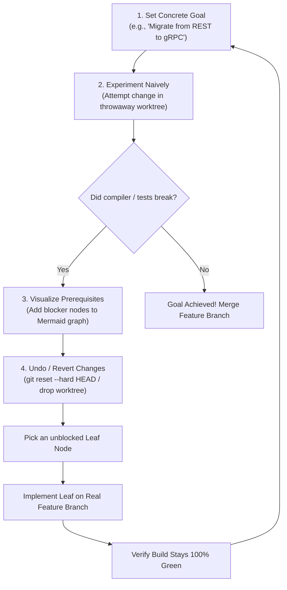
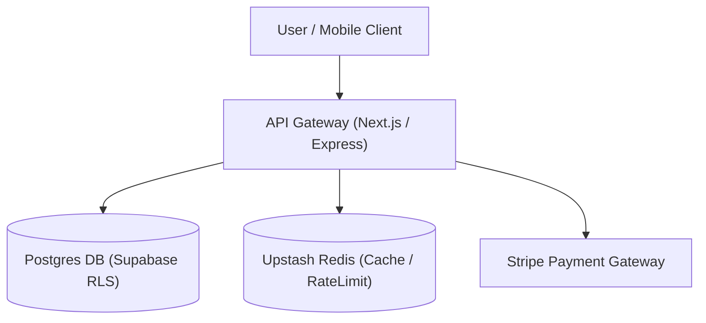
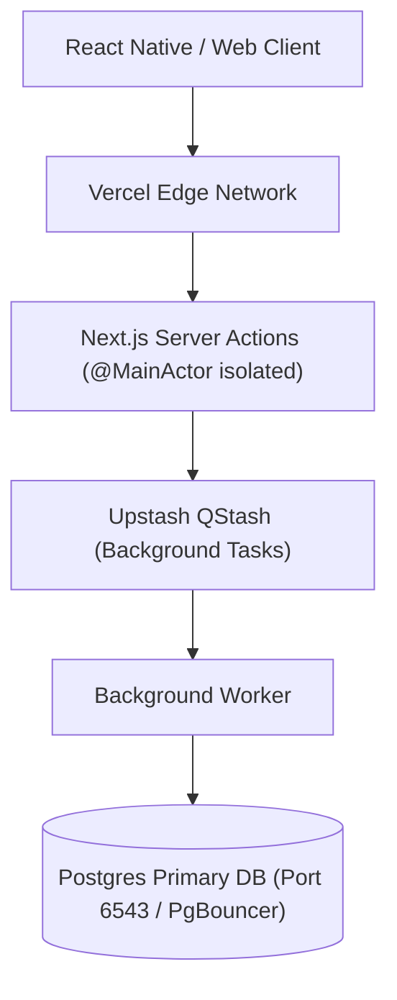
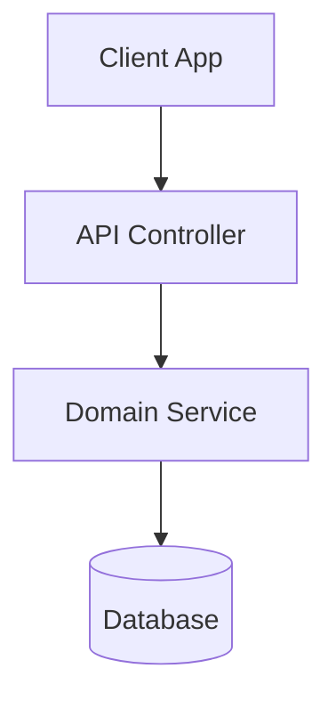

# Ultimate Planning & Architecture Workflow (12/10 Frontier Master Engine)

> [!CAUTION]
> ### 🛑 THE SPEC-AS-SOURCE & VERIFIABLE CHECKPOINT MANDATES
> This workflow enforces two non-negotiable execution invariants:
> 1. **The Spec-as-Source Invariant (SDD Standard):** Specifications don't serve code—code serves specifications. For any change touching $> 2$ files, $> 1$ DB table, or public APIs, a formal specification (`spec.md`) MUST be approved before implementation. "The spec is the prompt."
> 2. **The Adversarial Verification Invariant:** Never allow an implementing agent to self-verify its own work. Every implementation task MUST define an explicit, independent terminal command (`curl`, `vitest`, `tsc`, `prisma`) that an Adversarial Verifier executes to validate completion.

This workflow is the definitive 12/10 technical planning and architecture design system. It unifies the aerospace determinism of **NASA JPL**, the concurrency and frame budgets of **Apple**, the operational resilience of **Google SRE**, the customer backwardness of **Amazon PR/FAQ**, the structural clarity of **C4 Architecture Models**, the non-linear refactoring trees of the **Mikado Method**, the unambiguous requirements syntax of **Rolls-Royce EARS**, the contract-first rigor of **GitHub Spec Kit**, the mutation resilience of **Qodo**, the chaos anticipation of **Netflix Pre-Mortems**, and the comprehensive rigor of the **Pentadeca (15/15) Research Foundation**.

```
                           [TECHNICAL INITIATIVE / COMPLEX REFACTOR]
                                              │
                   ┌──────────────────────────┴──────────────────────────┐
                   ▼                                                     ▼
      [PENTADECA RESEARCH MATRIX (15/15)]                   [CAPACITY & SLO BUDGETING]
      ├─ Cluster 1: Canonical Docs (Tavily/Ctx7/You)        ├─ QPS Headroom & DB Pool Size
      ├─ Cluster 2: Neural Vectors (Exa/Jina/SERPdive)      ├─ Apple 0-Hang (<100ms) Threading
      ├─ Cluster 3: Live SERP (Linkup/Parallel/SerpApi)     ├─ NASA Bounded Loops (<MAX_ATTEMPTS)
      ├─ Cluster 4: Source AST (GitHub/Firecrawl/Crawleo)   └─ Latency Targets (p95/p99)
      └─ Cluster 5: Deep Web (BrightData/Apify/Brave)
                   │
                   ▼
  ┌─────────────────────────────────────────────────────────────────────────────┐
  │                      SPEC-DRIVEN DEVELOPMENT (SDD) LIFECYCLE                │
  │   1. SPECIFY (EARS Syntax) ──► 2. PLAN (Design Doc / C4 / Pre-Mortem)       │
  │   ──► 3. CONTRACTS (Zod/OpenAPI) ──► 4. TASKS (Dynamic Toposort DAG)       │
  └──────────────────────────────────────┬──────────────────────────────────────┘
                                         ▼
                 [THE MIKADO METHOD (FOR COMPLEX REFACTORS)]
          Goal ──► Naive Experiment ──► Visualize (Mermaid) ──► Undo & Revert
                 (Implement Cleanly from Leaf Nodes, Keeping Main Green)
                                         │
                                         ▼
                         [CROSS-CUTTING CHECKPOINTS (SRE)]
               ┌──────────────────────────┬──────────────────────────┐
               ▼                          ▼                          ▼
       ┌──────────────┐           ┌──────────────┐           ┌──────────────┐
       │ 🔒 SECURITY  │           │ 👁️ TELEMETRY │           │ 🛡️ RELIABLE  │
       │ RLS & Secrets│           │ OTel & Traces│           │ Flags & FMEA │
       └──────────────┘           └──────────────┘           └──────────────┘
                                         │
                                         ▼
                   [DYNAMIC DAG TASK DECOMPOSITION (TOPOSORT)]
       Phase 1: Contracts/Types ──► Phase 2: Tests (Contract/E2E/Unit)
       ──► Phase 3: Source Impl ──► Phase 4: Dual-Agent Adversarial Verification
```

---

## 🏛️ Iron Laws of Architecture & Planning

1. **No Big Bangs**: Every implementation step must be completable in 2–10 minutes. If a step takes longer, decompose into smaller leaf sub-tasks.
2. **Every Step Is Verifiable**: Every step MUST have a concrete, copy-pasteable terminal command (e.g. `npx prisma db pull`, `curl -I`, `npm test`) to verify completion.
3. **The Spec Is the Prompt (SDD Law)**: Code is regenerable output compiled from the specification. When requirements change, update the spec first, then regenerate code.
4. **Contract-First File Ordering**:
   - **Step 1:** Define `contracts/` (Zod schemas, OpenAPI 3.1, TypeScript interfaces, Protobuf stubs).
   - **Step 2:** Write test suites targeting contracts (contract $\rightarrow$ integration $\rightarrow$ e2e $\rightarrow$ unit).
   - **Step 3:** Implement source code to satisfy tests and contracts.
5. **The Mikado Refactoring Law**: On complex refactors, never leave the codebase broken. Perform a naive experiment in a throwaway worktree, record breaking prerequisites in a Mermaid graph, immediately revert (`git revert`), and implement leaf nodes one-by-one.
6. **Adversarial Verification Gate**: Never let the implementing agent self-grade. An independent Verifier agent must execute the verification command and check boundary conditions before marking any task complete.
7. **Rollback Is Part of the Plan**: Every task spec MUST define exact rollback shell commands. "Revert the commit" is acceptable; "We'll figure it out" is an immediate rejection.
8. **No Speculative Abstractions (`ponytail` YAGNI)**: Zero premature interfaces, zero single-use abstract wrappers.
9. **Pentadeca-Engine Research Mandate**: Complex architecture decisions MUST evaluate findings across all 15 engines in the 5 Strategic Clusters with an explicit consensus matrix before selecting the design target.
10. **NASA JPL Safety & Resource Budgets**:
    - Statically bounded loops (`attempts < MAX_ATTEMPTS`).
    - Function length budgeted at $\le 60$ LOC.
    - Zero dynamic heap allocation in high-frequency runtime loops.
11. **Apple Thread & Concurrency Budgets**:
    - 0-Hang invariant: zero disk I/O, heavy JSON parsing, or network calls on main UI thread ($< 100\text{ms}$).
    - 0-Hitch invariant: 120Hz ProMotion layout budget ($8.33\text{ms}$).
12. **Zero-Downtime Rollouts (Expand/Contract Pattern)**: Destructive schema changes must use the 3-phase Add $\rightarrow$ Dual-Write $\rightarrow$ Drop pattern.

---

## 📜 Spec-Driven Development (SDD) & EARS Requirements Syntax

Specifications must be written using **Rolls-Royce EARS (Easy Approach to Requirements Syntax)** to prevent LLM context blindness and ambiguous interpretations:

### The 5 EARS Patterns:
| Pattern | Syntax Template | Example |
|---|---|---|
| **1. Ubiquitous** | The system shall `<response>`. | "The system shall encrypt all user tokens at rest using AES-256-GCM." |
| **2. Event-Driven** | When `<trigger>`, the system shall `<response>`. | "When a payment request is received, the system shall verify the `Idempotency-Key` header." |
| **3. State-Driven** | While `<precondition>`, the system shall `<response>`. | "While the database connection pool is saturated, the system shall queue requests up to 500ms." |
| **4. Optional-Feature** | Where `<feature flag>`, the system shall `<response>`. | "Where `ENABLE_BIOMETRIC_AUTH` is active, the system shall prompt for FaceID before payment." |
| **5. Unwanted-Behavior** | If `<error condition>`, then the system shall `<response>`. | "If the payment gateway returns a 5xx error, then the system shall retry up to 3 times with exponential backoff and full jitter." |

---

## 🌲 The Mikado Method for Complex Brownfield Refactoring

When refactoring legacy, tightly coupled, or brownfield code, standard linear plans fail because hidden dependencies break the build. The Mikado Method provides a deterministic 4-primitive loop:



### The 4 Mikado Primitives:
1. **Set a Concrete Goal:** State the exact end-state (e.g. "Payment service decoupled from Auth service").
2. **Experiment Naively:** Attempt the change immediately in an isolated throwaway worktree (`git worktree add`). Run the compiler and test suite. See what breaks.
3. **Visualize Prerequisites:** Whatever broke is an empirical prerequisite. Add it to the Mermaid prerequisite graph pointing toward the goal. The graph is the sole artifact that survives.
4. **Undo / Revert (`git reset --hard`):** Revert every broken change immediately. Reverts have zero emotional cost; the experiment taught you the prerequisite structure.
5. **Execute Leaves:** Implement leaf prerequisites that break nothing, commit them to the real branch, and work back up the tree until the goal is cleanly achieved.

---

## 📚 Document Taxonomy & Selection Matrix

| Document Type | Primary Purpose | Scope & Lifetime | Key Companies | Target Audience |
|---|---|---|---|---|
| **RFC (Request for Comments)** | Org-wide proposal & consensus building | Multi-team / Strategic (Archived post-decision) | Uber, IETF, Rust, Stripe | Engineering org, Leadership |
| **ADR (Architectural Decision Record)** | Permanent immutable log of 1 architectural choice | Repository-scoped / Permanent (`docs/adr/`) | AWS, ThoughtWorks, GitHub | Current & future maintainers |
| **Google-Style Design Doc** | Deep technical architecture & trade-off analysis | Project-scoped / Living doc during development | Google, Meta, Airbnb | Team leads, Peer reviewers |
| **Spec-Driven Spec (`spec.md`)** | Executable prompt contract & acceptance criteria | Feature-scoped / Single source of truth | GitHub, AWS, Claude Code | Coding agents, Engineers |
| **Implementation Plan (Task Spec)** | Atomic, DAG-sequenced verifiable checklist | Task-scoped / Completed in 1–5 days | Stripe, Slack, Apple | Implementing & Verifier agents |

---

## 🛡️ Cross-Cutting Checkpoint Protocol (Google SRE Standard)

Every Design Doc and Implementation Plan MUST explicitly satisfy these 4 checkpoints:

1. **Security Checkpoint**:
   - Input validation & sanitization defined at public boundaries (Zod / JSON Schema).
   - Authentication & Authorization: Postgres Row-Level Security (RLS) policies and RBAC roles defined.
   - Zero hardcoded secrets, tokens, or private keys committed to git.
2. **Privacy & Data Compliance**:
   - PII data classification (Public / Internal / Confidential / Restricted).
   - Audit trail logging and GDPR/CCPA data retention/deletion lifecycles specified.
3. **Observability & Telemetry (OpenTelemetry)**:
   - Structured JSON logging with W3C `trace_id` and `span_id` context propagation.
   - Error rates, latency metrics, and SLI/SLO tracking thresholds defined.
4. **Reliability & Blast Radius (AWS/Netflix)**:
   - Timeouts, circuit breakers, and exponential backoff with full jitter configured on all external calls.
   - Fallback responses specified for degraded downstream microservices.

---

## 🔥 Amazon & Netflix Pre-Mortem & Chaos Simulation

Before writing code, conduct a **Pre-Mortem**: Imagine that 6 months after launching this feature, it caused a catastrophic production outage (SEV-1). Answer these questions directly in the plan:

1. **What broke?** (e.g., Unindexed foreign key caused table locks under peak load; unbounded retry storm exhausted downstream API rate limits; worker thread pool ran out of memory).
2. **Why didn't tests catch it?** (e.g., Mock tests assumed instant network responses; local SQLite didn't replicate Postgres MVCC locking behavior).
3. **Pre-Emptive Mitigations Built into This Plan:**
   - Explicit bulkheads isolating the new service.
   - Circuit breaker thresholds (trip after 5 consecutive failures, 30s half-open cooling).
   - Rate limit ceilings enforced via Upstash Redis.
   - Canary rollout schedule (1% $\rightarrow$ 10% $\rightarrow$ 50% $\rightarrow$ 100% over 48 hours).

---

## 🛍️ Amazon Working Backwards PR/FAQ Framework

For complex or customer-facing initiatives, include a PR/FAQ section:

### 1. The Press Release (PR)
- **Headline:** 1-sentence product announcement written from the future launch date.
- **Summary:** Who is the customer, what problem is solved, and why is this solution superior to existing alternatives?
- **Customer Quote:** Testimonial statement illustrating the tangible benefit received.

### 2. Frequently Asked Questions (FAQ)
- **Customer FAQs:** Edge cases, backward compatibility, performance impact, pricing/limits.
- **Engineering FAQs:** Failure modes, operational overhead, rollback complexity, third-party dependency risks.

---

## 📐 C4 Model Visual System Architecture

Design docs MUST include Mermaid diagrams at the required abstraction level:

### Level 1: System Context Diagram


### Level 2: Container Diagram


---

## 📊 FMEA Risk Matrix & Blast Radius Containment

Calculate the **Risk Priority Number (RPN)** for all identified architectural failure modes:
$$\text{RPN} = \text{Severity (1--5)} \times \text{Likelihood (1--5)} \times \text{Detection Difficulty (1--5)}$$

| RPN Score | Risk Level | Mandatory Mitigation Required |
|---|---|---|
| **1 – 15** | Low Risk | Standard unit tests and local verification commands. |
| **16 – 35** | Moderate Risk | Staging dry-run, feature flag gating, integration test coverage. |
| **36 – 125** | High / Critical | Automated circuit breaker, `Expand/Contract` DB migration, canary rollout, instant rollback script. |

---

## 🚀 Dynamic DAG Task Decomposition & Toposort

Structure all multi-file implementation tasks into a Directed Acyclic Graph (DAG) by dependency rank to prevent race conditions during parallel subagent execution:

```
    ┌──────────────────────┐         ┌──────────────────────┐
    │ Task 1A: DB Schema   │         │ Task 1B: Contracts   │  <-- Rank 1 (Contracts & Types First)
    └──────────┬───────────┘         └──────────┬───────────┘
               │                                │
               └────────────────┬───────────────┘
                                ▼
                    ┌──────────────────────┐
                    │ Task 2: Test Suites  │                    <-- Rank 2 (Contract & Integration Tests)
                    └──────────┬───────────┘
                                │
               ┌────────────────┴───────────────┐
               ▼                                ▼
    ┌──────────────────────┐         ┌──────────────────────┐
    │ Task 3A: Client UI   │         │ Task 3B: Server Impl │  <-- Rank 3 (Parallel Feature Execution)
    └──────────┬───────────┘         └──────────┬───────────┘
               │                                │
               └────────────────┬───────────────┘
                                ▼
                    ┌──────────────────────┐
                    │ Task 4: Adversarial  │                    <-- Rank 4 (Adversarial Verification)
                    │ Verification Gate    │
                    └──────────────────────┘
```

### Dynamic Re-Planning Protocol:
1. If any task fails its verification command, **STOP** downstream task execution immediately.
2. Freeze the DAG state and log the exact failure output.
3. Trigger the **Dynamic Re-planner**:
   - Inspect whether the failure indicates an unmapped prerequisite (Mikado pattern).
   - If an unexpected dependency is uncovered, generate an intermediate sub-task node (e.g. `Task 2.5: Fix schema enum mismatch`).
   - Re-toposort the graph, update the verification script, and resume.

---

## 🔄 Zero-Downtime Database Migration Pattern (Expand/Contract)

```
Phase 1: EXPAND          Phase 2: TRANSITION       Phase 3: CONTRACT
┌──────────────┐         ┌──────────────┐         ┌──────────────┐
│ Add nullable │  ───►   │ Double-write │  ───►   │ Read new,    │
│ new column   │         │ old & new    │         │ drop old col │
└──────────────┘         └──────────────┘         └──────────────┘
```

1. **Expand Phase:** Add `new_column_name` as nullable. Old column remains untouched.
2. **Transition Phase:** Backend writes to both `old_column_name` and `new_column_name`. Background backfill script populates existing records.
3. **Contract Phase:** Reads switch to `new_column_name`. Once stable for 7 days, drop `old_column_name`.

---

## 📝 12/10 Implementation Plan Template

```markdown
# 📋 Technical Specification & Implementation Plan: [Feature Name]

## 1. Executive Summary & Goal
- **Primary Objective**: [1-2 sentences on what is being delivered and why]
- **Document Type**: [Spec-Driven Spec / Google Design Doc / ADR / RFC]
- **Scope Metrics**: [N] Files | [Y/N] DB Schema | [Y/N] Public API | [Y/N] Auth/Billing
- **Rolls-Royce EARS Requirements**:
  - *Ubiquitous*: The system shall [mandatory behavior].
  - *Event-Driven*: When [event], the system shall [action].
  - *Unwanted-Behavior*: If [failure], then the system shall [graceful fallback].

---

## 2. Pentadeca-Engine Research Comparison Matrix (15/15)
| Strategic Cluster | Engine | Canonical Finding / Spec Grounding | Impact on Architecture |
|---|---|---|---|
| **Cluster 1: Canonical Docs** | Tavily / Context7 / You.com | [API specs / Zod schemas] | [Contract-First Boundary] |
| **Cluster 2: Neural Vectors** | Exa AI / Jina AI / SERPdive | [Mikado patterns / arXiv specs] | [Refactoring Tree Layout] |
| **Cluster 3: Live SERP** | Linkup / Parallel / SerpApi | [Live benchmarks / Best practices] | [SLO Headroom Targets] |
| **Cluster 4: Source AST** | GitHub / Firecrawl / Crawleo | [Merged PR diffs / Tree-sitter] | [Dependency Boundary Design] |
| **Cluster 5: Anti-Bot Reach**| Bright Data / Apify / Brave | [Deep web specs / Forum consensus]| [Edge Case Hardening] |

---

## 3. Architecture & C4 Visual Flows


---

## 4. Amazon & Netflix Pre-Mortem & FMEA Risk Assessment
- **Pre-Mortem Failure Scenario**: [Hypothetical catastrophic failure 6 months post-launch]
- **Root Cause Identified**: [e.g. Unbounded connection pool exhaustion during flash traffic]
- **Pre-Emptive Built-in Guard**: [e.g. PgBouncer pool ceiling + Upstash rate limiter]

| Risk / Failure Mode | Severity (1-5) | Likelihood (1-5) | Detection (1-5) | RPN | Mitigation Strategy |
|---|---|---|---|---|---|
| [DB connection saturation] | 4 | 2 | 2 | 16 | PgBouncer pooler + connection_limit=1 |
| [Payment double-charge] | 5 | 2 | 1 | 10 | Mandatory UUIDv4 Idempotency-Key |

---

## 5. Contract-First Interface Stubs (`contracts/`)

```typescript
// contracts/feature.contract.ts
import { z } from 'zod';

export const CreateFeatureSchema = z.object({
  idempotencyKey: z.string().uuid(),
  amountInCents: z.number().int().positive(),
  metadata: z.record(z.string()).optional(),
});

export type CreateFeatureInput = z.infer<typeof CreateFeatureSchema>;
```

---

## 6. Topologically Sorted DAG Task Sequence

### Phase 1: Contracts & Types First (Rank 1)
- [ ] **Task 1A: Shared Contract Definition**
  - **Files**: `contracts/feature.contract.ts`
  - **Action**: Export Zod schemas and TypeScript input/output types.
  - **Verify**: `npx tsc --noEmit`
  - **Rollback**: `git checkout HEAD -- contracts/`

- [ ] **Task 1B: Database Schema Migration (Expand Phase)**
  - **Files**: `prisma/schema.prisma`
  - **Action**: Add nullable column with index.
  - **Verify**: `npx prisma migrate dev --name add_feature_column`
  - **Rollback**: `npx prisma migrate resolve --rolled-back [migration_name]`

### Phase 2: Tests First (Rank 2)
- [ ] **Task 2: Contract & Integration Test Suite**
  - **Files**: `test/contracts/feature.test.ts`
  - **Action**: Write red tests covering valid inputs, invalid bounds, and idempotency collisions.
  - **Verify**: `npm run test -- test/contracts/feature.test.ts` (Expected to fail before Phase 3)
  - **Rollback**: `git checkout HEAD -- test/contracts/feature.test.ts`

### Phase 3: Source Implementation (Rank 3)
- [ ] **Task 3A: Backend API Handler**
  - **Files**: `src/app/api/feature/route.ts`
  - **Action**: Implement POST handler satisfying contract schema and passing Phase 2 tests.
  - **Verify**: `npm run test -- test/contracts/feature.test.ts` (Must now pass 100% green)
  - **Rollback**: `git checkout HEAD -- src/app/api/feature/route.ts`

### Phase 4: Dual-Agent Adversarial Verification (Rank 4)
- [ ] **Task 4: Adversarial Edge Case Probe**
  - **Action**: Verifier subagent runs fuzzing and negative boundary inputs against live handler.
  - **Verify**: `curl -X POST http://localhost:3000/api/feature -d '{"amountInCents": -1}' -> 400 Bad Request`
  - **Sign-off**: Verified 0 unhandled exceptions; 0 lint errors; build is green.

---

## 7. Pre-Merge & Rollout Verification Gate
- [ ] `npx tsc --noEmit` passes with 0 errors
- [ ] `npx eslint` passes with 0 warnings
- [ ] Unit & contract tests pass (`npm run test`)
- [ ] Expand/Contract DB migration verified reversible
- [ ] Feature flag toggle verified in Upstash Redis
```

---

## 🔗 Integrated Domain Skills & Sub-Skill Triggers

- **Architecture & System Design**: `ultimate-architecture-workflow`, `ultimate-database-workflow`, `ultimate-api-workflow`
- **Research & Verification**: `ultimate-research-workflow`, `superpowers-tdd`, `lint-and-validate`
- **Safety & Performance**: `ultimate-security-workflow`, `ultimate-caching-workflow`, `react-native-best-practices`
- **Code Review & Quality**: `ultimate-review-workflow`, `ponytail-review`, `caveman-review`
