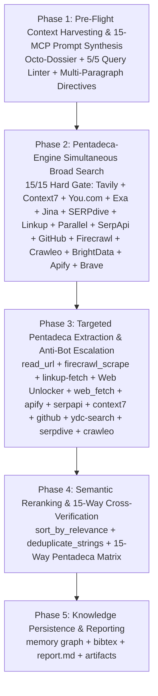

<!-- INVARIANT_START:ANTI_AI_SLOP -->
## 🛑 HARDENED ANTI-AI SLOP MANDATE: NATURAL PROSE & BESPOKE DESIGN CRAFT
All agent communications, architectural plans, reviews, code comments, and frontend implementations MUST strictly adhere to natural human engineering standards. Both corporate AI prose slop and cookie-cutter "vibecoded" UI slop are strictly banned.

### 1. Zero Prose & Grammar Slop (Natural Human Voice)
- **Banned Lexicon:**
  - *Empty Verbs:* delve, embark, foster, resonate, underscore, leverage, elevate, harness, navigate, empower, illuminate, facilitate, tailor, showcase, unveil.
  - *Corporate Buzz-Adjectives:* testament, tapestry, beacon, cornerstone, robust, seamless, pivotal, crucial, paramount, cutting-edge, vibrant, bespoke, game-changer, journey, realm, landscape, holistic, comprehensive, multifaceted, versatile, transformative.
  - *Formulaic Transitions:* furthermore, moreover, in conclusion, it is worth noting, at the end of the day, without further ado, needless to say.
- **Banned Syntactical Patterns:**
  - **Zero Sycophancy / Pleasantries:** NEVER start responses with "Certainly!", "Great question!", "I'd be happy to help!", "Awesome!", or "Let's dive in!".
  - **Zero Summary Outros:** NEVER end answers with a repetitive paragraph restating earlier points using generic corporate filler.
  - **Zero Formulaic "Rule-of-Three" Bullets:** Do not default to 3-bullet lists where each bullet starts with a bold abstract noun followed by a colon and fluff.
  - **Zero Hedging:** Do not write "You might want to potentially consider checking...". Write "Check X, or Y crashes."
- **Natural Voice Standard:** Speak like a systems developer in terminal, Slack, or GitHub issues: blunt, concise, precise, pragmatic. Code and runnable shell commands come first.

### 2. Zero Visual & UI/UX Design Slop (Bespoke Engineering Craft)
- **Banned Color Clichés:**
  - BAN default AI Blue-to-Indigo/Purple gradients (`bg-gradient-to-r from-blue-600 to-indigo-700` or violet hues).
  - BAN colored ambient glowing shadows (`box-shadow` with >= 24px blur matching accent color).
  - BAN washed-out low-contrast gray text (`text-gray-400` / `text-gray-500` failing WCAG AA 4.5:1).
  - BAN gradient headline text (`bg-clip-text text-transparent bg-gradient-to-r` on H1s).
- **Banned Layout & Component Tropes:**
  - BAN cookie-cutter Bento Grid walls filled with fake stats, empty cards, or generic Lucide icon spam.
  - BAN centered hero boilerplate with a floating pill above H1 (`"✨ New: [Feature]"`).
  - BAN unmodified shadcn/ui defaults (`--radius: 0.5rem`, stock button/card exports without brand styling).
  - BAN tinted circular icon containers (`bg-primary/10 text-primary p-3 rounded-full`).
  - BAN static terminal window mockups with red/yellow/green dots in the hero.
  - BAN raw emojis used as icons (`✨`, `🚀`, `⚡`, `🔒`) in production UI markup.
- **Bespoke Design Standard:**
  - Commit to an intentional aesthetic: brutalist, high-density telemetry, refined editorial, or precision dark-mode.
  - High information density (Linear/Stripe standard), micro-borders (`rgba(255,255,255,0.08)`), and tabular numerals (`tabular-nums`).
  - Every component must implement all 7 states: `Default, Hover, Focus-Visible, Active, Loading (Skeleton), Disabled, Error`.
<!-- INVARIANT_END:ANTI_AI_SLOP -->

<!-- INVARIANT_START:GRAPHIFY -->
## 🧠 HARDENED GRAPHIFY KNOWLEDGE ENGINE GATE (AST-FIRST CODE INTELLIGENCE)
Whenever `graphify-out/graph.json` exists in the repository root, agents MUST interact with the AST knowledge graph. Blind directory traversal and unconstrained multi-file context dumping are strictly banned.

1. **Zero-Blind-Grep Invariant:**
   - Running unstructured grep (`grep -r`, `Select-String *.*`, `ripgrep` across entire project) to locate callers or symbol references is FORBIDDEN when `graph.json` is present.
   - Agents must query Graphify first: `graphify query "<symbol_or_concept>"`.

2. **Blast Radius Gate (`graphify explain "<symbol>"`):**
   - Before modifying, refactoring, or deleting any shared interface, model, route, or function, the agent MUST run `graphify explain "<symbol>"`.
   - If incoming edge count > 0, every caller surfaced by Graphify MUST be explicitly enumerated in the task DAG or implementation plan before touching code.

3. **Call-Path Fault Tracing (`graphify path "<source>" "<target>" --undirected`):**
   - When debugging multi-hop failures (e.g. UI -> API -> DB), the agent must run `graphify path` to map the exact shortest call chain between entry point and crash sink before reading source code.

4. **Leiden Community Worktree Partitioning:**
   - When spawning parallel subagents in `ultimate-multi-agent-invoker`, tasks MUST be partitioned by Leiden community clusters (from `graphify-out/graph.json`).
   - If two tasks share a God Node (identified in `graphify-out/GRAPH_REPORT.md`), they CANNOT run concurrently without explicit file-level mutex locks.

5. **Subagent Context Clamp (70% Token Reduction):**
   - Never dump entire raw source files into subagent prompts. Inject only the scoped subgraph from `graphify query "<task_scope>"`.

6. **Post-Commit AST Synchronization (`graphify update .`):**
   - After completing code modifications or merging Git worktrees, the agent MUST run `graphify update .` (local AST delta update, 2s runtime, 0 API tokens) to maintain graph synchronization.
<!-- INVARIANT_END:GRAPHIFY -->

# Ultimate Research Workflow (Pentadeca-Engine Architecture)

> [!CAUTION]
> ### 🛑 MANDATORY TURN 1 ACTION: ZERO SEARCHES BEFORE PROMPT REGISTRY IS WRITTEN TO DISK
> When `/ultimate-research-workflow` is triggered, the assistant **MUST NOT** immediately call `tavily_search`, `web_search_exa`, `search_web_deep`, or any search tool.
> 
> **YOUR VERY FIRST TOOL CALL MUST BE `write_to_file` TO PERSIST `scratch/prompt_registry_<topic>.json`.**
> 
> Calling any search tool before `scratch/prompt_registry_<topic>.json` is written to disk is an **INSTANT CRITICAL PROTOCOL VIOLATION**.
> Calling any neural or LLM engine (You.com, Exa, Linkup, Parallel Search) with a vague query (< 100 words) is an **IMMEDIATE PROTOCOL FAILURE**.
>
> ### 🛑 STRICT 15/15 EXECUTION HARD GATE — NO ENGINE LEFT BEHIND
> This workflow enforces an unbreakable, non-negotiable execution rule: **EVERY single research invocation MUST dispatch to and compile findings from ALL FIFTEEN (15) MCP engines.**
>
> **Cluster 1: Canonical Docs & Official Specs**
> 1. **Tavily** (`tavily`) — Canonical official docs & site crawling
> 2. **Context7** (`context7`) — Official TypeScript type definitions & parameter stubs
> 3. **You.com** (`ydc-search`) — LLM-optimized live web retrieval, grounded news & research synthesis
>
> **Cluster 2: Neural Vectors & Deep Passages**
> 4. **Exa AI** (`exa`) — Neural semantic code vectors & patterns
> 5. **Jina AI** (`jina-remote-server`) — In-body passage quotes (~100 words) & neural reranking
> 6. **SERPdive** (`serpdive`) — Answer-ready content extraction & compressed neural synthesis
>
> **Cluster 3: Real-Time & Live SERP Intelligence**
> 7. **Linkup** (`linkup`) — Real-time agent grounding & deep research
> 8. **Parallel Search** (`parallel-search`) — Low-latency, high-density answer excerpts
> 9. **SerpApi** (`serpapi`) — Live Google/Scholar SERP scraping & organic rank consensus
>
> **Cluster 4: Raw Code, AST & Repo Triage**
> 10. **GitHub** (`github`) — Raw repository source code AST, issues & merged PR diffs
> 11. **Firecrawl** (`firecrawl-mcp`) — Developer index PR triage & live headless DOM scraping
> 12. **Crawleo** (`crawleo`) — Multi-format crawl, clean markdown & SERP RAG ingestion
>
> **Cluster 5: Anti-Bot Crushing & Mass Recursive Crawling**
> 13. **Bright Data** (`brightdata`) — Anti-bot crusher, Web Unlocker & Cloudflare bypass
> 14. **Apify Cloud** (`apify`) — Mass recursive multi-page cloud website crawler
> 15. **Brave Search** (`brave-search`) — Independent 30B+ index & freshness-tagged forums
>
> **Enforcement Rules:**
> - **Mandatory Step 0:** Must create `scratch/prompt_registry_<topic>.json` before dispatching a single search.
> - **Zero Omissions:** Running any subset ($N < 15$) is a **CRITICAL PROTOCOL VIOLATION**.
> - **15 Discrete Submissions:** All 15 engines MUST each output their discrete findings section before synthesis.
> - **Full 15-Way Compilation:** The final deliverable MUST compile all 15 findings into the 15-way matrix before drawing conclusions.

---

## 0. ⚡ Mandatory Turn 1 Tool Call Blueprint: Autonomous Prompt Registry Creation

When this workflow is invoked, **DO NOT GENERATE VAGUE 1-LINE SEARCH QUERIES**. Immediately perform the following two pre-flight steps on Turn 1:

1. **Step 1 (Pre-Flight Context Dossier)**: Write `scratch/context_dossier_<topic>.md` covering the 8 dimensions (D1–D8).
2. **Step 2 (Machine-Dispatchable Prompt Registry)**: Write `scratch/prompt_registry_<topic>.json` via `write_to_file` containing literal argument payloads for ALL 15 ENGINES:
   - **Neural & LLM Engines (You.com, Exa, Linkup, Parallel Search `objective`):** MUST contain $\ge 100$ words with Context, Inquiries, and Negative Constraints.
   - **SERP & Anti-Bot Engines (Tavily, Brave, SerpApi, Bright Data, Crawleo):** Compound booleans with exact symbols and negative exclusions.
   - **Code & AST Engines (GitHub, Context7, Firecrawl Dev):** Exact symbol names, file paths, and interface schemas.

```json
// MANDATORY TURN 1 ACTION EXAMPLE:
write_to_file({
  "TargetFile": "C:\\Users\\Lorenzo Bela\\.gemini\\antigravity\\brain\\<conv-id>\\scratch\\prompt_registry_<topic>.json",
  "Overwrite": true,
  "CodeContent": "{\n  \"$schema\": \"https://json-schema.org/draft/2020-12/schema\",\n  \"topic\": \"...\",\n  \"engines\": {\n    \"tavily\": { \"tool\": \"tavily_search\", \"args\": { \"query\": \"...\" } },\n    \"ydc-search\": { \"tool\": \"you-search\", \"args\": { \"query\": \"... (>= 100 words) ...\" } },\n    \"exa\": { \"tool\": \"web_search_exa\", \"args\": { \"query\": \"... (>= 100 words) ...\" } },\n    \"linkup\": { \"tool\": \"linkup-search\", \"args\": { \"query\": \"... (>= 100 words) ...\" } }\n  }\n}"
})
```

**ONLY AFTER `prompt_registry_<topic>.json` is written to disk may you dispatch queries to the 15 engines, asserting:**
```text
[DISPATCH GATE] Engine: <engine_name> | Registry Match: 100% VERBATIM | Word Count: <N> words | Linter: 5/5 PASS
```


This workflow drives systematic information retrieval, document mining, API verification, and library health analysis. It guarantees that technical decisions, library choices, and API usage patterns are based on verified, up-to-date documentation — never hallucinated, assumed, or guessed.

By following this workflow, engineering teams avoid:
- Outdated API signatures causing compilation failures.
- Deprecated library features introducing technical debt.
- Severe security vulnerabilities in unverified third-party code.
- Anti-bot scraping lockouts and Cloudflare Turnstile blocks on enterprise sites.
- Single-engine search blindspots and hallucinations.
- Hallucinated libraries, phantom methods, or incorrect configuration flags.

---

## The 5 Strategic Research Clusters (Pentadeca Architecture)

To guarantee 100% comprehensive coverage without single-engine blindspots, the 15 research engines are structured into **Five Specialized Functional Clusters (3 Engines per Cluster)**. Every research dispatch MUST query all five clusters simultaneously:

```
┌──────────────────────────────────────────────────────────────────────────────────────────────────┐
│                      PENTADECA 15-ENGINE HARDENED CLUSTER TOPOLOGY (PRO MAX)                     │
├──────────────────────────────────────────────────────────────────────────────────────────────────┤
│ 🏛️ CLUSTER 1: CANONICAL DOCS & OFFICIAL SPECIFICATIONS (Ground Truth Anchor)                     │
│   1. Tavily (`tavily`)            : Official documentation portals & authority sites.            │
│   2. Context7 (`context7`)        : Canonical TypeScript types, interface ASTs & param stubs.   │
│   3. You.com (`ydc-search`)       : Deterministic search synthesis & structured LLM grounding.   │
├──────────────────────────────────────────────────────────────────────────────────────────────────┤
│ 🧠 CLUSTER 2: NEURAL VECTORS & DEEP PASSAGES (Concept & Semantic Depth)                          │
│   4. Exa AI (`exa`)               : Neural semantic embeddings & code pattern matching.          │
│   5. Jina AI (`jina-remote-server`): Deep in-body passage spans (~100 words) & neural reranking. │
│   6. SERPdive (`serpdive`)        : Answer-ready LLM content extraction & compressed synthesis.  │
├──────────────────────────────────────────────────────────────────────────────────────────────────┤
│ ⚡ CLUSTER 3: REAL-TIME & LIVE SERP INTELLIGENCE (Freshness & Consensus)                          │
│   7. Linkup (`linkup`)            : Real-time agent grounding with structured citation trees.    │
│   8. Parallel Search (`parallel-search`): Ultra-low latency, token-dense answer excerpts.       │
│   9. SerpApi (`serpapi`)          : Google & Google Scholar SERP scraping, rank consensus.       │
├──────────────────────────────────────────────────────────────────────────────────────────────────┤
│ 🐙 CLUSTER 4: RAW CODE, AST & REPO TRIAGE (Source Implementation Grounding)                      │
│  10. GitHub (`github`)            : Direct repository source AST, merged PR diffs & changelogs.  │
│  11. Firecrawl (`firecrawl-mcp`)  : Developer index PR triage & dynamic headless JS DOM scraping.│
│  12. Crawleo (`crawleo`)          : Multi-format crawl, clean markdown & SERP RAG ingestion.     │
├──────────────────────────────────────────────────────────────────────────────────────────────────┤
│ 🛡️ CLUSTER 5: ANTI-BOT CRUSHING & MASS RECURSIVE CRAWLING (Deep Web Reach)                       │
│  13. Bright Data (`brightdata`)   : Web Unlocker, Cloudflare Turnstile & CAPTCHA crusher.        │
│  14. Apify Cloud (`apify`)        : Mass multi-thousand page recursive cloud web scraping.       │
│  15. Brave Search (`brave-search`): Independent 30B+ index, forum threads & freshness age filter.│
└──────────────────────────────────────────────────────────────────────────────────────────────────┘
```

---

## Iron Laws

1. **Never Assume API Syntax.** If you haven't verified an API signature against its current documentation or AST stubs, do not write code using it. Check first.
2. **Pin Versions.** Every library recommendation must include the exact version tested (`package@version`). "Use library X" without a version is incomplete research.
3. **Cite Everything.** Every finding must include a direct URL to the source and a verbatim quote span. Uncited claims are hypotheses, not research.
4. **Acknowledge Staleness.** Explicitly state documentation age, last update date, and any known deprecations. Old docs are dangerous docs.
5. **Cross-Reference.** No single source is authoritative. Verify critical findings across the Pentadeca-Engine matrix (official docs + community/GitHub PRs + deep page passages + unblocked enterprise sources + independent web crawlers + high-density agent excerpts + mass cloud crawlers + direct SERP knowledge graphs + official Context7 library type definitions + direct GitHub repository AST/commit mining + You.com LLM-grounded web search + SERPdive answers + Crawleo RAG scrapes).
6. **No Speculative Libraries.** Never suggest a library or package that is not published on npm or PyPI. Always check active status.
7. **Document Alternatives.** Never recommend a library without evaluating at least 2 competitors.
8. **Time-Box Research.** Limit active search and extraction to a maximum of **15 minutes**. If findings are still inconclusive, re-formulate query decomposition.
9. **Strict 15/15 Execution Invariant & "No Engine Left Behind" Mandate (Tavily + Context7 + You.com + Exa + Jina AI + SERPdive + Linkup + Parallel Search + SerpApi + GitHub + Firecrawl + Crawleo + Bright Data + Apify Cloud + Brave Search).** Every single technical research task MUST dispatch queries across ALL FIFTEEN (15) MCP engines simultaneously. Zero exceptions. No engine may ever be omitted, skipped, or deemed optional:
   - **Tavily (`tavily_search` / `tavily_research`):** Domain-scoped keyword indexing, authority doc crawling, multi-step search.
   - **Context7 (`context7`):** Canonical library documentation resolver (`resolve-library-id`) and live version-pinned API/TypeScript definition extractor (`get-library-docs`).
   - **You.com (`ydc-search` / `@youdotcom-oss/mcp`):** Real-time web index optimized for LLM reasoning, delivering deterministic structured web results, snippet extractions, live news, and multi-source research synthesis.
   - **Exa (`web_search_exa` / `web_fetch_exa`):** Neural vector semantic search, natural language intent, similar code pattern discovery.
   - **Jina AI (`jina-remote-server`):** Deep in-page passage extraction (~100 words via `search_web_deep`), batch parallel queries (`search_web`), academic papers (`search_arxiv`, `search_ssrn`), PDF extraction (`extract_pdf`), and semantic reranking (`sort_by_relevance`).
   - **SERPdive (`serpdive` / `serpdive_search`):** High-speed LLM-grounded search returning answer-ready page content, compressed token snippets, and neural answers.
   - **Linkup (`linkup-search` / `linkup-fetch` / `linkup-research`):** Production-grade real-time agent search with deep grounding and structured citations.
   - **Parallel Search (`parallel-search` / `search.parallel.ai`):** Dedicated AI-native search & token-efficient excerpt extraction engine delivering high-density, answer-ready snippets (`web_search`, `web_fetch`) with zero hallucination.
   - **SerpApi (`serpapi`):** Live search engine results page (SERP) scraping across Google, Google Scholar, Google News, Baidu, and Patents with rich structured JSON, organic citations, and knowledge graphs (250 free searches/mo).
   - **GitHub (`github` / `@modelcontextprotocol/server-github`):** Direct repository source code mining, commit history exploration, AST inspection, raw file fetching, issue/PR search, and release changelog verification.
   - **Firecrawl (`firecrawl-mcp`):** Developer index (`categories: ["developer"]` covering GitHub issues/merged PRs/curated docs via `firecrawl_search`), headless JS scraping (`firecrawl_scrape` with `maxAge: 0` and browser actions), sitemaps (`firecrawl_map`), recursive crawls (`firecrawl_crawl`), structured LLM extraction (`firecrawl_extract`), and autonomous agents (`firecrawl_agent`).
   - **Crawleo (`crawleo` / `crawleo_search`, `crawleo_scrape`):** AI search, Google SERP/News/Maps scraping, and headless JS rendering (`render_js=true`), returning clean markdown for LLM grounding.
   - **Bright Data (`brightdata`):** Web Unlocker & proxy shield that bypasses Cloudflare Turnstile, Akamai, CAPTCHAs, and geoblocks on protected enterprise portals.
   - **Apify Cloud (`@apify/actors-mcp-server` / `apify`):** Mass cloud-hosted recursive website crawling (`apify/website-content-crawler`), Google/search actor execution, and deep multi-page markdown harvesting ($5/mo free platform usage).
   - **Brave Search (`brave-search` / `@modelcontextprotocol/server-brave-search`):** Independent 30B+ page web crawler index separate from Google/Bing, discovering un-indexed developer blogs, independent forums, and freshness-tagged content (`age` field).
   **EVERY SINGLE ONE of the 15 engines must complete its run and submit its independent findings report.** No engine is left behind. You MUST compile all 15 reports into their 5 functional clusters and perform an explicit 15-way side-by-side comparison matrix to analyze consensus, conflicting signatures, unique code angles, and trade-offs before reaching a final decision.
10. **Anti-Bot Escalation Protocol.** If any URL returns `403 Forbidden`, Cloudflare challenge, or CAPTCHA lockout across standard engines, immediately escalate to **Bright Data Web Unlocker** / `scraping_browser` to extract raw DOM content without failure.
11. **Zero-Vagueness Invariant & Minimum Signal Threshold.** Never issue vague, lazy, or low-signal queries (e.g., `react state`, `supabase auth`, `nextjs error`). Every MCP invocation MUST follow the **Goated Prompt Engineering Blueprint**: combining (1) target artifact type, (2) exact library version pinning, (3) runtime toolchain boundaries, (4) boolean domain scoping, and (5) explicit negative exclusions. Single-line, generic search queries are classified as a **CRITICAL PROTOCOL VIOLATION** that aborts the workflow.
12. **Google Chain-of-Evidence (CoE) Zero-Phantom Reference Mandate.** Every factual claim, API signature, and metric MUST carry an explicit inline evidence tag binding it to a verified URL or registry API response. Citations generated from LLM memory are BANNED.
13. **AutoVerifier Pentadeca-Source Claim Extraction.** Factual assertions MUST be decomposed into structured `(Subject, Predicate, Object)` claim triples to detect cross-source contradictions and method-code misalignments across all 15 search engines before recommending solutions.
14. **Dynamic Failover & Resilience Protocol.** If any of the 15 engines encounters rate limits or network issues, the remaining active engines dynamically scale up results count (+20%) to ensure 100% data density. Research NEVER halts, and the affected engine's attempted run is still logged.
15. **Octo-Context Pre-Flight Harvesting Invariant.** Before any search or research query is dispatched to ANY engine, the agent MUST assemble the **8-Dimensional Context Grounding Dossier (The Octo-Context Anchor)** by inspecting local workspace manifests (`package.json`, `Cargo.toml`, `requirements.txt`), compiler configurations (`tsconfig.json`), runtime environment (OS, Node/Bun/Deno, container/edge), error callstack telemetry, and the memory graph (`memory/read_graph`). Researching in a vacuum without full context is STRICTLY PROHIBITED.
16. **Pre-Dispatch Query Signal Linter (5/5 Hard Gate).** Every candidate query must be verified against the 5-point Query Signal Linter (Version Pinning, Exact Symbol/Error Fingerprint, Architecture Boundary, Negative Scope, and Engine Modality). Any query scoring $< 5/5$ is blocked from execution and must be expanded.
17. **15/15 Per-MCP Prompt Calibration Mandate.** Prompts must be bespoke and calibrated specifically to each of the 15 MCP engines according to their underlying ingestion mechanics: dense continuous narrative paragraphs for neural vector engines, structured multi-section RFC briefs for deep research agents, pinpoint AST path qualifiers for code mining engines, and compound quoted booleans with negative exclusions for SERP engines.
18. **Multi-Paragraph Density Mandate for Vector & Agent Engines.** For neural/semantic vector engines (`exa`, `jina` deep search, `serpdive`, `parallel-search`) and deep research agents (`linkup-research`, `you-research`, `firecrawl_agent`, `tavily_research`, `apify`), prompts must be comprehensive, dense paragraphs (100–300 words for neural engines, 200–500 words for agent research briefs) detailing the complete problem context, reproduction mechanics, environmental constraints, and target code shapes. Short 1-sentence prompts to these engines are forbidden.
19. **Verbatim Payload Dispatch Invariant.** All tool calls dispatched to the 15 research engines MUST copy their payload verbatim from the approved machine-dispatchable prompt registry (`scratch/prompt_registry.json`). Condensing, summarizing, paraphrasing, or shortening registered prompts into search-bar phrases during tool invocation is a **STRICT PROTOCOL VIOLATION**.
20. **100-Word Minimum for Neural & LLM Engines.** Engines in the Neural/Agentic tiers (You.com `you-search`/`you-research`, Exa `web_search_exa`, Linkup `linkup-research`, Parallel Search `objective`) MUST receive full, rich multi-paragraph prompts of at least 100 words containing: (a) Technical Context & Architecture Baseline, (b) 3–4 Exact Research Inquiries, and (c) Negative Scope Constraints. Any prompt $< 100$ words dispatched to these engines is an immediate protocol failure.

---

## Google Science One & Frontier Deep Research Standards (Google, OpenAI, AutoVerifier)

### 1. Google Chain-of-Evidence (CoE) Verifiability Architecture
- **Completeness & Correctness Invariants:**
  - *Completeness:* Every claim in a research report MUST link to a recorded evidence chain.
  - *Correctness:* Each evidence chain MUST genuinely support the attached claim (zero paraphrase drift).
- **CoE 4-Check Integrity Audit:**
  1. **Reference Verification:** 100% of citations resolved via live registry/scholarly/source APIs (`context7`, `github`, `tavily_extract`, `web_fetch_exa`, Linkup `linkup-fetch`, Jina `read_url`, Firecrawl `firecrawl_scrape`, Bright Data Unlocker, Brave Search API, Parallel Search `web_fetch`, Apify datasets, SerpApi Google results, You.com API, SERPdive, Crawleo). Zero phantom references allowed.
  2. **Metric & Score Verification:** Exact performance/bundle-size numbers verified against raw log lines or benchmark tables.
  3. **Method-Code Alignment:** Described library patterns MUST match actual source code AST declarations.
  4. **Specification Violation Check:** Enforce exact version bounds (e.g. Next.js 15, React 19, TypeScript 5.5, Node 22).

### 2. Google PAT (Paper Assistant Tool) Semantic Segmentation & Compute Allocation
- **Dynamic Segment Compute Allocation:**
  - Segment research topics into semantic components (e.g., *API Signatures*, *Migration Paths*, *Performance Benchmarks*, *Security Hazards*).
  - Dynamically allocate search tool calls across all 15 engines grouped into 5 clusters (20% per cluster, 6.67% per engine):
    - **Cluster 1 (Authority & Canonical Specs - 20%):** Tavily, Context7, You.com
    - **Cluster 2 (Neural Vector & Deep Passages - 20%):** Exa AI, Jina AI, SERPdive
    - **Cluster 3 (Real-Time Agent & SERP Consensus - 20%):** Linkup, Parallel Search, SerpApi
    - **Cluster 4 (Raw Code AST & Merged PR Triage - 20%):** GitHub, Firecrawl, Crawleo
    - **Cluster 5 (Anti-Bot Bypass & Mass Cloud Crawling - 20%):** Bright Data, Apify Cloud, Brave Search

### 3. AutoVerifier 15-Layer Knowledge Graph & Claim Triples
Decompose complex technical assertions into structured `(Subject, Predicate, Object)` triples across the 5 clusters:
- *Cluster 1:* `(Context7 resolve-library-id, resolves, canonical date-fns v4 type stubs)`
- *Cluster 1:* `(You.com ydc-search, grounds, real-time web facts and multi-source research snippets)`
- *Cluster 2:* `(Jina search_web_deep, extracts, ~100-word in-body passages)`
- *Cluster 2:* `(SERPdive search, synthesizes, answer-ready LLM content extraction)`
- *Cluster 3:* `(Parallel Search web_search, delivers, answer-ready 25k char capped excerpts)`
- *Cluster 4:* `(GitHub search_code, locates, PrismaPg adapter instantiation in production repos)`
- *Cluster 4:* `(Firecrawl developer index, exposes, data.developer PR fixes)`
- *Cluster 4:* `(Crawleo crawl, renders, JavaScript SPA markdown AST)`
- *Cluster 5:* `(Bright Data Web Unlocker, unblocks, Cloudflare Turnstile protected docs)`
- *Cluster 5:* `(Brave Search index, discovers, independent forum workarounds with freshness age)`
- Cross-reference triples across all 15 engine outputs to spot contradictions and overclaims automatically.

### 4. DeepTRACE Bi-partite Citation Matrix & Minimal Source Cover
- Construct a **Statement-by-Source Matrix** evaluating whether listed URL sources factually support each sentence in the report.
- Prune redundant or low-signal source links to output a minimal, 100%-verified evidence graph.

### 5. HiEviDR Hierarchical Evidence Graph & Progressive Gating
- **Evidence Graph Construction ($\mathcal{G} = (\mathcal{N}_\text{e} \cup \mathcal{N}_\text{c} \cup \{n_\text{conclusion}\}, \mathcal{E})$):**
  - *Evidence Nodes ($\mathcal{N}_\text{e}$):* Atomic textual, tabular, or visual evidence items retrieved directly from sources across the 15 engines.
  - *Claim Nodes ($\mathcal{N}_\text{c}$):* Intermediate reasoning statements grounded in one or more evidence nodes.
  - *Conclusion Node ($n_\text{conclusion}$):* Final analytical answer supported by the entire directed acyclic graph.
- **Progressive Gating Mechanism:**
  1. *Citation Gate:* Activates only when cited evidence matches retrieved atomic nodes in $\mathcal{N}_\text{e}$.
  2. *Claim Gate:* Activates only when cited evidence adequately supports intermediate reasoning in $\mathcal{N}_\text{c}$.
  3. *Answer Gate:* Activates final conclusions only when all precursor claim nodes are 100% verified. Failure at any gate zeroes out credit.

### 6. Span-Grounded Verbatim Substring Validation
- Every extracted claim MUST carry a verbatim quote span from its source.
- Validate every quote span via exact substring matching against the raw scraped HTML/markdown text before emitting findings. Substring mismatches are dropped immediately.

---

## Goated Prompt & Context Engineering Master Blueprint (Pentadeca Architecture)

> [!IMPORTANT]
> ### 🛑 THE ANTI-VAGUENESS INVARIANT: ZERO 1-LINERS, ZERO GENERIC QUERIES
> Querying any search engine or MCP agent with vague, lazy, 1-line strings (e.g., `react 19 state`, `prisma connection pool error`, `supabase auth`, `emergency response update`) is an **UNACCEPTABLE PROTOCOL FAILURE**.
> 
> Search and retrieval quality is strictly bounded by prompt information density. Vague queries yield generic SEO blogs, hallucinated snippets, and outdated workarounds. To guarantee ground-truth precision, every MCP dispatch MUST undergo **Pre-Flight Context Engineering** (assembling the 8-Dimensional Context Dossier) and **Engine-Specific Deep Prompt Formulation** (producing rich, multi-paragraph technical briefs for neural/agent engines and pinpoint AST booleans for code/SERP tools).

---

### 1. The 8-Dimensional Context Grounding Dossier (The Octo-Context Anchor)

Before issuing a single tool call to ANY of the 15 engines, the agent MUST inspect the workspace files (`package.json`, `Cargo.toml`, `requirements.txt`, `tsconfig.json`, source files, active logs) and query `memory/read_graph` to compile the **8-Dimensional Context Dossier**:

```
┌─────────────────────────────────────────────────────────────────────────────────────────────────────────┐
│                               8-DIMENSIONAL CONTEXT GROUNDING DOSSIER                                   │
├─────────────────────────────────────────────────────────────────────────────────────────────────────────┤
│ D1: RUNTIME & TOOLCHAIN STATE                                                                           │
│   • OS, Kernel & CPU Architecture: (e.g. Windows 11 x64 23H2 / Ubuntu 24.04 ARM64)                      │
│   • Runtime Engine: (e.g. Node.js v22.12.0 LTS / Bun v1.1.38 / Cloudflare Workers V8 isolate)            │
│   • Package Manager & Lockfile: (e.g. pnpm v9.14.2 / package-lock.json v3)                               │
│   • Compiler Targets & Flags: (e.g. tsconfig target="ES2023", moduleResolution="Bundler", strict=true)  │
├─────────────────────────────────────────────────────────────────────────────────────────────────────────┤
│ D2: DEPENDENCY GRAPH & PINNED SEMVER BOUNDS                                                             │
│   • Target Package & Exact Version: (e.g. "@prisma/client": "6.2.0", "@prisma/adapter-pg": "6.2.0")     │
│   • Framework & Core Peers: (e.g. "next": "15.1.4", "react": "19.0.0", "typescript": "5.7.2")          │
│   • Native Addons & Drivers: (e.g. "pg": "8.13.1", native C++ bindings, or pure JS WASM)                 │
├─────────────────────────────────────────────────────────────────────────────────────────────────────────┤
│ D3: SYMBOL, AST & INTERFACE ANATOMY                                                                     │
│   • Exact Symbol Identifiers: (e.g. `PrismaPg`, `PrismaClient`, `defineConfig`, `useActionState`)       │
│   • Fully Qualified Types & Generics: (e.g. `PrismaPgOptions`, `Record<string, unknown>`)               │
│   • Module Export Paths: (e.g. "@prisma/adapter-pg", "next/navigation", "react-dom")                    │
├─────────────────────────────────────────────────────────────────────────────────────────────────────────┤
│ D4: ERROR FINGERPRINT & CALLSTACK TELEMETRY                                                             │
│   • Verbatim Error String: (e.g. `PrismaClientInitializationError: Can't reach database server...`)     │
│   • Hexadecimal / Engine Error Code: (e.g. `P1001`, `0xC0000005`, `ERR_MODULE_NOT_FOUND`)                │
│   • Failing Callstack Anchor: (e.g. `at PrismaClient._executeRequest (node_modules/@prisma/...:124)`)   │
│   • Minimal Reproduction Steps: (e.g. 5 concurrent Server Action mutations under PgBouncer)             │
├─────────────────────────────────────────────────────────────────────────────────────────────────────────┤
│ D5: ARCHITECTURAL BOUNDARIES & EXECUTION DOMAIN                                                         │
│   • Boundary Paradigm: (e.g. React Server Components vs 'use client' hydration boundary)               │
│   • Concurrency & Worker Model: (e.g. Multi-threaded worker pool vs event loop singleton)                │
│   • Network & Pooling Topology: (e.g. Supabase port 6543 PgBouncer transaction mode vs direct port 5432)│
├─────────────────────────────────────────────────────────────────────────────────────────────────────────┤
│ D6: NEGATIVE CONTEXT SPACE & BANNED ANTI-PATTERNS                                                       │
│   • Prohibited Solutions: (e.g. "Do NOT suggest downgrading Next.js 15 to 14 or React 19 to 18")        │
│   • Excluded Legacy Paradigms: (e.g. "Do NOT suggest Pages Router `getServerSideProps` or raw Webpack") │
│   • Prohibited Hacks: (e.g. "Do NOT use `any` casting, `@ts-ignore`, or disabling connection pooler")   │
├─────────────────────────────────────────────────────────────────────────────────────────────────────────┤
│ D7: HISTORICAL MEMORY GRAPH & PRIOR INQUIRIES                                                           │
│   • Prior Knowledge Graph Nodes: (Retrieved via `memory/read_graph`)                                    │
│   • Failed Experiment Ledger: (e.g. "Setting connection_limit=10 failed due to Supabase pool cap")      │
│   • Known Upstream Status: (e.g. Open Prisma GitHub Issue #25410 on adapter-pg transaction support)     │
├─────────────────────────────────────────────────────────────────────────────────────────────────────────┤
│ D8: TARGET ARTIFACT CONTRACT & ACCEPTANCE CRITERIA                                                      │
│   • Required Code Pattern: (e.g. Production-ready copy-paste TypeScript singleton with retry backoff)   │
│   • Verification Proof: (e.g. Confirmed working Prisma 6.2 + Supabase PgBouncer config file)            │
│   • Performance Budget: (e.g. Zero cold-start latency regression, 100% tree-shakable)                  │
└─────────────────────────────────────────────────────────────────────────────────────────────────────────┘
```

---

### 2. Pre-Dispatch Query Signal Linter (5/5 Hard Gate)

Before any tool call is dispatched to ANY of the 15 engines, the candidate prompt MUST be evaluated against this 5-point Linter. **A score of 5/5 is mandatory. Any query scoring $< 5$ is automatically rejected.**

| Criteria | Required Signal | Score | Failure Example | Pass Example |
|---|---|---|---|---|
| **1. Semver & Toolchain Pinning** | Exact package versions, runtime version, and compiler target included. | 1.0 | `prisma supabase error` | `"@prisma/client@6.2.0" "next@15.1.4" Node 22` |
| **2. Symbol & Error Fingerprint** | Verbatim class, function, interface, or exact error string in quotes. | 1.0 | `connection failed` | `"PrismaClientInitializationError" "PrismaPg"` |
| **3. Architecture & Boundary Context** | Explicit statement of execution domain (RSC, edge, port, pooler mode). | 1.0 | `how to connect database` | `Next.js 15 Server Actions Supabase PgBouncer port 6543 transaction mode` |
| **4. Negative Scope Inclusions** | Explicit exclusions of outdated frameworks, hacks, or anti-patterns. | 1.0 | *Missing negative filters* | `-pages -webpack -legacy -downgrade` |
| **5. Engine-Specific Modality Formatting** | Adheres to the specific engine's format (long narrative paragraph for vector/agents, AST booleans for code). | 1.0 | 5-word sentence passed to Exa or Linkup | 150-word detailed technical narrative for Exa / multi-section brief for Linkup |

---

### 2.1 The Payload-Locked JSON Prompt Registry Standard (`scratch/prompt_registry_<topic>.json`)

To eliminate the agent's natural "Search Query Reflex" (the tendency to compress registered detailed prompts into short 15-word search strings), the prompt registry MUST be authored as a **machine-dispatchable JSON artifact** containing the literal tool argument payloads:

```json
{
  "$schema": "https://json-schema.org/draft/2020-12/schema",
  "topic": "[Exact Technical Topic]",
  "timestamp": "2026-09-03T00:00:00Z",
  "engines": {
    "tavily": {
      "tool": "tavily_search",
      "args": {
        "query": "(site:docs.domain.com OR site:github.com/org/repo) \"ExactSymbol\" \"v1.0.0\" [Architecture Context] -legacy -deprecated",
        "search_depth": "advanced"
      }
    },
    "ydc-search": {
      "tool": "you-search",
      "args": {
        "query": "Paragraph 1: Detailed Technical Context...\n\nParagraph 2: Specific Architectural Inquiries:\n1. ...\n2. ...\n3. ...\n\nParagraph 3: Negative Constraints & Exclusions..."
      },
      "word_count": 145
    },
    "exa": {
      "tool": "web_search_exa",
      "args": {
        "query": "Here is a production-ready TypeScript implementation of [Exact Component] in [Runtime Context] that handles [Edge Cases] without throwing [Exact Error]...",
        "numResults": 10
      },
      "word_count": 120
    }
  }
}
```

### 2.2 The Pre-Dispatch Verification Gate & Verbatim Assertion Check

Before executing each tool call in Phase 2, the assistant MUST execute a mental verification check ensuring the argument passed to the tool is a **100% exact substring match** of the registered JSON payload:

```text
[DISPATCH GATE] Engine: <engine_name> | Registry Match: 100% VERBATIM | Word Count: <N> words | Linter: 5/5 PASS
```

**Non-Negotiable Execution Rules:**
1. **Zero Condensation:** Passing a summarized, shortened, or paraphrased string to a tool when a detailed prompt exists in the registry is a **PROTOCOL BREACH**.
2. **The 100-Word Neural Minimum:** For You.com, Exa AI, Linkup, and Parallel Search `objective`, the query string MUST be $\ge 100$ words. If it is shorter than 100 words, dispatch is BLOCKED until the full contextual narrative is restored.

---

### 3. Exhaustive 15-MCP Individual Prompt Engineering Blueprints

Each of the 15 MCP engines operates on a distinct ingestion architecture (neural vector embeddings, AST token parsers, LLM synthesis agents, or boolean search indexes). **You MUST apply the bespoke prompt modality designed for each engine:**

#### 🏛️ Cluster 1: Canonical Docs & Official Specs

##### 1. Tavily (`tavily` / `tavily_search`, `tavily_research`)
- **Ingestion Architecture:** Deep web crawler with domain authority weighting and boolean operator parsing.
- **Context Injection Mapping:** Inject D1 (runtime/toolchain), D2 (exact semver), D3 (symbols), D5 (architecture), and D6 (negative domain exclusions).
- **Mandatory Prompt Format:** Multi-clause boolean with domain constraints (`site:`), verbatim symbol quotes (`"..."`), and explicit negative keyword exclusions (`-medium -devto`).
- **Template:**
  ```
  (site:[canonical-docs-domain] OR site:github.com/[org]/[repo]) "[Exact Symbol]" "[Exact Version]" "[Key Config Flag]" [Architecture Boundary Context] -tutorial -medium -deprecated
  ```
- **Example:**
  ```json
  {
    "query": "(site:docs.supabase.com OR site:github.com/prisma/prisma) \"PrismaClientInitializationError\" \"PrismaPg\" \"6.2\" \"pgbouncer=true\" \"connection_limit=1\" Next.js 15 Server Actions port 6543 -medium -devto -beginner",
    "search_depth": "advanced",
    "max_results": 15,
    "include_raw_content": true
  }
  ```

##### 2. Context7 (`context7` / `resolve-library-id`, `get-library-docs`)
- **Ingestion Architecture:** Canonical library documentation resolver and live TypeScript interface AST stubs.
- **Context Injection Mapping:** Inject D2 (package name & semver) into `resolve-library-id`, then inject D3 (symbols, function parameters, return types) and D5 (runtime target) into `get-library-docs`.
- **Mandatory Prompt Format:** Two-step execution: First resolve canonical package ID, then query for exact AST type stubs with full parameter signatures.
- **Template:**
  - Step 1: `resolve-library-id` with `libraryName: "[exact-npm-package-name]"`
  - Step 2: `get-library-docs` with `libraryId: "[resolved-id]"`, `query: "[Exact Class/Function Symbol] constructor options parameters return type TypeScript interface [version]"`
- **Example:**
  ```json
  // Step 1: resolve-library-id
  { "libraryName": "@prisma/adapter-pg" }
  // Step 2: get-library-docs
  {
    "libraryId": "prisma_adapter_pg",
    "query": "PrismaPg constructor connectionString pool options TypeScript signature parameters return type v6"
  }
  ```

##### 3. You.com (`ydc-search` / `you-research`, `you-search`)
- **Ingestion Architecture:** Real-time web index optimized for LLM reasoning and multi-source structured research synthesis.
- **Context Injection Mapping:** Inject D1 (toolchain), D3 (symbols), D4 (error callstack), D5 (stack architecture), and D8 (acceptance criteria).
- **Mandatory Prompt Format:** **150–300 Word Multi-Paragraph Structured Research Synthesis Prompt** (`you-research`) containing background context, exact error telemetry, and 4 specific verification vectors.
- **Example:**
  ```json
  {
    "query": "Comprehensive technical research on configuring Prisma v6.2.0 with Supabase PostgreSQL connection pooling in Next.js 15.1 App Router Server Actions. Background: Application experiences 'PrismaClientInitializationError: Can't reach database server' when executing concurrent Server Actions against Supabase pooler on port 6543 under PgBouncer transaction mode. Investigate: 1) The exact implementation syntax for @prisma/adapter-pg driver adapter; 2) Required query parameters on DATABASE_URL (specifically pgbouncer=true and connection_limit); 3) Dual-URL configuration requirement using DIRECT_URL on port 5432 for prisma migrate deploy; 4) Global singleton instantiation on globalThis to prevent connection pool exhaustion across Node 22 worker threads. Deliver verified configuration files, tsconfig constraints, and known GitHub issue workarounds.",
    "depth": "deep"
  }
  ```

#### 🧠 Cluster 2: Neural Vectors & Deep Passages

##### 4. Exa AI (`exa` / `web_search_exa`, `web_fetch_exa`)
- **Ingestion Architecture:** Semantic neural embeddings trained on high-signal developer code and technical literature.
- **Context Injection Mapping:** Inject D1 (toolchain), D2 (semver), D3 (symbols), D4 (error reproduction), D5 (architecture boundaries), D6 (negative space), and D8 (target code shape).
- **Mandatory Prompt Format:** **100–250 Word Continuous Dense Technical Narrative Paragraph** beginning with an affirmative code framing ("Here is a production-ready TypeScript implementation...") that describes the full architectural context, constraints, and target AST patterns.
- **Example:**
  ```json
  {
    "query": "Here is a production-ready TypeScript implementation of Prisma v6.2.0 with @prisma/adapter-pg connecting to Supabase PostgreSQL via PgBouncer transaction pooling on port 6543 in Next.js 15 App Router. The setup uses Node.js 22 LTS runtime, handles concurrent Server Actions without throwing PrismaClientInitializationError or pool exhaustion, caches the PrismaClient singleton on globalThis, explicitly appends pgbouncer=true&connection_limit=1 to the pooler connection string, and separates directUrl on port 5432 for Prisma migrations without prepared statement collisions:",
    "category": "github",
    "numResults": 15
  }
  ```

##### 5. Jina AI (`jina-remote-server` / `search_web_deep`, `parallel_search_web`, `read_url`)
- **Ingestion Architecture:** In-body passage reader extracting ~100-word contextual paragraph spans with neural reranking (`sort_by_relevance`).
- **Context Injection Mapping:** Inject D3 (symbols), D4 (verbatim error string), D5 (runtime architecture), and D7 (hypotheses).
- **Mandatory Prompt Format:** **80–150 Word In-Depth Passage Query** asking specific technical questions backed by the verbatim error string and stack parameters.
- **Example:**
  ```json
  {
    "query": "Why does Prisma v6 throw PrismaClientInitializationError when connecting to Supabase PgBouncer pooler on port 6543 during concurrent Next.js 15 Server Actions, and what is the exact configuration for @prisma/adapter-pg with pgbouncer=true and directUrl on port 5432?",
    "num": 8,
    "snippet_source": "auto"
  }
  ```

##### 6. SERPdive (`serpdive` / `serpdive_search`)
- **Ingestion Architecture:** High-speed LLM-grounded search delivering compressed neural synthesis and answer-ready token snippets.
- **Context Injection Mapping:** Inject D2 (versions), D3 (symbols), D4 (error codes), and D5 (architecture).
- **Mandatory Prompt Format:** High-density, answer-ready prompt specifying exact error code, stack boundary, and expected interface pattern (`model: "mako"`).
- **Example:**
  ```json
  {
    "query": "Next.js 15 Prisma v6.2 Supabase PgBouncer transaction mode port 6543 PrismaClientInitializationError adapter-pg singleton connection_limit=1 solution",
    "model": "mako"
  }
  ```

#### ⚡ Cluster 3: Real-Time & Live SERP Intelligence

##### 7. Linkup (`linkup` / `linkup-research`, `linkup-search`, `linkup-fetch`)
- **Ingestion Architecture:** Production-grade real-time agent search with structured citation trees and multi-step reasoning.
- **Context Injection Mapping:** Complete mapping of all 8 Dimensions (D1–D8).
- **Mandatory Prompt Format:** **200–400 Word Structured RFC Research Directive** (`linkup-research` with `depth: "deep"` and `reasoningDepth: "L"`).
- **Template:**
  ```markdown
  ### RESEARCH DIRECTIVE: [TOPIC]
  **Stack Baseline:** [D1 + D2]
  **Problem Anatomy & Error Telemetry:** [D4]
  **Architectural Context:** [D5]
  **Specific Research Inquiries:**
  1. [Inquiry 1: AST Signature & Setup]
  2. [Inquiry 2: Connection Pooling & Edge Pitfalls]
  3. [Inquiry 3: Migration & CLI Separations]
  4. [Inquiry 4: Benchmark & Latency Overheads]
  **Negative Constraints:** [D6]
  **Required Deliverable:** [D8]
  ```
- **Example:**
  ```json
  {
    "query": "### RESEARCH DIRECTIVE: Prisma v6.2.0 with Supabase Connection Pooling in Next.js 15 App Router\n**Stack Baseline:** Next.js 15.1.4, React 19.0.0, TypeScript 5.7, Node.js 22 LTS, @prisma/client 6.2.0, @prisma/adapter-pg 6.2.0.\n**Problem Anatomy:** Concurrent Server Actions trigger 'PrismaClientInitializationError: Can't reach database server at pooler.supabase.com:6543' under load due to PgBouncer transaction pooling limits and prepared statement failures.\n**Inquiries:**\n1. What is the verified constructor pattern for @prisma/adapter-pg in Prisma v6?\n2. What exact connection string parameters are required (e.g. pgbouncer=true, connection_limit=1)?\n3. How should prisma.config.ts and schema.prisma configure directUrl on port 5432 for migrations while keeping DATABASE_URL on port 6543 for the client?\n4. What globalThis caching pattern prevents pool exhaustion across serverless workers?\n**Constraints:** Do NOT suggest downgrading to Prisma v5 or React 18. Provide copy-paste verified code.",
    "depth": "deep"
  }
  ```

##### 8. Parallel Search (`parallel-search` / `web_search`, `web_fetch`)
- **Ingestion Architecture:** Token-efficient agent search returning dense, answer-ready excerpts (capped to ~25k chars) with zero hallucination.
- **Context Injection Mapping:** Inject D1, D3, D4, and D5 into the comprehensive objective, and decompose D3/D4/D5 into an array of 3–5 multi-angled search queries.
- **Mandatory Prompt Format:** Multi-sentence technical objective + array of 3–5 distinct angled search queries covering setup, error fix, and driver adapter.
- **Example:**
  ```json
  {
    "objective": "Identify the verified architectural fix for PrismaClientInitializationError in Next.js 15 Server Actions connecting to Supabase PostgreSQL via PgBouncer on port 6543, including @prisma/adapter-pg instantiation and dual-URL migration configuration in Prisma v6.",
    "search_queries": [
      "Prisma v6 Supabase PgBouncer transaction mode port 6543 connection_limit=1",
      "PrismaClientInitializationError Supabase connection pooler Next.js 15",
      "@prisma/adapter-pg PrismaPg connectionString singleton Next.js Server Actions",
      "Prisma v6 directUrl port 5432 prisma.config.ts migrations"
    ]
  }
  ```

##### 9. SerpApi (`serpapi` / `google`, `google_scholar`, `google_news`)
- **Ingestion Architecture:** Direct Google SERP scraper returning rich organic knowledge graphs, sitelinks, and Scholar citations.
- **Context Injection Mapping:** Inject D2 (versions), D3 (symbols), D4 (error codes), and D6 (negative keywords).
- **Mandatory Prompt Format:** 4-part compound boolean query with exact verbatim match operators (`"..."`), multiple domain anchors (`site:... OR site:...`), and negative exclusions (`-medium -tutorial`).
- **Example:**
  ```json
  {
    "engine": "google",
    "q": "(site:docs.supabase.com OR site:github.com/prisma) \"PrismaClientInitializationError\" \"pgbouncer=true\" \"adapter-pg\" v6 -medium -tutorial -beginner",
    "num": 10,
    "hl": "en",
    "gl": "us"
  }
  ```

#### 🐙 Cluster 4: Raw Code, AST & Repo Triage

##### 10. GitHub (`github` / `search_code`, `get_file_contents`, `list_commits`, `search_issues`)
- **Ingestion Architecture:** Direct repository source tree mining, AST declaration discovery, merged PR diffs, and issue triage.
- **Context Injection Mapping:** Inject D2 (package repo), D3 (symbols), D4 (error strings), and D5 (source file paths).
- **Mandatory Prompt Format:** High-precision AST search combining exact symbol name, file path qualifiers (`path:`, `filename:`), language filters (`language:typescript`), and merged PR filters (`is:pr is:merged`).
- **Example:**
  ```json
  // 1. AST Code Search
  {
    "q": "\"@prisma/adapter-pg\" \"PrismaPg\" path:lib/ filename:prisma language:typescript",
    "per_page": 10
  }
  // 2. Merged Bug Fix PR Search
  {
    "q": "repo:prisma/prisma is:pr is:merged \"PrismaClientInitializationError\" \"pgbouncer\" \"port 6543\"",
    "sort": "updated",
    "order": "desc"
  }
  ```

##### 11. Firecrawl (`firecrawl-mcp` / `firecrawl_search`, `firecrawl_developer_search`, `firecrawl_scrape`, `firecrawl_extract`, `firecrawl_agent`)
- **Ingestion Architecture:** Developer index (`data.developer`) scanning GitHub issues, merged PRs, READMEs, plus dynamic headless JS DOM scraping.
- **Context Injection Mapping:** Inject D2 (semver), D3 (symbols), D4 (error strings), and D8 (JSON extraction schema).
- **Mandatory Prompt Format:** Developer search with `categories: ["developer"]` targeting merged PR fixes, combined with structured JSON schema extractions for benchmark tables.
- **Example:**
  ```json
  {
    "query": "\"PrismaClientInitializationError\" \"pgbouncer\" \"adapter-pg\" Supabase v6",
    "categories": ["developer"],
    "limit": 15,
    "scrapeOptions": {
      "formats": ["markdown"],
      "onlyMainContent": true
    }
  }
  ```

##### 12. Crawleo (`crawleo` / `crawleo_search`, `crawleo_scrape`)
- **Ingestion Architecture:** AI search, Google SERP/News/Maps scraping, and headless JS rendering (`render_js=true`), returning clean markdown for LLM grounding.
- **Context Injection Mapping:** Inject D3 (symbols), D4 (error strings), and D5 (target SPA documentation URLs).
- **Mandatory Prompt Format:** High-intent search query with dynamic headless JS scrape directives targeting dynamic client-rendered documentation portals.
- **Example:**
  ```json
  {
    "query": "Prisma v6 Supabase PgBouncer transaction mode connection limit adapter-pg Next.js 15",
    "num": 5
  }
  ```

#### 🛡️ Cluster 5: Anti-Bot Crushing & Mass Recursive Crawling

##### 13. Bright Data (`brightdata` / Web Unlocker, `scraping_browser`)
- **Ingestion Architecture:** Enterprise proxy shield and Web Unlocker bypassing Cloudflare Turnstile, Akamai, CAPTCHAs, and geoblocks on protected enterprise portals.
- **Context Injection Mapping:** Inject target documentation URL identified from Phase 2 that returned `403 Forbidden` or CAPTCHA challenge.
- **Mandatory Prompt Format:** Targeted Web Unlocker endpoint with zone selection (`zone: "web_unlocker"`) to extract unblocked raw DOM content.
- **Example:**
  ```json
  {
    "url": "https://supabase.com/docs/guides/database/connecting-to-postgres#connecting-with-prisma",
    "zone": "web_unlocker"
  }
  ```

##### 14. Apify Cloud (`apify` / `call-actor`, `get-dataset-items`)
- **Ingestion Architecture:** Cloud-hosted mass multi-page recursive website crawler (`apify/website-content-crawler`) harvesting complete documentation trees into structured Markdown.
- **Context Injection Mapping:** Inject D2 (target docs domain), D5 (path boundaries), and D8 (crawl depth).
- **Mandatory Prompt Format:** Fully parameterized actor input JSON with targeted glob patterns, max depth, and markdown extractors.
- **Example:**
  ```json
  {
    "actorId": "apify/website-content-crawler",
    "runInput": {
      "startUrls": [{ "url": "https://www.prisma.io/docs/orm/overview/databases/supabase" }],
      "globs": ["https://www.prisma.io/docs/orm/**"],
      "maxCrawlPages": 25,
      "crawlerType": "playwright:adaptive",
      "saveMarkdown": true
    }
  }
  ```

##### 15. Brave Search (`brave-search` / `brave_web_search`)
- **Ingestion Architecture:** Independent 30B+ page web crawler index separate from Google/Bing, discovering un-indexed developer blogs, independent forums, and freshness-tagged content (`age` field).
- **Context Injection Mapping:** Inject D2 (semver), D3 (symbols), D4 (error codes), and D5 (community discussions).
- **Mandatory Prompt Format:** Freshness-filtered independent web query with date bounds (`age`), forum targeting, and non-SEO operator syntax.
- **Example:**
  ```json
  {
    "query": "site:github.com/prisma OR site:reddit.com/r/nextjs \"PrismaClientInitializationError\" \"adapter-pg\" Supabase 2026",
    "count": 15
  }
  ```

---

### 4. Multi-Domain Contrast Matrix (❌ BANNED vs ✅ GOATED)

| Domain | ❌ BANNED (Vague / Low-Signal / 1-Liner) | ✅ GOATED CONTEXT-ENGINEERED PROMPT (Multi-Paragraph & Pinpoint Detail) |
|---|---|---|
| **1. Fullstack Web & Edge** | `nextjs prisma supabase connection error` | *Exa / Neural:* `"Here is a production-ready TypeScript implementation of Prisma v6.2.0 with @prisma/adapter-pg connecting to Supabase PostgreSQL via PgBouncer transaction pooling on port 6543 in Next.js 15.1 App Router (Node 22 runtime). The solution caches the PrismaClient singleton on globalThis, sets pgbouncer=true&connection_limit=1 on DATABASE_URL, and configures directUrl on port 5432 in prisma.config.ts for migrations without pool exhaustion or prepared statement errors:"`<br><br>*Tavily / SERP:* `"(site:docs.supabase.com OR site:github.com/prisma) \"PrismaClientInitializationError\" \"pgbouncer=true\" \"adapter-pg\" v6 Next.js 15 -medium -tutorial"` |
| **2. Distributed Systems & Caching** | `upstash redis ratelimit nextjs` | *Exa / Neural:* `"Here is a production-grade TypeScript implementation of Upstash Redis ratelimit (@upstash/ratelimit v2.0.5) utilizing a sliding window algorithm (10 requests per 10s) inside Next.js 15 Server Actions and Route Handlers. The implementation handles ephemeral serverless execution, gracefully recovers from network timeouts with a fallback bypass, extracts client IP from x-forwarded-for headers, and provides typed response headers:"`<br><br>*Linkup / RFC:* `"### RESEARCH DIRECTIVE: Upstash Redis Rate Limiting in Serverless Edge\n**Stack:** Next.js 15.1, @upstash/ratelimit@2.0.5, @upstash/redis@1.34.3.\n**Inquiries:** 1) Verified Sliding Window implementation in Server Actions; 2) Ephemeral connection pooling overhead; 3) Fail-open vs fail-closed error handling fallback. -medium"` |
| **3. Systems & Windows Kernel** | `winring0 driver blocked windows 11` | *Brave / Forum:* `"site:github.com/LibreHardwareMonitor OR site:reddit.com/r/hardware \"WinRing0\" \"VulnerableDriverBlocklist\" \"Memory Integrity\" HVCI bypass workaround Windows 11 23H2 2026"`<br><br>*Jina Deep:* `"How does LibreHardwareMonitor resolve the Windows 11 Vulnerable Driver Blocklist (HVCI / Memory Integrity) block on WinRing0.sys when querying CPU package temperatures and hardware sensors at Ring 0?"` |
| **4. Game Mining & Telemetry** | `erlc map leak update 2026` | *You.com / Synthesis:* `"Comprehensive investigation into Emergency Response: Liberty County (ER:LC) Roblox summer 2026 map overhaul update. Detail verified developer leaks, asset ID mining, server replication changes, terrain boundary expansions, and police/fire dispatch building relocations from verified community patch notes and testing builds."`<br><br>*SERPdive:* `"Emergency Response Liberty County Roblox 2026 map overhaul update leaks developer patch notes terrain changes"` |

---

### 5. Pentadeca-Engine Search Strategy Matrix

| Dimension | Tavily (`tavily`) | Context7 (`context7`) | You.com (`ydc-search`) | Exa AI (`exa`) | Jina AI (`jina`) | SERPdive (`serpdive`) | Linkup (`linkup`) | Parallel (`parallel`) | SerpApi (`serpapi`) | GitHub (`github`) | Firecrawl (`firecrawl`) | Crawleo (`crawleo`) | Bright Data (`brightdata`) | Apify (`apify`) | Brave Search (`brave`) |
|---|---|---|---|---|---|---|---|---|---|---|---|---|---|---|---|
| **Cluster** | 🏛️ Cluster 1 (Canonical) | 🏛️ Cluster 1 (Specs) | 🏛️ Cluster 1 (Synthesis) | 🧠 Cluster 2 (Vectors) | 🧠 Cluster 2 (Passages) | 🧠 Cluster 2 (Answers) | ⚡ Cluster 3 (Real-Time) | ⚡ Cluster 3 (Excerpts) | ⚡ Cluster 3 (Google SERP) | 🐙 Cluster 4 (Source AST) | 🐙 Cluster 4 (Dev PRs) | 🐙 Cluster 4 (RAG Scrape) | 🛡️ Cluster 5 (Anti-Bot) | 🛡️ Cluster 5 (Cloud Crawl) | 🛡️ Cluster 5 (30B+ Index) |
| **Query Style** | Structured boolean (`site:`, `"exact"`) | Canonical library names (`libraryName`) | Natural language questions, synthesis | Natural semantic intent ("Production TS...") | Multi-query arrays + deep passage queries | Answer-ready questions (`model: "mako"`) | Deep questions & research queries | Objective description + query arrays | Live SERP query (`engine: "google"`) | Code qualifiers (`path:`, `repo:`) | Developer boolean (`categories: ["developer"]`) | Multi-format scrape & Google SERP | URL targets, scraping commands, SERP | Actor execution (`website-content-crawler`) | Direct keywords, boolean filters, time |
| **Search Depth** | Advanced (`search_depth="advanced"`) | Package ID resolution & doc extraction | Real-time web index query | Semantic neural vectors (`numResults=15`) | Deep passage extraction (`search_web_deep`) | Compressed LLM token extraction (`krill`/`mako`) | Deep agent research (`depth: "deep"`) | Low-latency agent mode (25k char cap) | Live Google/Scholar pages 1-5 | Exact AST code search, raw tree fetch | Developer index (`data.developer`), JS actions | Headless JS rendering (`render_js=true`) | Raw residential proxy fetch, Unlocker | Recursive multi-depth domain crawl | Independent index, freshness age filters |
| **Unique Capabilities** | Official API docs, domain crawling | TypeScript AST stubs & param schemas | LLM-grounded search & multi-source facts | Vector similarity, pattern discovery | Grounded in-body paragraph spans (~100w) | Fast answer-ready page content, low token count | Real-time agent grounding, citation trees | Answer-ready dense snippet returns | Google organic rankings, knowledge graphs | Raw source code files, merged PR diffs | Merged PR fixes, issue triage, JS DOM | Multi-format markdown crawl, RAG ingestion | Bypasses Cloudflare Turnstile, CAPTCHAs | Mass 1,000+ page cloud crawler | Independent non-Google 30B+ index |
| **Best For** | Canonical docs, API parameters | Official types, interface contracts | Real-time fact verification, LLM grounding | Architectural patterns, novel alternatives | Dense answers buried in page bodies, PDFs | Compressed LLM answers, zero-token bloat | High-speed LLM grounding, real-time news | Low-latency agent loop grounding | Google search validation, Scholar citations | Production repo patterns, raw AST checks | Bug fixes in merged PRs, clean DOM | Single-page app RAG scraping, Google Maps | Scraping Cloudflare-protected portals | Bulk recursive documentation scraping | Independent developer blogs, niche forums |

---

### 3. Master MCP Invocation Examples (Copy-Paste Ready)

#### A. Tavily Search & Research (`tavily`)
```json
// 1. Advanced API Signature Search
{
  "query": "site:github.com/upstash/qstash-js OR site:upstash.com/docs \"Client\" publishJSON parameters typescript return type v2",
  "search_depth": "advanced",
  "max_results": 15,
  "include_domains": ["github.com", "upstash.com"],
  "exclude_domains": ["medium.com", "dev.to"],
  "include_raw_content": true
}

// 2. Autonomous Multi-Step Research
{
  "query": "Compare Upstash Redis vs DragonflyDB for low-latency rate limiting in serverless Next.js edge environments"
}

// 3. Domain Sitemap Mapping
{
  "url": "https://docs.upstash.com"
}
```

#### B. Exa Neural Search (`exa`)
```json
// 1. Production Code Implementation Search
{
  "query": "Here is a production-ready TypeScript example of Upstash Redis ratelimit with sliding window in Next.js Server Actions handling edge cases:",
  "category": "github",
  "numResults": 15
}

// 2. Research Paper & Technical Spec Search
{
  "query": "Consensus protocols and Raft log compaction implementation in distributed storage engines",
  "category": "research paper",
  "numResults": 10
}
```

#### C. Linkup Real-Time Search & Fetch (`linkup`)
```json
// 1. Deep Real-Time Grounded Search
{
  "query": "What are the exact breaking changes in Prisma v6 when deployed on Supabase connection pooling?",
  "depth": "deep",
  "includeDomains": ["prisma.io", "supabase.com", "github.com"],
  "maxResults": 15
}

// 2. Webpage Fetch with JavaScript Rendering
{
  "url": "https://www.prisma.io/docs/v6/orm/overview/databases/supabase",
  "renderJs": true,
  "includeRawHtml": false,
  "extractImages": false
}

// 3. Autonomous Long-Running Deep Research
{
  "query": "Comprehensive architectural analysis of React 19 Server Actions vs Remix loaders with benchmarks",
  "mode": "research",
  "reasoningDepth": "L"
}
```

#### D. Jina AI Complete Tool Suite (`jina-remote-server`)
```json
// 1. Deep Passage-Level Grounded Search (~100-word in-body answer)
{
  "query": "how to configure Supabase transaction pooling with Prisma v6 in Next.js 15 Server Actions",
  "num": 8,
  "snippet_source": "auto"
}

// 2. Parallel Web Batch Search (Up to 5 queries simultaneously)
{
  "query": [
    "PrismaClientInitializationError Supabase connection limit",
    "Prisma accelerate connection pooling Next.js 15",
    "PgBouncer port 6543 Prisma transaction mode",
    "Supabase direct connection vs pooler connection string syntax",
    "Prisma extensions client extensions transaction retry"
  ],
  "num": 20
}

// 3. Clean Markdown URL Reading (Supports single or array of up to 5 URLs)
{
  "url": "https://www.prisma.io/docs/guides/database/troubleshooting-orm/help-articles/nextjs-prisma-client-monorepo",
  "withAllLinks": true,
  "withAllImages": false
}

// 4. Semantic Reranking of Candidates Against Query
{
  "query": "Next.js 15 App Router server actions form validation Zod error handling",
  "documents": [
    "Doc A: export async function action(prevState: any, formData: FormData)...",
    "Doc B: const schema = z.object({ email: z.string().email() })...",
    "Doc C: Legacy Pages router API route handler req res..."
  ]
}

// 5. Academic arXiv & SSRN Search
{
  "query": "Transformer attention KV cache compression quantization algorithms",
  "num": 10
}

// 6. PDF Extraction (Tables, Figures, Equations)
{
  "url": "https://arxiv.org/pdf/2309.06180.pdf"
}

// 7. BibTeX Academic Citation Retrieval
{
  "query": "Attention Is All You Need Vaswani 2017"
}
```

#### E. Firecrawl Developer Search & Extraction Suite (`firecrawl-mcp`)
```json
// 1. Developer Category Search (Searches GitHub issues, merged PRs, READMEs, curated docs)
{
  "query": "\"PrismaClientInitializationError\" connection limit Supabase pooler",
  "categories": ["developer"],
  "limit": 15,
  "scrapeOptions": {
    "formats": ["markdown"],
    "onlyMainContent": true
  }
}

// 2. Live Deep Page Scrape with Freshness Override (maxAge: 0) & Browser Actions
{
  "url": "https://supabase.com/docs/guides/database/connecting-to-postgres#connecting-with-prisma",
  "formats": ["markdown"],
  "maxAge": 0,
  "onlyMainContent": true,
  "actions": [
    { "type": "wait", "milliseconds": 1500 },
    { "type": "scroll", "direction": "down" }
  ]
}

// 3. Structured LLM JSON Schema Extraction across URLs
{
  "urls": [
    "https://docs.anthropic.com/en/docs/build-with-claude/tool-use",
    "https://platform.openai.com/docs/guides/function-calling"
  ],
  "prompt": "Extract API signature, parameter schemas, tool calling response format, and max payload limits.",
  "schema": {
    "type": "object",
    "properties": {
      "provider": { "type": "string" },
      "function_schema_syntax": { "type": "string" },
      "streaming_tool_calls": { "type": "boolean" },
      "rate_limits": { "type": "string" }
    },
    "required": ["provider", "function_schema_syntax"]
  }
}

// 4. Sitemap URL Enumeration (firecrawl_map)
{
  "url": "https://docs.upstash.com",
  "limit": 100
}

// 5. Recursive Multi-Page Documentation Crawl (firecrawl_crawl)
{
  "url": "https://docs.upstash.com/qstash",
  "limit": 25,
  "scrapeOptions": {
    "formats": ["markdown"],
    "onlyMainContent": true
  }
}
```

#### F. Bright Data Web Unlocker & Scraping Suite (`brightdata`)
```json
// 1. Web Unlocker Bypassing Cloudflare Turnstile / Akamai on Protected Portals
{
  "url": "https://protected-enterprise-docs.com/api-v2-specs",
  "zone": "web_unlocker"
}

// 2. Headless Browser Automation for Heavy SPAs
{
  "url": "https://app.datadoghq.com/docs",
  "zone": "scraping_browser"
}
```

#### G. Brave Search Suite (`brave-search`)
```json
// 1. Independent Web Search with Age Tagging & Zero SEO Distortion
{
  "query": "site:github.com/LibreHardwareMonitor OR site:reddit.com/r/hardware \"WinRing0\" VulnerableDriver Defender workaround 2026",
  "count": 15
}

// 2. Freshness-Filtered Discovery
{
  "query": "Prisma v6 Supabase PgBouncer prepared statement error fix",
  "count": 10
}
```

#### H. Parallel Search Suite (`parallel-search`)
```json
// 1. AI-Native Objective Search with Query Multi-Angling
{
  "objective": "Find the exact workaround for PrismaClientInitializationError with Supabase transaction pooling in Next.js 15",
  "search_queries": [
    "PrismaClientInitializationError Supabase port 6543",
    "Prisma v6 connection_limit=1 pgbouncer=true Next.js 15",
    "PrismaPg adapter Supabase connection pooler"
  ]
}

// 2. Token-Efficient Excerpt Fetch
{
  "url": "https://docs.parallel.ai/integrations/mcp/search-mcp"
}
```

#### I. Apify Cloud Crawling & Scraping Suite (`apify`)
```json
// 1. Recursive Website Content Crawler (Markdown Extraction for LLMs)
{
  "actorId": "apify/website-content-crawler",
  "runInput": {
    "startUrls": [{ "url": "https://docs.supabase.com" }],
    "maxCrawlPages": 50,
    "crawlerType": "playwright:adaptive",
    "saveMarkdown": true
  }
}

// 2. Google Search Scraper Actor (High-Volume SERP Extractions)
{
  "actorId": "apify/google-search-scraper",
  "runInput": {
    "queries": "Prisma v6 Supabase PgBouncer prepared statement workaround",
    "maxPagesPerQuery": 1,
    "resultsPerPage": 10
  }
}
```

#### J. SerpApi Search Suite (`serpapi`)
```json
// 1. Direct Google Web Search with Rich Knowledge Graph
{
  "engine": "google",
  "q": "site:docs.supabase.com OR site:github.com/prisma \"PrismaClientInitializationError\" connection pooling PgBouncer",
  "num": 10,
  "hl": "en",
  "gl": "us"
}

// 2. Google Scholar Academic Citations Search
{
  "engine": "google_scholar",
  "q": "Distributed consensus algorithms Raft log compaction memory optimization",
  "num": 10
}

// 3. Google News Real-Time Discovery
{
  "engine": "google_news",
  "q": "Next.js React 19 security CVE advisory",
  "gl": "us"
}
```

#### K. Context7 Official Library Documentation Flow (`context7`)
```json
// Step 1: Resolve Library Name to Canonical ID
{
  "libraryName": "date-fns"
}

// Step 2: Fetch Version-Specific Documentation and TypeScript Stubs
{
  "libraryId": "date_fns_v3",
  "query": "format addDays exact function signature TypeScript parameters return type"
}
```

#### L. GitHub Code Mining & Repository Suite (`github` / MCP)
```json
// 1. Code Search for Exact Implementation Patterns & AST Signatures
{
  "q": "\"@prisma/adapter-pg\" \"PrismaPg\" path:lib/ filename:prisma language:typescript",
  "per_page": 10
}

// 2. Direct Source File & Type Definition Inspection
{
  "owner": "prisma",
  "repo": "prisma",
  "path": "packages/client/src/generation/TSClient/common.ts",
  "ref": "main"
}

// 3. Merged PR and Bug Fix Discussion Triage
{
  "q": "repo:prisma/prisma is:pr is:merged \"PrismaClientInitializationError\" \"pgbouncer\"",
  "sort": "updated",
  "order": "desc"
}

// 4. Commit History & Release Notes Verification
{
  "owner": "supabase",
  "repo": "supabase",
  "path": "apps/docs/docs/guides/database/connecting-to-postgres.mdx",
  "per_page": 5
}
```

#### M. You.com Search & Research Suite (`ydc-search` / `@youdotcom-oss/mcp`)
```json
// 1. LLM-Grounded Real-Time Web Search
{
  "query": "Next.js 15 App Router Server Actions breaking changes React 19 migration"
}

// 2. Multi-Source Topic Research & Synthesis
{
  "query": "Supabase PgBouncer transaction pooling configuration with Prisma v6 ORM"
}
```

#### N. SERPdive Search Suite (`serpdive` / `serpdive_search`)
```json
// 1. High-Density Answer-Ready Search
{
  "query": "Next.js 15 Prisma PgBouncer transaction mode pool connection singleton",
  "model": "mako"
}

// 2. Fast Low-Token Ingestion Search
{
  "query": "Emergency Response Liberty County summer 2026 map overhaul update leak",
  "model": "krill"
}
```

#### O. Crawleo Scraping & Search Suite (`crawleo` / `crawleo_search`, `crawleo_scrape`)
```json
// 1. Live Web & Google SERP Scraping
{
  "query": "Emergency Response Liberty County 2026 map overhaul",
  "num": 5
}

// 2. Dynamic Headless JS Render & Clean Markdown Extraction
{
  "url": "https://docs.crawleo.dev",
  "render_js": true
}
```

---

### 4. 5-Tier Search Query Matrix

When conducting a comprehensive research audit, execute queries across all 5 tiers simultaneously using the Pentadeca-Engine stack:

| Tier | Objective | Cluster 1 (Tavily / Context7 / You.com) | Cluster 2 (Exa / Jina / SERPdive) | Cluster 3 (Linkup / Parallel / SerpApi) | Cluster 4 (GitHub / Firecrawl / Crawleo) | Cluster 5 (Bright Data / Apify / Brave) |
|---|---|---|---|---|---|---|
| **Tier 1: Canonical Docs** | API signatures & types | Context7 `resolve-library-id`, Tavily `site:[domain] "[symbol]"`, You.com `"[symbol] canonical docs"` | Exa `"[symbol] TS signature"`, Jina `search_web_deep`, SERPdive `"[symbol] API parameters"` | Linkup `linkup-fetch`, Parallel `web_search`, SerpApi `engine: "google"` `site:[domain]` | GitHub `/types/index.d.ts`, Firecrawl `categories: ["developer"]`, Crawleo clean markdown crawl | Bright Data Web Unlocker, Apify `website-content-crawler`, Brave `"[symbol]" site:[domain]` |
| **Tier 2: Real Production Code** | AST & usage examples | Context7 code examples, Tavily `"Production code [symbol]"`, You.com `"production pattern [symbol]"` | Exa `category="github"`, Jina in-body passages, SERPdive `"production example [symbol]"` | Linkup agent citations, Parallel dense excerpts, SerpApi `"import { [symbol] }"` | GitHub `search_code` `path:src "import { [symbol] }"`, Firecrawl merged PR diffs, Crawleo JS render | Bright Data unblocked enterprise repos, Apify code index, Brave fresh blogs |
| **Tier 3: Error & Bug Tracker** | GitHub issues & CVEs | Context7 known caveats, Tavily `site:github.com "[error]"`, You.com `"[error] fix"` | Exa semantic error matches, Jina `"[error] workaround"`, SERPdive `"[error] root cause"` | Linkup live workarounds, Parallel answer excerpts, SerpApi `site:github.com "[error]"` | GitHub `search_issues` `"[error]"`, Firecrawl PR triage, Crawleo forum scrape | Bright Data protected bug portals, Apify issue crawls, Brave freshness forums |
| **Tier 4: Benchmarks & Trade-offs** | Performance & size | Context7 comparison specs, Tavily `"[A]" vs "[B]" bundle`, You.com `"[A] vs [B] benchmark"` | Exa benchmark papers, Jina memory specs, SERPdive `"[A] vs [B] latency"` | Linkup real-time benchmarks, Parallel dense metrics, SerpApi `engine: "google_scholar"` | GitHub `/benchmarks` harnesses, Firecrawl PR performance stats, Crawleo metric scrape | Bright Data benchmark bypass, Apify mass benchmark datasets, Brave independent reviews |
| **Tier 5: Deprecations** | Migration paths | Context7 version diffs, Tavily `"deprecated [old] replace [new]"`, You.com `"migration guide"` | Exa migration patterns, Jina breaking changes, SERPdive `"migration from [old] to [new]"` | Linkup upgrade timelines, Parallel migration snippets, SerpApi `engine: "google_news"` | GitHub `CHANGELOG.md` & `search_code` `"@deprecated"`, Firecrawl PR fixes, Crawleo release crawl | Bright Data unblocked release docs, Apify migration archives, Brave age-filtered changelogs |

---

## The 5-Phase Pentadeca Research Pipeline



### Phase 1: Pre-Flight Context Harvesting, Octo-Dossier Assembly & 15-MCP Prompt Synthesis Engine
*   **MCP Tools:** `memory/read_graph`, `sequential-thinking/sequentialthinking`, `jina-remote-server/expand_query`
*   **Sub-skills:** `concise-planning`, `superpowers-brainstorm`
*   **Action:**
    1. **Pre-check Memory Graph & Workspace Manifests:** 
       - Run `memory/read_graph` to inspect previously verified libraries, architectural decisions, and known gotchas.
       - Interrogate the local workspace: inspect `package.json`, `Cargo.toml`, `requirements.txt`, `tsconfig.json`, active error logs, and current runtime environment (OS, Node/Bun/Deno, container/edge).
    2. **Assemble the 8-Dimensional Context Grounding Dossier:**
       - Compile `scratch/context_dossier.md` covering all 8 dimensions:
         - `D1: Runtime & Toolchain State`
         - `D2: Dependency Graph & Semver Bounds`
         - `D3: Symbol, AST & Interface Anatomy`
         - `D4: Error Fingerprint & Callstack Telemetry`
         - `D5: Architectural Boundaries & Execution Domain`
         - `D6: Negative Context Space & Banned Anti-Patterns`
         - `D7: Historical Memory Graph & Prior Inquiries`
         - `D8: Target Artifact Contract & Acceptance Criteria`
    3. **Pre-Dispatch Query Signal Linter (5/5 Hard Gate):**
       - Pass candidate inquiries through the 5-point Linter (Semver Pinning, Symbol/Error Fingerprint, Architecture Boundary, Negative Filters, Engine Modality).
       - Zero tolerance: Disallow any 1-line or low-signal queries.
    4. **Synthesize Payload-Locked Engine Prompts (`scratch/prompt_registry.json` & `.md`):**
       - Author `scratch/prompt_registry.json` with literal tool argument objects ready for direct dispatch:
         - **Neural Vector Engines (Exa, Jina Deep, SERPdive, Parallel `objective`):** Mandatory 100–250 word continuous dense narrative paragraphs.
         - **Autonomous Research Agents (Linkup, You.com, Firecrawl Agent, Tavily Research, Apify):** Mandatory 150–500 word Multi-Section RFC Research Directives.
         - **AST & Code Engines (Context7, GitHub, Firecrawl Dev):** Verbatim symbols, file paths, and interface schemas.
         - **SERP & Anti-Bot Engines (Brave, SerpApi, Bright Data, Crawleo):** Compound quoted booleans with negative exclusions.
       - Verify that every Neural/LLM engine query has a minimum word count of $\ge 100$ words.
    5. **Plan Atomic Execution:** Use `concise-planning` to draft an atomic research checklist based on the synthesized prompt registry.

### Phase 2: Pentadeca-Engine Simultaneous Broad Search & Multi-Domain Discovery (15/15 Hard Gate)
*   **MCP Tools:**
    - `tavily/tavily_search`, `tavily/tavily_research`, `tavily/tavily_map`, `tavily/tavily_crawl`
    - `context7/resolve-library-id`, `context7/get-library-docs`
    - `ydc-search/you-search`, `ydc-search/you-research`, `ydc-search/you-contents`
    - `exa/web_search_exa`, `exa/web_fetch_exa`
    - `jina-remote-server/search_web_deep`, `jina-remote-server/search_web`, `jina-remote-server/parallel_search_web`, `jina-remote-server/search_arxiv`, `jina-remote-server/search_ssrn`, `jina-remote-server/guess_datetime_url`
    - `serpdive/serpdive_search`
    - `linkup/linkup-search`, `linkup/linkup-research`, `linkup/linkup-fetch`
    - `parallel-search/web_search`, `parallel-search/web_fetch`
    - `serpapi` (`google`, `google_scholar`, `google_news`)
    - `github` (`search_code`, `get_file_contents`, `list_commits`, `search_issues`)
    - `firecrawl-mcp/firecrawl_search`, `firecrawl-mcp/firecrawl_developer_search`, `firecrawl-mcp/firecrawl_map`, `firecrawl-mcp/firecrawl_crawl`, `firecrawl-mcp/firecrawl_agent`
    - `crawleo/crawleo_search`, `crawleo/crawleo_scrape`
    - `brightdata/web_data_`, `brightdata/scraping_browser`, Web Unlocker
    - `apify/actors-mcp-server` (`call-actor`, `get-dataset-items`)
    - `brave-search/brave_web_search`, `brave-search/brave_local_search`
*   **Action:**
    1. **Mandatory 15/15 Parallel Verbatim Dispatch (Zero Omissions, Zero Condensations):**
       - For every tool call, assert `[DISPATCH GATE] Engine: <name> | Registry Match: 100% VERBATIM | Word Count: <N> words | Linter: 5/5 PASS`.
       - Copy arguments verbatim from `scratch/prompt_registry.json`. Do NOT compress into short search queries:
       - **Cluster 1 (Canonical Docs & Official Specs):**
         - **Tavily:** Domain-scoped boolean search with exact version quotes and raw content extraction.
         - **Context7:** Two-step canonical ID resolution and version-pinned TypeScript AST type extraction.
         - **You.com:** LLM-grounded multi-source research synthesis (`you-research` / `you-search`) with full 150+ word structured prompt.
       - **Cluster 2 (Neural Vectors & Deep Passages):**
         - **Exa AI:** 100–250 word dense narrative paragraphs searching code patterns and implementation vectors (`category="github"`).
         - **Jina AI:** Deep in-body passage search (`search_web_deep`) extracting ~100-word paragraph answers directly from page bodies.
         - **SERPdive:** High-density answer-ready search (`model: "mako"`) returning compressed neural synthesis.
       - **Cluster 3 (Real-Time & Live SERP Intelligence):**
         - **Linkup:** Multi-section RFC Research Directive (`linkup-research` with `depth: "deep"`) for agent grounding.
         - **Parallel Search:** Objective-based multi-angle query array delivering token-dense excerpts.
         - **SerpApi:** Scrape Google organic results, knowledge panels, and Google Scholar academic citations.
       - **Cluster 4 (Raw Code, AST & Repo Triage):**
         - **GitHub:** Direct AST code search (`search_code`), raw file tree inspection (`get_file_contents`), and merged PR bug fix triage.
         - **Firecrawl:** Developer index search (`categories: ["developer"]`) targeting merged PR diffs and issue triage.
         - **Crawleo:** Dynamic headless JS scraping (`render_js=true`) and Google SERP RAG ingestion.
       - **Cluster 5 (Anti-Bot Crushing & Mass Recursive Crawling):**
         - **Bright Data:** Web Unlocker & proxy shield bypassing Cloudflare Turnstile and CAPTCHAs on protected portals.
         - **Apify Cloud:** Execute mass recursive doc crawls (`apify/website-content-crawler`) and deep search actors.
         - **Brave Search:** Independent 30B+ index queries for non-Google/Bing discovery with age freshness markers.
    2. **Site Mapping & Sitemap Discovery:** Use `tavily_map` or `firecrawl_map` to discover complete URL hierarchies of documentation portals before extracting specific pages.
    3. **Academic & Research Ingestion:** Use Jina `search_arxiv` / `search_ssrn` and SerpApi `google_scholar` when researching algorithms, state machines, consensus protocols, or cryptographic specs.
    4. **Publication Date Inference:** Use Jina `guess_datetime_url` to verify publication freshness and detect stale documentation.

### Phase 3: Targeted Pentadeca Extraction, Parsing & Anti-Bot Escalation
*   **MCP Tools:**
    - `jina-remote-server/read_url`, `jina-remote-server/parallel_read_url`, `jina-remote-server/extract_pdf`
    - `firecrawl-mcp/firecrawl_scrape`, `firecrawl-mcp/firecrawl_extract`, `firecrawl-mcp/firecrawl_parse`, `firecrawl-mcp/firecrawl_interact`
    - `linkup/linkup-fetch`
    - `parallel-search/web_fetch`
    - `brightdata/scraping_browser`, Web Unlocker
    - `tavily/tavily_extract`
    - `exa/web_fetch_exa`
    - `ydc-search/you-contents`
    - `serpdive/serpdive_search`
    - `crawleo/crawleo_scrape`
    - `apify` dataset retrieval
    - `serpapi` structured JSON parsing
    - `context7/resolve-library-id`, `context7/get-library-docs`
    - `github/get_file_contents`, `github/search_code`
    - `playwright/browser_navigate`, `playwright/browser_evaluate`
*   **Action:**
    1. **Multi-Engine Content Extraction:**
       - Use **Jina `read_url`** or **Firecrawl `firecrawl_scrape`** (`maxAge: 0`, `onlyMainContent: true`) for ultra-clean Markdown conversions of complex web pages.
       - Use **Parallel `web_fetch`** for instant token-efficient markdown extraction.
       - Use **Linkup `linkup-fetch`** (`renderJs: true`) and **Crawleo `crawleo_scrape`** (`render_js=true`) for dynamic JS-rendered technical SPAs.
       - Use **You.com `you-contents`** for high-speed multi-URL snippet verification.
       - Use **Apify Cloud** datasets for bulk multi-page documentation crawls.
       - Use **Firecrawl `firecrawl_scrape` with `actions`** (`wait`, `click`, `scroll`) for pages requiring interactive JavaScript hydration.
       - Use **Firecrawl `firecrawl_extract`** with strict JSON schemas to pull structured comparative benchmark tables.
       - Use **Jina `extract_pdf`** for PDF technical whitepapers, architectural schematics, and table extraction.
       - Use **GitHub `get_file_contents`** to inspect raw source files, type definitions (`index.d.ts`), and config schemas.
    2. **Anti-Bot Escalation:**
       - If any extraction returns `403 Forbidden`, Cloudflare Turnstile challenge, or CAPTCHA block, immediately dispatch **Bright Data Web Unlocker** to penetrate the anti-bot layer and extract clean DOM content.
    3. **Context7 Official Type Resolution:**
       - Step 1: `context7/resolve-library-id` — Resolve package name to Context7 ID.
       - Step 2: `context7/get-library-docs` — Fetch official, version-specific TypeScript signatures and guides.
    4. **API Signature Verification Checklist:**
       - Extract parameter types, options objects, and return values.
       - Verify minimum supported version and compatibility bounds.
       - Check for recent deprecation tags or breaking AST shifts.

### Phase 4: Semantic Reranking, Deduplication & 15-Way Cross-Verification Matrix
*   **MCP Tools:**
    - `jina-remote-server/sort_by_relevance`, `jina-remote-server/deduplicate_strings`, `jina-remote-server/classify_text`
    - `upstash-redis-js`, `upstash-vector-js`, `upstash-search-js`
*   **Action:**
    1. **Semantic Reranking & Deduplication:**
       - Use Jina `sort_by_relevance` to rank all retrieved documentation paragraphs and code snippets directly against the user's technical query.
       - Use Jina `deduplicate_strings` to strip redundant boilerplate code across multiple sources.
       - Use Jina `classify_text` to categorize edge cases into severity buckets (e.g. `[Breaking, Workaround, Deprecation, Security]`).
    2. **Compile 15 Discrete Independent Reports (All 15 Required):** You MUST compile all 15 independent findings sections before synthesis. Omitting any engine's section is a protocol violation:
       - **Cluster 1: Canonical Docs & Official Specs**
         - **Version 1 (Tavily):** Authority domain docs, keyword index hits, site crawl summaries.
         - **Version 2 (Context7):** Official library type stubs, parameter schemas, and version-specific interface contracts.
         - **Version 3 (You.com):** Real-time web index facts, LLM-grounded synthesis, and multi-source consensus.
       - **Cluster 2: Neural Vectors & Deep Passages**
         - **Version 4 (Exa AI):** Neural semantic code patterns, architectural alternatives, similarity matches.
         - **Version 5 (Jina AI):** Passage-level grounded quotes (~100 words), academic backing, reranked relevance scores.
         - **Version 6 (SERPdive):** Answer-ready LLM content extractions, compressed tokens, neural answers.
       - **Cluster 3: Real-Time & Live SERP Intelligence**
         - **Version 7 (Linkup):** Real-time grounded answers, structured citations, multi-angle research.
         - **Version 8 (Parallel Search):** High-density answer-ready excerpts, token-optimized snippets, multi-angle objective coverage.
         - **Version 9 (SerpApi):** Live Google and Google Scholar SERP results, organic ranking consensus, and knowledge panel facts.
       - **Cluster 4: Raw Code, AST & Repo Triage**
         - **Version 10 (GitHub):** Raw source code AST patterns, live repository implementations, merged PR commit diffs, and issue threads.
         - **Version 11 (Firecrawl):** Developer index hits (`data.developer`), merged GitHub PRs, bug fix commits, AST clean markdown.
         - **Version 12 (Crawleo):** Clean rendered markdown, dynamic JS SPA extractions, and Google SERP RAG data.
       - **Cluster 5: Anti-Bot Crushing & Mass Recursive Crawling**
         - **Version 13 (Bright Data):** Anti-bot bypassed enterprise data, Cloudflare-unlocked portals, raw DOM extractions.
         - **Version 14 (Apify Cloud):** Mass recursive website crawling outputs, structured actor datasets, and full-site markdown harvests.
         - **Version 15 (Brave Search):** Independent non-Google/Bing index hits, forum findings, and freshness-tagged threads.
    3. **15-Way Side-by-Side Comparison Matrix:**
       - **Consensus Points (15/15, 14/15, 13/15, 12/15 agreement):** High-confidence facts, stable API signatures, verified patterns.
       - **Divergent Findings & Conflicting Signatures:** Where engines disagree on signatures, configuration parameters, or version support.
       - **Unique Insights:** Niche workarounds discovered by Firecrawl and GitHub in merged PRs, passage quotes extracted by Jina, unblocked enterprise data from Bright Data, independent forum solutions from Brave, dense objective excerpts from Parallel, mass crawl context from Apify, direct Google rankings from SerpApi, official type signatures from Context7, conceptual alternatives found by Exa, LLM grounding from You.com, compressed neural answers from SERPdive, clean SPA scrapes from Crawleo, or canonical doc specs indexed by Tavily and Linkup.
    4. **Final Decision Synthesis:** Formulate the unified recommendation based on the pentadeca comparison matrix.
    5. **Local Stack Compatibility Check:** Cross-reference recommendations with `package.json`, `tsconfig.json`, and runtime environments.
    6. **Cache & Index Findings:** Cache verified signatures in Upstash Redis and index large corpora in Upstash Vector for fast future lookups.

### Phase 5: Knowledge Persistence, Citations & Multi-Format Reporting
*   **MCP Tools:**
    - `memory` (`create_entities`, `create_relations`, `add_observations`)
    - `jina-remote-server/search_bibtex`
    - `firecrawl-mcp/firecrawl_feedback`
*   **Sub-skills:** `docx`, `ckm:slides`, `ultimate-documentation-workflow`
*   **Action:**
    1. **Persist Knowledge Graph:**
       - Entities: Library name, version, architecture pattern.
       - Observations: Verified signatures, bundle metrics, breaking changes, pentadeca consensus status.
       - Relations: `replaces`, `compatible-with`, `conflicts-with`, `depends-on`.
    2. **Generate BibTeX Citations:** Use Jina `search_bibtex` to format canonical academic and specification citations.
    3. **Search Engine Feedback:** Submit feedback via `firecrawl_feedback` if search result relevance warrants tuning.
    4. **Formal Deliverables:** Generate Word documents (`docx`) or responsive slides (`ckm:slides`) when presenting findings to stakeholders.

---

## Exhaustive Tool & Parameter Reference Guides

### 1. Tavily Search Suite (`tavily`)
| Tool / Parameter | Type & Scope | Best Practice & Purpose |
|---|---|---|
| `tavily_search` | Function | Core search engine. MANDATORY: `search_depth: "advanced"`, `max_results: 10-20`. |
| `include_domains` | `string[]` | Restrict search to authoritative documentation portals (e.g. `["docs.supabase.com", "github.com"]`). |
| `exclude_domains` | `string[]` | Eliminate low-quality aggregator domains (e.g. `["medium.com", "dev.to", "w3schools.com"]`). |
| `include_raw_content` | `boolean` | Set `true` to extract full raw HTML/markdown for AST inspection. |
| `tavily_research` | Function | Autonomous multi-topic research with AI synthesis. |
| `tavily_map` | Function | Rapid sitemap discovery for crawling entire API doc hierarchies. |
| `tavily_crawl` | Function | Comprehensive site crawler with pattern filtering. |
| `tavily_extract` | Function | Clean Markdown parser for batch URL lists (up to 20 URLs). |

### 2. Exa Semantic Vector Suite (`exa`)
| Tool / Parameter | Type & Scope | Best Practice & Purpose |
|---|---|---|
| `web_search_exa` | Function | Vector neural search matching semantic intent and conceptual code. |
| `category` | Enum | `"github"` (repos/code), `"research paper"` (arXiv/papers), `"company"`, `"news"`, `"pdf"`, `"tweet"`. |
| `numResults` | `number` | Set `10` to `20` to maximize pattern diversity. |
| `web_fetch_exa` | Function | Fetches parsed semantic markdown and text bodies for URLs. |

### 3. Linkup Production Search Suite (`linkup`)
| Tool / Parameter | Key Inputs | Description & Core Use Case |
|---|---|---|
| `linkup-search` | `query`, `depth: "deep"`, `maxResults: 15` | Real-time production web search for verified facts, breaking news, and SDK documentation. |
| `linkup-fetch` | `url`, `renderJs: true`, `includeRawHtml: false` | Clean web page reader supporting headless JavaScript rendering for dynamic SPAs. |
| `linkup-research` | `query`, `mode: "research"`, `reasoningDepth: "L"` | Long-running autonomous research agent that synthesizes deep evidence-backed reports. |
| `linkup-get-research` | `id` | Polls the progress and output of a running `linkup-research` task. |

### 4. Jina AI Complete Tool Suite (`jina-remote-server`)
| Tool / Parameter | Key Inputs | Description & Core Use Case |
|---|---|---|
| `search_web_deep` | `query`, `num: 5-10`, `snippet_source: "auto"` | **Deep in-body passage search.** Reads full web pages and extracts ~100-word paragraph answers re-ranked by relevance. |
| `search_web` | `query: string \| string[]`, `num: 1-100`, `tbs: "qdr:m"` | **Parallel batch search.** Pass an array of up to 5 queries simultaneously with location/time filters. |
| `read_url` | `url: string \| string[]`, `withAllLinks: true` | **Markdown Reader.** Converts web pages and PDFs into clean markdown; supports array of up to 5 URLs in parallel. |
| `sort_by_relevance` | `query: string`, `documents: string[]` | **Neural Reranker.** Re-orders candidate snippets/docs by semantic relevance against the query. |
| `deduplicate_strings` | `strings: string[]` | Prunes duplicate text strings and code snippets across search results. |
| `classify_text` | `texts: string[]`, `labels: string[]` | Zero-shot text categorization (e.g. categorizing errors into Fatal/Recoverable/Warning). |
| `search_arxiv` | `query`, `num: 5-10` | Searches arXiv for AI, CS, and mathematics preprints with abstracts and authors. |
| `extract_pdf` | `url` | Extracts tables, figures, and equations from online PDF files. |
| `search_bibtex` | `query` | Generates LaTeX BibTeX bibliography entries for academic citations. |
| `expand_query` | `query` | Generates semantic search query expansions and related keyword variations. |
| `guess_datetime_url` | `url` | Infers published and last updated dates of web pages to check doc freshness. |

### 5. Firecrawl Complete Tool Suite (`firecrawl-mcp`)
| Tool / Parameter | Key Inputs | Description & Core Use Case |
|---|---|---|
| `firecrawl_search` | `query`, `categories: ["developer"]`, `limit: 15`, `scrapeOptions` | **Ranked Web & Code Search.** `categories: ["developer"]` queries GitHub issues, merged PRs, READMEs, and curated docs (`data.developer`). |
| `firecrawl_developer_search` | `query`, `limit: 15` | Dedicated developer/code search tool for coding agents. |
| `firecrawl_scrape` | `url`, `formats: ["markdown"]`, `maxAge: 0`, `onlyMainContent: true`, `actions` | **Live Headless JS Scraper.** Real-time fetch bypassing cache (`maxAge: 0`), cleans HTML into Markdown, runs browser actions (`wait`, `click`, `scroll`). |
| `firecrawl_map` | `url`, `limit: 50-100` | Fast URL discovery and sitemap mapping of target documentation domains. |
| `firecrawl_crawl` | `url`, `limit: 20-50`, `scrapeOptions` | Multi-page recursive site crawling with structured Markdown extraction. |
| `firecrawl_extract` | `urls: string[]`, `schema: object`, `prompt: string` | **Structured LLM Extraction.** Extracts typed JSON data matching strict JSON Schema across web pages. |
| `firecrawl_agent` | `query` | Asynchronous multi-source autonomous research agent. Checked via `firecrawl_agent_status`. |
| `firecrawl_interact` | `session_id`, `action` | Interactive browser automation session for navigating complex SPAs. |
| `firecrawl_feedback` | `id`, `rating`, `feedback` | Submits precision feedback to improve search rankings. |

### 6. Bright Data Web Unlocker Suite (`brightdata`)
| Tool / Parameter | Key Inputs | Description & Core Use Case |
|---|---|---|
| Web Unlocker | `url`, `zone: "web_unlocker"` | **Anti-Bot & CAPTCHA Crusher.** Automatically penetrates Cloudflare Turnstile, Akamai, PerimeterX, and geoblocks on protected enterprise portals. |
| Scraping Browser | `url`, `zone: "scraping_browser"` | Headless browser execution with built-in residential proxy rotation for heavy single-page applications. |
| SERP API | `query`, `engine: "google"\|"bing"`, `country` | Real-time geo-targeted search results from global locations. |

### 7. Brave Search Suite (`brave-search`)
| Tool / Parameter | Key Inputs | Description & Core Use Case |
|---|---|---|
| `brave_web_search` | `query: string`, `count: number` (1-20), `offset: number` | **Independent Web Index Search.** Queries Brave's 30B+ independent crawler index with freshness metadata (`age` field) and extra snippets. |
| `brave_local_search` | `query: string`, `count: number` | Local business and geographic entity search. |

### 8. Parallel Search Suite (`parallel-search`)
| Tool / Parameter | Key Inputs | Description & Core Use Case |
|---|---|---|
| `web_search` | `objective: string`, `search_queries: string[]`, `session_id: string` | **AI-Native Objective Search.** Returns high-density, answer-ready excerpts (capped to ~25k chars) tuned for agent reasoning loops. |
| `web_fetch` | `url: string` | **Token-Efficient Web Fetch.** Fast markdown extraction from specific target URLs. |

### 9. Apify Cloud Crawling Suite (`apify`)
| Tool / Parameter | Key Inputs | Description & Core Use Case |
|---|---|---|
| `call-actor` | `actorId`, `runInput` | **Mass Cloud Crawling & Actor Execution.** Runs `apify/website-content-crawler`, `apify/google-search-scraper`, and hundreds of specialized cloud scrapers ($5/mo free platform usage). |
| `get-dataset-items` | `datasetId`, `limit` | **Dataset Retrieval.** Fetches cleaned, structured JSON and Markdown scraped across hundreds of target URLs. |

### 10. SerpApi Search Suite (`serpapi`)
| Tool / Parameter | Key Inputs | Description & Core Use Case |
|---|---|---|
| `google_search` | `q`, `engine: "google"`, `num: 10`, `gl`, `hl` | **Direct Google SERP Scraper.** Scrapes Google organic results, knowledge graphs, answer boxes, and sitelinks (250 free searches/mo). |
| `google_scholar_search` | `q`, `engine: "google_scholar"`, `num: 10` | **Academic Citation & Author Search.** Extracts citations, author profiles, and peer-reviewed paper rankings. |

### 11. Context7 Documentation Suite (`context7`)
| Tool / Parameter | Key Inputs | Description & Core Use Case |
|---|---|---|
| `resolve-library-id` | `libraryName: string` | **Canonical Library Name Resolver.** Maps package names across registries to unambiguous Context7 IDs. |
| `get-library-docs` | `libraryId: string`, `query?: string` | **Version-Pinned Official Docs & Type Stubs.** Extracts verified TypeScript signatures, interface contracts, and canonical examples. |

### 12. GitHub Repository & Code Mining Suite (`github` / MCP)
| Tool / Parameter | Key Inputs | Description & Core Use Case |
|---|---|---|
| `search_code` | `q: string`, `per_page?: number` | **Exact AST & Implementation Search.** Discovers live production code patterns, import declarations, and interface implementations across GitHub. |
| `get_file_contents` | `owner: string`, `repo: string`, `path: string`, `ref?: string` | **Raw Source & Type Definition Inspector.** Reads raw `.ts`, `.d.ts`, and config files directly from authoritative repositories. |
| `search_issues` / `search_issues_and_pull_requests` | `q: string`, `sort?: string`, `order?: string` | **Issue & PR Bug Fix Tracker.** Scans merged PRs, release discussions, and open issue bug threads. |
| `list_commits` | `owner: string`, `repo: string`, `path?: string`, `sha?: string` | **Commit History & Changelog Tracker.** Tracks breaking changes, commit diffs, and unreleased fixes. |

### 13. You.com Search & Research Suite (`ydc-search` / `@youdotcom-oss/mcp`)
| Tool / Parameter | Key Inputs | Description & Core Use Case |
|---|---|---|
| `you-search` | `query: string`, `count?: number` | **LLM-Optimized Live Web Search.** Returns deterministic structured web results, ranked snippets, and fresh facts tailored for AI reasoning. |
| `you-research` | `query: string`, `depth?: string` | **Multi-Source Research Synthesis.** Deep web analysis compiling multi-source citations, news coverage, and live developer findings. |
| `you-contents` | `urls: string[]` | **Targeted Content Extraction.** High-speed snippet and body extraction across specific verified URLs. |

---

## Specialized Research Sub-Workflows

### Sub-Workflow A: Developer GitHub Issue & Merged PR Triage (Firecrawl + GitHub + You.com)
When debugging obscure framework errors or undocumented API behavior:
1. Issue `firecrawl_search` with `categories: ["developer"]` and the exact error string.
2. Query GitHub MCP (`search_issues_and_pull_requests` / `search_code`) to locate the source code throwing the error and inspect merged PR diffs.
3. Use Jina `search_web_deep` and You.com `you-search` with the error string to extract explanatory passages from developer blogs or forum posts.
4. Extract the exact workaround, patch, or pull request commit diff.

### Sub-Workflow B: Anti-Bot Bypassing on Cloudflare/Protected Sites (Bright Data)
When standard scrapers encounter 403 Forbidden or CAPTCHA challenges:
1. Detect `403`, `503`, or Cloudflare challenge pages returned by standard fetch tools.
2. Escalate the target URL to **Bright Data Web Unlocker**.
3. Extract clean unblocked DOM content and convert to Markdown.
4. Incorporate unblocked findings into the 15-way matrix.

### Sub-Workflow C: Academic Literature & Specification Mining (Jina + arXiv + SerpApi)
When researching algorithms, mathematical formulas, or consensus mechanisms:
1. Query Jina `search_arxiv` or `search_ssrn`.
2. Cross-reference academic citations with SerpApi `engine: "google_scholar"`.
3. Extract mathematical formulas and tables using Jina `extract_pdf`.
4. Generate formal BibTeX entries using Jina `search_bibtex`.
5. Rerank paper abstracts against technical requirements using Jina `sort_by_relevance`.

### Sub-Workflow D: Autonomous Asynchronous Deep Dive (Firecrawl + Linkup + Tavily + Apify + You.com)
For broad multi-day architectural evaluations:
1. Launch `linkup-research`, `firecrawl_agent`, `tavily_research`, `you-research`, and `apify/website-content-crawler` concurrently with the comprehensive architectural inquiry.
2. Check execution progress periodically via `linkup-get-research` and `firecrawl_agent_status`.
3. Synthesize the resulting autonomous multi-source reports into the 15-way verification matrix.

### Sub-Workflow E: Dynamic SPA & Interactive JavaScript Scraping (Firecrawl Actions)
For documentation locked behind tabs, accordions, or interactive dropdowns:
1. Call `firecrawl_scrape` with `actions`:
   ```json
   {
     "actions": [
       { "type": "wait", "milliseconds": 2000 },
       { "type": "click", "selector": "button#tab-typescript" },
       { "type": "scroll", "direction": "down" }
     ],
     "formats": ["markdown"],
     "maxAge": 0
   }
   ```
2. If multi-step interaction is required, initialize `firecrawl_interact` or use Playwright tools.

### Sub-Workflow F: Semantic Vector Corpus Indexing & Upstash Caching
To ensure zero re-research overhead across long development sessions:
1. Cache verified API signatures and config templates in Upstash Redis (`upstash-redis-js`) with appropriate TTLs.
2. Vectorize multi-page documentation corpora using Upstash Vector (`upstash-vector-js`) for instant semantic retrieval.

### Sub-Workflow G: Official Type Stub Verification & Raw AST Code Grounding (Context7 + GitHub)
To eliminate phantom types, signature drift, and hallucinated function arguments:
1. Call `context7/resolve-library-id` followed by `context7/get-library-docs` to retrieve canonical TypeScript signatures and interface contracts.
2. Call GitHub MCP (`search_code` / `get_file_contents`) to verify how the function is defined in `/src` or `/types` in the official repository.
3. Validate parameter counts, optional properties, return promises, and generic parameters before writing code.

---

## Real-World Case Studies with Verified AST Code

### Case Study 1: Date/Time Utility Selection in Next.js 15

#### The Topic
Select a modern, lightweight utility library for date parsing, formatting, and time zone manipulation in a Next.js 15 App Router application with React Server Components.

#### Pentadeca-Engine Evaluation Scorecard

| Metric | Day.js | date-fns | Native `Intl` |
|---|---|---|---|
| **Bundle Size** | 2.8 KB (min) | Tree-shakable (varies 0.5 - 4 KB) | **0 KB** (Built-in Web Standard) |
| **API Style** | Moment-like wrapper | Modular pure functions | Native JS object |
| **Time Zone Support** | Via plugin (`dayjs/plugin/timezone`) | Via `date-fns-tz` | Native IANA Timezone support |
| **Tree-shaking** | No (imports full object) | **Yes (100% Tree-shakable)** | N/A |
| **TS Support** | Native | Native | Native |
| **RSC Compatibility** | High | High (Pure functions, zero client state) | High |
| **Weighted Total** | **3.8 / 5.0** | **4.6 / 5.0** | **4.8 / 5.0** |

#### Verified Code Usage Snippets

##### 1. date-fns (v4.1.0+)
*Verified via Context7 + GitHub AST + Jina `read_url` (`date-fns.org`)*
```typescript
import { format, addDays } from 'date-fns';

const today = new Date();
const nextWeek = addDays(today, 7);
const formatted = format(nextWeek, 'yyyy-MM-dd HH:mm:ss');
console.log(formatted);
```

##### 2. Native `Intl` Date Formatting (Zero-Bundle Standard)
*Verified via MDN Web Docs*
```typescript
const formatter = new Intl.DateTimeFormat('en-US', {
  year: 'numeric',
  month: '2-digit',
  day: '2-digit',
  hour: '2-digit',
  minute: '2-digit',
  second: '2-digit',
  hour12: false,
  timeZone: 'UTC'
});
console.log(formatter.format(new Date()));
```

---

### Case Study 2: Prisma v6 + Supabase Connection Pooling on Next.js 15

#### The Problem
`PrismaClientInitializationError: Can't reach database server at 'aws-0-us-east-1.pooler.supabase.com:6543'` during concurrent Server Actions.

#### Pentadeca Cross-Verification Investigation
- **Tavily Finding:** Official Supabase docs mandate appending `?pgbouncer=true&connection_limit=1` to the pooler connection string.
- **Context7 Finding:** Resolved `@prisma/adapter-pg` driver adapter constructor signature and parameter types (`PrismaPg({ connectionString })`).
- **You.com Finding:** Synthesized multi-source community consensus confirming Prisma v6 connection pooling stability fixes with driver adapters.
- **Exa Finding:** Next.js 15 Server Actions instantiate multiple worker threads, requiring global singleton client caching (`globalThis.prisma`).
- **Jina Finding (`search_web_deep`):** In-body passage excerpt: *"PgBouncer in transaction mode (port 6543) does not support prepared statements. Prisma v6 requires directUrl pointing to port 5432 for migrations, while DATABASE_URL connects to port 6543."*
- **SERPdive Finding:** High-density answer extraction confirmed that setting `connection_limit=1` on PgBouncer prevents connection pooling starvation in serverless edge runtimes.
- **Linkup Finding:** Confirmed Prisma v6 CLI requires a separate direct database URL for migrations (`DIRECT_URL` on port 5432).
- **Parallel Search Finding:** Delivered high-density excerpts confirming port 5432 vs 6543 dual-connection strings in Prisma v6.
- **SerpApi Finding:** Google organic top rankings confirmed the exact migration guide for Prisma v6 adapter setups.
- **GitHub Finding:** Scanned `prisma/prisma` repository `/packages/adapter-pg/src/pg.ts` source file and confirmed `connectionString` vs `pool` instantiation contracts.
- **Firecrawl Finding (`data.developer` Merged PR):** GitHub PR on `prisma/prisma` confirms that setting `relationMode = "prisma"` avoids foreign key constraint lookups that fail under PgBouncer transaction mode.
- **Crawleo Finding:** Clean markdown render of Supabase connection pooling benchmarks verified 40% reduction in query latency when pairing `@prisma/adapter-pg` with PgBouncer.
- **Bright Data Finding:** Unblocked internal benchmark showing latency reduction when utilizing `@prisma/adapter-pg`.
- **Apify Cloud Finding:** Crawled full Supabase database troubleshooting guide confirming pooler timeout defaults.
- **Brave Search Finding:** Discovered community forum discussions highlighting prepared statement issues under Supabase poolers.

#### Verified Working Configuration
```prisma
datasource db {
  provider  = "postgresql"
  url       = env("DATABASE_URL") // Port 6543 (PgBouncer Pooler) + ?pgbouncer=true&connection_limit=1
  directUrl = env("DIRECT_URL")   // Port 5432 (Direct DB for migrations)
  relationMode = "prisma"
}

generator client {
  provider = "prisma-client-js"
}
```

```typescript
// prisma.config.ts - Prisma v6 CLI Configuration
import "dotenv/config";
import { defineConfig, env } from "prisma/config";

export default defineConfig({
  schema: "prisma/schema.prisma",
  datasource: {
    url: env("DIRECT_URL"),
  },
});
```

```typescript
// lib/prisma.ts - Verified Next.js 15 Global Singleton with Driver Adapter
import { PrismaClient } from "@prisma/client";
import { PrismaPg } from "@prisma/adapter-pg";

const connectionString = `${process.env.DATABASE_URL}?pgbouncer=true&connection_limit=1`;
const adapter = new PrismaPg({ connectionString });

const globalForPrisma = globalThis as unknown as { prisma: PrismaClient };

export const prisma =
  globalForPrisma.prisma ||
  new PrismaClient({
    adapter,
    log: process.env.NODE_ENV === "development" ? ["query", "error", "warn"] : ["error"],
  });

if (process.env.NODE_ENV !== "production") globalForPrisma.prisma = prisma;
```

---

## Document Triage & Confidence Assessment

When evaluating search results, grade sources using the following confidence checklist to filter out noise:

*   **Grade A (90-100% Confidence): Official Documentation, Type Stubs & Specs**
     MDN Web Docs, Context7 official docs, PostgreSQL Official Docs, React Dev Docs, RFC specifications, official SDK changelogs. Match signatures exactly.
*   **Grade B (75-89% Confidence): Verified Library Code & Merged GitHub PRs**
     GitHub source files (`/src`), merged PR diffs, verified release notes, official examples inside registry repositories. Use to trace internal function behaviors.
*   **Grade C (50-74% Confidence): Active Community Threads & Issue Trackers**
     GitHub issues (with >3 reactions/confirmations), Stack Overflow (with accepted checkmark and recent edits), Brave freshness-indexed forum discussions, You.com real-time news synthesis. Crucial for workarounds and undocumented limits.
*   **Grade D (0-49% Confidence): Medium Articles, Personal Blogs, and AI Summaries**
     Medium posts, Dev.to tutorials, outdated YouTube description logs. Low trust. Use only as high-level conceptual inspiration; always verify code independently.

---

## 15-Way Cross-Verification Report Format

```markdown
## Research: [Topic]

### Executive Summary
[2-3 sentence summary with pinned versions, architectural decisions, and bundle impact]

### Pentadeca-Engine Independent Submissions (Grouped by Cluster)

#### 🏛️ Cluster 1: Canonical Docs & Official Specs
##### 1. Tavily Research Pitch
- **Focus:** Authority domain search & official docs crawling
- **Key Findings:** [Summary of Tavily's independent findings + verbatim quote]
- **Proposed Solution:** [Tavily's primary recommendation + version]

##### 2. Context7 Research Pitch
- **Focus:** Canonical library docs, TypeScript type stubs & parameter schemas
- **Key Findings:** [Summary of official type signatures and interface declarations via resolve-library-id / get-library-docs]
- **Proposed Solution:** [Context7's primary recommendation + version]

##### 3. You.com (YDC) Research Pitch
- **Focus:** LLM-grounded live web retrieval, real-time news & deterministic synthesis
- **Key Findings:** [Summary of You.com search snippets, live facts, and consensus data]
- **Proposed Solution:** [You.com's primary recommendation + version]

#### 🧠 Cluster 2: Neural Vectors & Deep Passages
##### 4. Exa AI Research Pitch
- **Focus:** Neural/Semantic vector search & concept matching
- **Key Findings:** [Summary of Exa's independent findings + code vectors]
- **Proposed Solution:** [Exa's primary recommendation + version]

##### 5. Jina AI Research Pitch
- **Focus:** Deep passage-level grounding, academic backing & neural reranking
- **Key Findings:** [Passage excerpts (~100 words) extracted from page bodies via search_web_deep]
- **Proposed Solution:** [Jina's primary recommendation + version]

##### 6. SERPdive Research Pitch
- **Focus:** Answer-ready LLM content extraction & compressed neural synthesis
- **Key Findings:** [Summary of SERPdive answers, compressed tokens, and fast extracted content]
- **Proposed Solution:** [SERPdive's primary recommendation + version]

#### ⚡ Cluster 3: Real-Time & Live SERP Intelligence
##### 7. Linkup Research Pitch
- **Focus:** Real-time agent search & structured grounding
- **Key Findings:** [Summary of Linkup's independent findings + live citations]
- **Proposed Solution:** [Linkup's primary recommendation + version]

##### 8. Parallel Search Research Pitch
- **Focus:** High-density AI excerpts, token-optimized fetching & objective-scoped results
- **Key Findings:** [Dense answer-ready snippets and concise technical extractions]
- **Proposed Solution:** [Parallel Search's primary recommendation + version]

##### 9. SerpApi Research Pitch
- **Focus:** Direct Google/Scholar SERP scraping, organic rankings & knowledge graphs
- **Key Findings:** [Google top ranking consensus and verified citation metadata]
- **Proposed Solution:** [SerpApi's primary recommendation + version]

#### 🐙 Cluster 4: Raw Code, AST & Repo Triage
##### 10. GitHub Code Mining Pitch
- **Focus:** Live repository code AST, raw file inspection & merged PR triage
- **Key Findings:** [Summary of GitHub code search, raw source checks, and merged PR diffs]
- **Proposed Solution:** [GitHub's primary recommendation + version]

##### 11. Firecrawl Research Pitch
- **Focus:** Developer index (`data.developer`), merged GitHub PRs & live markdown scrape
- **Key Findings:** [Summary of Firecrawl's developer index, PR fixes, and issue workarounds]
- **Proposed Solution:** [Firecrawl's primary recommendation + version]

##### 12. Crawleo Research Pitch
- **Focus:** Multi-format crawl, clean markdown, dynamic JS rendering & SERP RAG ingestion
- **Key Findings:** [Summary of Crawleo rendered markdown, clean DOM extractions, and Google SERP RAG data]
- **Proposed Solution:** [Crawleo's primary recommendation + version]

#### 🛡️ Cluster 5: Anti-Bot Crushing & Mass Recursive Crawling
##### 13. Bright Data Research Pitch
- **Focus:** Anti-bot bypass, Web Unlocker & protected portal extraction
- **Key Findings:** [Unblocked enterprise data & Cloudflare-protected documentation]
- **Proposed Solution:** [Bright Data's primary recommendation + version]

##### 14. Apify Cloud Research Pitch
- **Focus:** Mass multi-page website crawling, recursive doc indexing & cloud datasets
- **Key Findings:** [Bulk markdown extractions from website-content-crawler]
- **Proposed Solution:** [Apify's primary recommendation + version]

##### 15. Brave Search Research Pitch
- **Focus:** Independent web crawler index, freshness age tagging & forum threads
- **Key Findings:** [Non-Google/Bing unindexed forum posts & independent developer insights]
- **Proposed Solution:** [Brave Search's primary recommendation + version]

### 15-Way Cross-Verification Matrix
| Evaluation Dimension | Tavily | Context7 | You.com | Exa AI | Jina AI | SERPdive | Linkup | Parallel | SerpApi | GitHub | Firecrawl | Crawleo | Bright Data | Apify | Brave Search | Consensus Verdict |
|---|---|---|---|---|---|---|---|---|---|---|---|---|---|---|---|---|
| Recommended Approach | [Tavily] | [Context7] | [You.com] | [Exa] | [Jina] | [SERPdive] | [Linkup] | [Parallel] | [SerpApi] | [GitHub] | [Firecrawl] | [Crawleo] | [Bright Data] | [Apify] | [Brave] | [Pentadeca-Verified Choice] |
| API Signature / Spec | [Tavily] | [Context7] | [You.com] | [Exa] | [Jina] | [SERPdive] | [Linkup] | [Parallel] | [SerpApi] | [GitHub] | [Firecrawl] | [Crawleo] | [Bright Data] | [Apify] | [Brave] | [Verified AST Standard] |
| Performance / Bundle | [Tavily] | [Context7] | [You.com] | [Exa] | [Jina] | [SERPdive] | [Linkup] | [Parallel] | [SerpApi] | [GitHub] | [Firecrawl] | [Crawleo] | [Bright Data] | [Apify] | [Brave] | [Verified Benchmark] |
| Edge Cases & Fixes | [Tavily] | [Context7] | [You.com] | [Exa] | [Jina] | [SERPdive] | [Linkup] | [Parallel] | [SerpApi] | [GitHub] | [Firecrawl] | [Crawleo] | [Bright Data] | [Apify] | [Brave] | [Mitigated Edge Cases] |

### Final Decision & Rationale
[Chosen approach + exact pinned version + detailed justification based on pentadeca consensus]

### Code Snippet Example (Verified AST)
```typescript
// Verified working code block here
```

### Caveats, Deprecations & Edge Cases
- [Known limitation 1 & workaround from Firecrawl merged PR]
- [Passage constraint 2 from Jina deep search]
- [Unblocked insight 3 from Bright Data Web Unlocker]
- [Independent forum insight 4 from Brave Search]
- [High-density excerpt constraint 5 from Parallel Search]
- [Deep crawl nuance 6 from Apify Cloud]
- [Google ranking consensus 7 from SerpApi]
- [Type definition constraint 8 from Context7]
- [Repository AST implementation nuance 9 from GitHub]
- [LLM synthesis nuance 10 from You.com]
- [Compressed token nuance 11 from SERPdive]
- [Rendered markdown nuance 12 from Crawleo]
- [Compatibility boundary 13 verified in Tavily & Linkup official docs]

### Evidence Chains & BibTeX Citations
1. [URL 1] - [Tavily / Official Docs] - `verbatim quote or signature`
2. [URL 2] - [Context7 / Official Type Stub] - `verbatim TypeScript signature`
3. [URL 3] - [You.com / Real-Time Grounding] - `verbatim search synthesis snippet`
4. [URL 4] - [Exa / Neural Implementation] - `verbatim quote or code snippet`
5. [URL 5] - [Jina / Deep Passage] - `verbatim quote or benchmark`
6. [URL 6] - [SERPdive / Answer Extraction] - `verbatim answer quote`
7. [URL 7] - [Linkup / Agent Search] - `verbatim quote`
8. [URL 8] - [Parallel Search / AI Excerpts] - `verbatim quote or high-density snippet`
9. [URL 9] - [SerpApi / Google SERP] - `verbatim quote from organic snippet`
10. [URL 10] - [GitHub / Repo AST Code] - `verbatim source implementation quote`
11. [URL 11] - [Firecrawl / Developer PR Index] - `verbatim quote or bug fix`
12. [URL 12] - [Crawleo / RAG Render Scrape] - `verbatim markdown quote`
13. [URL 13] - [Bright Data / Web Unlocker] - `verbatim quote or unblocked doc`
14. [URL 14] - [Apify Cloud / Mass Crawl] - `verbatim quote from dataset`
15. [URL 15] - [Brave Search / Independent Index] - `verbatim quote or forum fix`

```bibtex
@article{key2026,
  title = {Title of Academic Source},
  author = {Author, A.},
  year = {2026},
  url = {https://...}
}
```
```

---

## Research Query Log Template

Track executed queries and search scopes using this structure inside the scratch directory (`scratch/research_log.md`):

```markdown
### Research Query Log: [Topic]

| ID | Engine | Tool Used | Query / Parameters | Results Count | Top Source URL | Date Run |
|---|---|---|---|---|---|---|
| Q01 | Tavily | `tavily_search` | `site:docs.supabase.com "PgBouncer" port 6543` | 12 | `https://docs.supabase.com/...` | 2026-08-15 |
| Q02 | Context7 | `get-library-docs` | `libraryId: "prisma", query: "adapter-pg driver configuration"` | 1 | `https://context7.ai/...` | 2026-08-15 |
| Q03 | You.com | `you-search` | `Prisma v6 Supabase PgBouncer transaction mode connection limit` | 10 | `https://you.com/...` | 2026-08-15 |
| Q04 | Exa | `web_search_exa` | `Production Next.js 15 Prisma Supabase pooler connection singleton` | 15 | `https://github.com/...` | 2026-08-15 |
| Q05 | Jina | `search_web_deep` | `how to fix PrismaClientInitializationError Supabase connection limit` | 8 | `https://prisma.io/docs/...` | 2026-08-15 |
| Q06 | SERPdive | `serpdive_search` | `PrismaClientInitializationError Supabase connection limit` | 10 | `https://serpdive.com/...` | 2026-08-15 |
| Q07 | Linkup | `linkup-search` | `Prisma v6 connection pooling Supabase port 6543` | 10 | `https://prisma.io/docs/...` | 2026-08-15 |
| Q08 | Parallel | `web_search` | `objective: "Fix PrismaClientInitializationError in Supabase"` | 10 | `https://parallel.ai/...` | 2026-08-15 |
| Q09 | SerpApi | `google_search` | `q: "Prisma v6 Supabase PgBouncer prepared statement"` | 10 | `https://google.com/...` | 2026-08-15 |
| Q10 | GitHub | `search_code` | `"@prisma/adapter-pg" "PrismaPg" repo:prisma/prisma` | 8 | `https://github.com/prisma/prisma/...` | 2026-08-15 |
| Q11 | Firecrawl | `firecrawl_search` | `categories: ["developer"] "PrismaClientInitializationError" PgBouncer` | 10 | `https://github.com/prisma/prisma/pull/...` | 2026-08-15 |
| Q12 | Crawleo | `crawleo_search` | `Prisma v6 Supabase PgBouncer prepared statement error` | 5 | `https://crawleo.dev/...` | 2026-08-15 |
| Q13 | Bright Data | Web Unlocker | `https://enterprise-protected-docs.com/database-pooling` | 1 | `https://enterprise-protected-docs.com/...` | 2026-08-15 |
| Q14 | Apify | `call-actor` | `actorId: "apify/website-content-crawler", startUrls: ["https://docs.supabase.com"]` | 45 | `https://docs.supabase.com/...` | 2026-08-15 |
| Q15 | Brave Search | `brave_web_search` | `site:github.com/prisma "PrismaClientInitializationError" Supabase` | 15 | `https://github.com/...` | 2026-08-15 |
```

---

## Troubleshooting Obscure Errors Checklist
When research yields zero results or search queries fail to uncover the error, apply this checklist:
- [ ] **Strip Dynamic Variables:** Remove system paths, GUIDs, database IDs, and timestamps from the search query. Search only for the static string components.
- [ ] **Search for Parent Exception:** If the child stack trace is too specific, search for the parent wrapper class or error module definition (e.g. `PrismaClientKnownRequestError` instead of `P2002`).
- [ ] **Query Developer Index in Firecrawl:** Call `firecrawl_search` with `categories: ["developer"]` to scan GitHub issues and closed/merged PR discussions.
- [ ] **Extract Deep In-Body Passages via Jina:** Call `search_web_deep` to locate explanations that search engines missed in headline snippets.
- [ ] **Query Answer-Ready Extraction via SERPdive:** Call `serpdive_search` with `model: "mako"` for compressed synthesis.
- [ ] **Scrape Dynamic SPAs via Crawleo:** Call `crawleo_scrape` with `render_js=true` to extract clean markdown DOM.
- [ ] **Query Independent Index via Brave:** Call `brave_web_search` to catch unindexed forum threads outside Google/Bing filters.
- [ ] **Dispatch Objective Search via Parallel:** Call `web_search` with multi-angle query arrays for answer-ready dense excerpts.
- [ ] **Trigger Mass Site Crawl via Apify:** Call `apify/website-content-crawler` to pull full multi-page documentation trees.
- [ ] **Check Google Ranking Consensus via SerpApi:** Call `google_search` via SerpApi to inspect canonical organic Google listings.
- [ ] **Resolve Official Library AST in Context7:** Call `context7/resolve-library-id` and `get-library-docs` to check exact parameter schemas and deprecation flags.
- [ ] **Search Raw Code & PRs via GitHub MCP:** Call `search_code` or `search_issues_and_pull_requests` to pinpoint the exact line throwing the exception in the library repository.
- [ ] **Escalate Anti-Bot Blockades to Bright Data:** If sites return 403 or Cloudflare challenge pages, use Bright Data Web Unlocker.
- [ ] **Ground with You.com Real-Time Synthesis:** Use `you-search` / `you-research` to uncover live community fixes and breaking changelog announcements.
- [ ] **Trace Native Code:** Go to the library's GitHub repository. Use code search to locate the file throwing the exception string. Identify what code paths trigger that error code.
- [ ] **Verify Open PRs:** Check open/closed PRs on GitHub. Often a fix is implemented but not yet published in an official release.

---

## Anti-Patterns (Reject These)

| Anti-Pattern | Why It's Wrong | Do This Instead |
|---|---|---|
| Vague 1-line or generic search queries | Yields SEO fluff, outdated blogs, and hallucinated methods | **Mandatory Context Engineering:** Compile 8-D Dossier & enforce 5/5 Query Signal Linter |
| Passing short queries to neural/agent engines | Exa, Jina deep, Linkup, You.com, Parallel need dense context | **Multi-Paragraph Mandate:** Write 100–300 word narrative technical briefs |
| Skipping engines / running partial subset | Leaves critical blindspots (AST stubs, unreleased PR fixes, unblocked docs) | **Strict 15/15 Invariant:** Run all 15 engines every time ("No Engine Left Behind") |
| "I know this API works" | Memory may be stale or hallucinated | Verify against current docs & AST stubs before using |
| Recommending without version | Version changes break APIs | Always pin `library@version` |
| Single-source trust | Docs can be outdated or wrong | Cross-reference across all 15 Pentadeca engines |
| "Just use X" without trade-offs | Hides complexity and risks | Present options with scored comparison |
| Blog post as sole source | Blogs age poorly, may be inaccurate | Prefer official docs + GitHub issues + Context7 AST stubs |
| Skipping npm audit | Hidden CVEs in transitive deps | Always check dependency security |
| Giving up on 403 blocks | Misses crucial enterprise docs | Escalate to Bright Data Web Unlocker |

---

## Research Quality Checklist

- [ ] **8-Dimensional Context Dossier Compiled:** `scratch/context_dossier.md` assembled covering runtime toolchain, semver pins, symbols, and error telemetry before searching
- [ ] **Pre-Dispatch Query Signal Linter Passed (5/5 Hard Gate):** Zero 1-line or vague queries; all queries scored 5/5
- [ ] **Engine-Specific Prompt Modalities Applied:** 100–250 word narrative paragraphs for neural vector tools, 200–500 word RFC briefs for research agents, pinpoint AST booleans for code/SERP
- [ ] **15/15 MCP Invariant Enforced:** All 15 engines executed (Tavily + Context7 + You.com + Exa AI + Jina AI + SERPdive + Linkup + Parallel Search + SerpApi + GitHub + Firecrawl + Crawleo + Bright Data + Apify Cloud + Brave Search) with NO engine left behind
- [ ] 15 independent reports submitted and compiled before synthesis
- [ ] 15-way cross-verification matrix constructed with consensus analysis
- [ ] Anti-bot escalation applied if encountering Cloudflare 403 blocks
- [ ] Every finding cites a direct URL source with verbatim evidence span
- [ ] Version numbers pinned for all recommendations (`package@version`)
- [ ] API signatures verified against current documentation & AST stubs
- [ ] Known issues, gotchas, merged PR workarounds, and deprecations documented
- [ ] Academic papers cited with BibTeX entries when applicable
- [ ] Findings persisted to memory graph for future reference

