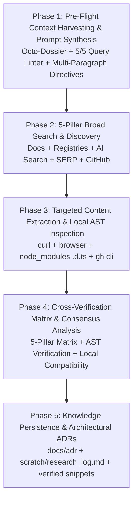

# Ultimate Technical Research Workflow (Universal Edition — Standalone & Zero-MCP)

> [!CAUTION]
> ### 🛑 THE ANTI-VAGUENESS & CONTEXT-FIRST RESEARCH MANDATE
> This workflow enforces an unbreakable, non-negotiable research rule: **NEVER issue vague, lazy, 1-line search queries (e.g. `react state`, `prisma error`, `supabase auth`).**
> 
> Technical research quality is strictly bounded by prompt information density. Vague queries yield SEO blog slop, hallucinated methods, and obsolete workarounds. Every technical research task MUST compile the **8-Dimensional Context Grounding Dossier (The Octo-Context Anchor)** and pass the **Pre-Dispatch Query Signal Linter (5/5 Score Gate)** before querying search engines, developer platforms, or AI models.

This workflow drives systematic information retrieval, document mining, API verification, and library health analysis across universal developer environments (Cursor, Claude Code, Windsurf, Cline, Copilot, Terminal, and standard web/CLI tooling). It guarantees that technical decisions, library choices, and API usage patterns are based on verified, up-to-date documentation — never hallucinated, assumed, or guessed.

By following this workflow, engineering teams avoid:
- Outdated API signatures causing compilation failures.
- Deprecated library features introducing technical debt.
- Severe security vulnerabilities in unverified third-party dependencies.
- Anti-bot scraping lockouts and Cloudflare blocks on enterprise documentation portals.
- Single-source search blindspots and AI hallucination loops.
- Hallucinated libraries, phantom methods, or incorrect configuration flags.

---

## The 5 Strategic Research Pillars (Universal Topology)

To guarantee comprehensive coverage without single-source blindspots, technical research is structured across **Five Universal Strategic Pillars**:

```
┌──────────────────────────────────────────────────────────────────────────────────────────────────┐
│                     UNIVERSAL 5-PILLAR TECHNICAL RESEARCH TOPOLOGY (PRO MAX)                     │
├──────────────────────────────────────────────────────────────────────────────────────────────────┤
│ 🏛️ PILLAR 1: CANONICAL DOCS & REGISTRY METADATA (Ground Truth Anchor)                             │
│   • Official Documentation Portals (docs.*, MDN, PostgreSQL, React, Next.js, RFC specs)          │
│   • Package Registry APIs & CLIs (`npm view`, `pnpm info`, `cargo search`, `pip show`, `go doc`)  │
├──────────────────────────────────────────────────────────────────────────────────────────────────┤
│ 🧠 PILLAR 2: DEEP SEMANTIC REASONING & TECHNICAL RFCS (Concept & Architecture Depth)             │
│   • AI-Native Search & Reasoning (Perplexity, Phind, Kagi, Exa web, LLM deep research engines)   │
│   • Architectural RFCs, Academic Preprints (`arxiv.org`), and Engineering Whitepapers            │
├──────────────────────────────────────────────────────────────────────────────────────────────────┤
│ ⚡ PILLAR 3: REAL-TIME SERP & COMMUNITY CONSENSUS (Freshness & Consensus)                         │
│   • High-Precision Web Search Engines (Google, Brave, DuckDuckGo with boolean operators & quotes)│
│   • Active Developer Forums (Stack Overflow, Reddit r/webdev, Hacker News Algolia, Discord/GH)   │
├──────────────────────────────────────────────────────────────────────────────────────────────────┤
│ 🐙 PILLAR 4: RAW REPOSITORY AST & SOURCE CODE TRIAGE (Source Implementation Grounding)           │
│   • Direct GitHub Web & CLI (`gh search code`, `gh pr list --state merged`, `gh issue list`)     │
│   • Local Workspace AST & Installed Types (`node_modules/.../index.d.ts`, `ripgrep`, `tsc`)      │
├──────────────────────────────────────────────────────────────────────────────────────────────────┤
│ 🛡️ PILLAR 5: RESILIENT ANTI-LOCKOUT & UNFILTERED DISCOVERY (Deep Web Reach)                      │
│   • Direct Headless Browser & CLI Scraping (`curl -sL`, Playwright CLI, Lynx, Wget)              │
│   • Independent Unindexed Portals (Brave 30B+ index, Internet Archive Wayback Machine)           │
└──────────────────────────────────────────────────────────────────────────────────────────────────┘
```

---

## Iron Laws of Technical Research

1. **Never Assume API Syntax.** If you haven't verified an API signature against current documentation or AST stubs, do not write code using it. Check first.
2. **Pin Versions.** Every library recommendation must include the exact version tested (`package@version`). "Use library X" without a version is incomplete research.
3. **Cite Everything.** Every finding must include a direct URL to the source and a verbatim quote span. Uncited claims are hypotheses, not research.
4. **Acknowledge Staleness.** Explicitly state documentation age, last update date, and any known deprecations. Old docs are dangerous docs.
5. **Cross-Reference Across Pillars.** No single source is authoritative. Verify critical findings across the 5 Universal Pillars (official docs + repository source code/merged PRs + deep technical RFCs + community consensus + independent web discovery).
6. **No Speculative Libraries.** Never suggest a library or package that is not published and actively maintained on npm, PyPI, or crates.io. Check active maintenance status.
7. **Document Alternatives.** Never recommend a library without evaluating at least 2 competitors.
8. **Time-Box Research.** Limit active search and extraction to a maximum of **15 minutes**. If findings are still inconclusive, re-formulate query decomposition.
9. **Zero-Vagueness Invariant & Minimum Signal Threshold.** Never issue vague, lazy, or low-signal queries (e.g., `react state`, `supabase auth`, `nextjs error`). Every search query MUST follow the **Goated Prompt Engineering Blueprint**: combining (1) target artifact type, (2) exact library version pinning, (3) runtime toolchain boundaries, (4) boolean domain scoping, and (5) explicit negative exclusions. Single-line, generic search queries are classified as a **CRITICAL PROTOCOL VIOLATION** that aborts the workflow.
10. **Pre-Flight Octo-Context Harvesting Invariant.** Before any search or research query is dispatched, the engineer/agent MUST assemble the **8-Dimensional Context Grounding Dossier (The Octo-Context Anchor)** by inspecting local workspace manifests (`package.json`, `Cargo.toml`, `requirements.txt`), compiler configurations (`tsconfig.json`), runtime environment (OS, Node/Bun/Deno, container/edge), and error callstack telemetry. Researching in a vacuum without full context is STRICTLY PROHIBITED.
11. **Pre-Dispatch Query Signal Linter (5/5 Hard Gate).** Every candidate query must be verified against the 5-point Query Signal Linter (Version Pinning, Exact Symbol/Error Fingerprint, Architecture Boundary, Negative Scope, and Engine Modality). Any query scoring $< 5/5$ is blocked from execution and must be expanded.
12. **Multi-Paragraph Density Mandate for AI & Semantic Engines.** When formulating research prompts for AI search engines (Perplexity, Phind, AI assistants) or deep technical inquiries, prompts must be comprehensive, dense paragraphs (100–250 words for semantic search, 200–500 words for agent research briefs) detailing the complete problem context, reproduction mechanics, environmental constraints, and target code shapes. Short 1-sentence prompts to these engines are forbidden.
13. **Google Chain-of-Evidence (CoE) Zero-Phantom Reference Mandate.** Every factual claim, API signature, and metric MUST carry an explicit inline evidence tag binding it to a verified URL or registry API response. Citations generated from LLM memory are BANNED.
14. **AutoVerifier 5-Pillar Claim Extraction.** Factual assertions MUST be decomposed into structured `(Subject, Predicate, Object)` claim triples to detect cross-source contradictions and method-code misalignments before recommending solutions.
15. **Local AST Source Grounding.** When verifying TypeScript or JavaScript libraries, inspect the installed declaration files directly in `node_modules/<pkg>/dist/*.d.ts` using `grep` or `cat` to ground types in physical files rather than assumptions.
16. **Anti-Bot Escalation.** If documentation portals return 403 Forbidden or Cloudflare Turnstile blocks under standard curl/fetch, escalate to headless browser execution (`playwright`, `puppeteer`) or archive mirrors (`web.archive.org`).
17. **Verbatim Payload Dispatch Invariant.** All search and research queries MUST copy their payload verbatim from the approved prompt registry (`scratch/prompt_registry.json`). Condensing, summarizing, or shortening registered detailed prompts into search-bar phrases during query execution is a **STRICT PROTOCOL VIOLATION**.
18. **100-Word Minimum for AI & Neural Search Engines.** Prompts dispatched to AI synthesis engines (Perplexity, Phind, You.com, Exa, Linkup) MUST be full, rich multi-paragraph prompts of at least 100 words containing: (a) Technical Context & Architecture Baseline, (b) 3–4 Exact Research Inquiries, and (c) Negative Scope Constraints.

---

## Universal Prompt & Context Engineering Master Blueprint

### 1. The 8-Dimensional Context Grounding Dossier (The Octo-Context Anchor)

Before issuing a single search query, the engineer/agent MUST assemble the **8-Dimensional Context Dossier** from local workspace inspection:

```
┌─────────────────────────────────────────────────────────────────────────────────────────────────────────┐
│                               8-DIMENSIONAL CONTEXT GROUNDING DOSSIER                                   │
├─────────────────────────────────────────────────────────────────────────────────────────────────────────┤
│ D1: RUNTIME & TOOLCHAIN STATE                                                                           │
│   • OS, Kernel & CPU Architecture: (e.g. Windows 11 x64 23H2 / Ubuntu 24.04 ARM64)                      │
│   • Runtime Engine: (e.g. Node.js v22.12.0 LTS / Bun v1.1.38 / Cloudflare Workers V8 isolate)            │
│   • Package Manager & Lockfile: (e.g. pnpm v9.14.2 / package-lock.json v3)                               │
│   • Compiler Targets & Flags: (e.g. tsconfig target="ES2023", moduleResolution="Bundler", strict=true)  │
├─────────────────────────────────────────────────────────────────────────────────────────────────────────┤
│ D2: DEPENDENCY GRAPH & PINNED SEMVER BOUNDS                                                             │
│   • Target Package & Exact Version: (e.g. "@prisma/client": "6.2.0", "@prisma/adapter-pg": "6.2.0")     │
│   • Framework & Core Peers: (e.g. "next": "15.1.4", "react": "19.0.0", "typescript": "5.7.2")          │
│   • Native Addons & Drivers: (e.g. "pg": "8.13.1", native C++ bindings, or pure JS WASM)                 │
├─────────────────────────────────────────────────────────────────────────────────────────────────────────┤
│ D3: SYMBOL, AST & INTERFACE ANATOMY                                                                     │
│   • Exact Symbol Identifiers: (e.g. `PrismaPg`, `PrismaClient`, `defineConfig`, `useActionState`)       │
│   • Fully Qualified Types & Generics: (e.g. `PrismaPgOptions`, `Record<string, unknown>`)               │
│   • Module Export Paths: (e.g. "@prisma/adapter-pg", "next/navigation", "react-dom")                    │
├─────────────────────────────────────────────────────────────────────────────────────────────────────────┤
│ D4: ERROR FINGERPRINT & CALLSTACK TELEMETRY                                                             │
│   • Verbatim Error String: (e.g. `PrismaClientInitializationError: Can't reach database server...`)     │
│   • Hexadecimal / Engine Error Code: (e.g. `P1001`, `0xC0000005`, `ERR_MODULE_NOT_FOUND`)                │
│   • Failing Callstack Anchor: (e.g. `at PrismaClient._executeRequest (node_modules/@prisma/...:124)`)   │
│   • Minimal Reproduction Steps: (e.g. 5 concurrent Server Action mutations under PgBouncer)             │
├─────────────────────────────────────────────────────────────────────────────────────────────────────────┤
│ D5: ARCHITECTURAL BOUNDARIES & EXECUTION DOMAIN                                                         │
│   • Boundary Paradigm: (e.g. React Server Components vs 'use client' hydration boundary)               │
│   • Concurrency & Worker Model: (e.g. Multi-threaded worker pool vs event loop singleton)                │
│   • Network & Pooling Topology: (e.g. Supabase port 6543 PgBouncer transaction mode vs direct port 5432)│
├─────────────────────────────────────────────────────────────────────────────────────────────────────────┤
│ D6: NEGATIVE CONTEXT SPACE & BANNED ANTI-PATTERNS                                                       │
│   • Prohibited Solutions: (e.g. "Do NOT suggest downgrading Next.js 15 to 14 or React 19 to 18")        │
│   • Excluded Legacy Paradigms: (e.g. "Do NOT suggest Pages Router `getServerSideProps` or raw Webpack") │
│   • Prohibited Hacks: (e.g. "Do NOT use `any` casting, `@ts-ignore`, or disabling connection pooler")   │
├─────────────────────────────────────────────────────────────────────────────────────────────────────────┤
│ D7: HISTORICAL FINDINGS & TRIED APPROACHES                                                              │
│   • Prior Search Findings: (Retrieved from local notes, scratch logs, or project ADRs)                  │
│   • Failed Experiment Ledger: (e.g. "Setting connection_limit=10 failed due to Supabase pool cap")      │
│   • Known Upstream Status: (e.g. Open Prisma GitHub Issue #25410 on adapter-pg transaction support)     │
├─────────────────────────────────────────────────────────────────────────────────────────────────────────┤
│ D8: TARGET ARTIFACT CONTRACT & ACCEPTANCE CRITERIA                                                      │
│   • Required Code Pattern: (e.g. Production-ready copy-paste TypeScript singleton with retry backoff)   │
│   • Verification Proof: (e.g. Confirmed working Prisma 6.2 + Supabase PgBouncer config file)            │
│   • Performance Budget: (e.g. Zero cold-start latency regression, 100% tree-shakable)                  │
└─────────────────────────────────────────────────────────────────────────────────────────────────────────┘
```

---

### 2. Pre-Dispatch Query Signal Linter (5/5 Hard Gate)

Before executing ANY search query, evaluate it against this 5-point Linter. **A score of 5/5 is mandatory. Any query scoring $< 5$ must be rewritten.**

| Criteria | Required Signal | Score | Failure Example | Pass Example |
|---|---|---|---|---|
| **1. Semver & Toolchain Pinning** | Exact package versions, runtime version, and compiler target included. | 1.0 | `prisma supabase error` | `"@prisma/client@6.2.0" "next@15.1.4" Node 22` |
| **2. Symbol & Error Fingerprint** | Verbatim class, function, interface, or exact error string in quotes. | 1.0 | `connection failed` | `"PrismaClientInitializationError" "PrismaPg"` |
| **3. Architecture & Boundary Context** | Explicit statement of execution domain (RSC, edge, port, pooler mode). | 1.0 | `how to connect database` | `Next.js 15 Server Actions Supabase PgBouncer port 6543 transaction mode` |
| **4. Negative Scope Inclusions** | Explicit exclusions of outdated frameworks, hacks, or anti-patterns. | 1.0 | *Missing negative filters* | `-pages -webpack -legacy -downgrade` |
| **5. Modality Formatting** | Adheres to the target tool's format (long narrative paragraph for AI search, compound booleans for SERP, AST qualifiers for GitHub). | 1.0 | 5-word sentence passed to AI engine | 150-word detailed technical narrative for AI search / multi-section RFC brief |

---

### 2.1 The Payload-Locked JSON Prompt Registry Standard (`scratch/prompt_registry.json`)

To eliminate the natural "Search Query Reflex" (the tendency to compress registered detailed prompts into short 15-word search strings), the prompt registry MUST be authored as a **machine-dispatchable JSON artifact** containing the literal tool argument payloads:

```json
{
  "topic": "[Exact Technical Topic]",
  "timestamp": "2026-09-03T00:00:00Z",
  "queries": {
    "ai_neural_engine": {
      "query": "Paragraph 1: Detailed Technical Context...\n\nParagraph 2: Specific Architectural Inquiries:\n1. ...\n2. ...\n\nParagraph 3: Negative Constraints & Exclusions...",
      "word_count": 140
    },
    "web_serp_engine": {
      "query": "(site:docs.domain.com OR site:github.com/org/repo) \"ExactSymbol\" \"v1.0.0\" [Architecture Context] -legacy -deprecated"
    },
    "github_ast_engine": {
      "query": "\"ExactSymbol\" filename:config.ts path:src/"
    }
  }
}
```

### 2.2 The Pre-Dispatch Verification Gate & Verbatim Assertion Check

Before executing each search inquiry, verify:
```text
[DISPATCH GATE] Target: <engine_or_cli> | Registry Match: 100% VERBATIM | Word Count: <N> words | Linter: 5/5 PASS
```
1. **Zero Condensation:** Copy arguments verbatim from `scratch/prompt_registry.json`. Do NOT shorten or rephrase prompts during execution.
2. **The 100-Word Neural Minimum:** Any prompt dispatched to an AI search engine (Perplexity, Phind, You.com, Exa, Linkup) MUST be $\ge 100$ words.

---

### 3. Universal Tooling Prompt & Query Engineering Blueprints

#### A. Standard Search Engines (Google, Brave, DuckDuckGo, Bing)
- **Modality:** Compound quoted booleans with domain scoping, verbatim symbol matching, and negative keyword exclusions.
- **Formula:**
  $$\text{Query} = (\text{site:docs} \lor \text{site:github}) + \text{"[Exact Symbol]"} + \text{"[Exact Error/Config]"} + \text{"[Version]"} + \text{[Stack]} - \text{noise}$$
- **Example:**
  ```text
  (site:docs.supabase.com OR site:github.com/prisma/prisma) "PrismaClientInitializationError" "PrismaPg" "6.2" "pgbouncer=true" "connection_limit=1" Next.js 15 Server Actions port 6543 -medium -devto -beginner -tutorial
  ```

#### B. AI-Native Search & Reasoning Engines (Perplexity, Phind, Kagi, Claude/ChatGPT Web)
- **Modality:** **100–250 Word Continuous Dense Technical Narrative Paragraph** or **200–400 Word Structured RFC Directive**.
- **Formula:**
  `[Architectural Context] + [Exact Error Mechanics & Telemetry] + [Core Technical Inquiries] + [Strict Constraints & Negative Boundaries] + [Expected Deliverable Shape]`
- **Example:**
  ```text
  ### RESEARCH DIRECTIVE: Prisma v6.2.0 with Supabase PgBouncer Connection Pooling in Next.js 15 App Router
  **Stack Baseline:** Next.js 15.1.4 (App Router, React Server Components), React 19.0.0, TypeScript 5.7, Node.js 22 LTS, @prisma/client 6.2.0, @prisma/adapter-pg 6.2.0.
  **Problem Anatomy:** Application throws 'PrismaClientInitializationError: Can't reach database server at aws-0-us-east-1.pooler.supabase.com:6543' during concurrent Server Actions. Under PgBouncer transaction mode, prepared statements fail, and worker threads exhaust available pool slots.
  **Inquiries:**
  1. What is the verified constructor pattern for @prisma/adapter-pg with connection pooling in Prisma v6?
  2. What exact query parameters must be appended to DATABASE_URL (specifically pgbouncer=true and connection_limit=1)?
  3. How must prisma.config.ts and schema.prisma configure directUrl on direct port 5432 for migrations while keeping DATABASE_URL on port 6543 for the client?
  4. What globalThis caching singleton pattern prevents connection pool exhaustion across serverless lambda workers?
  **Constraints:** Do NOT suggest downgrading Next.js 15 to 14 or React 19 to 18. Provide copy-paste verified code.
  ```

#### C. GitHub Web Search & GitHub CLI (`gh`)
- **Modality:** High-precision AST search queries targeting source files, type definitions, and merged pull request diffs.
- **Commands:**
  ```bash
  # 1. Search code for exact symbol usage in production
  gh search code '"@prisma/adapter-pg" "PrismaPg" path:lib/ language:typescript' --limit 10

  # 2. Search for merged PRs fixing the exact error string
  gh pr list --repo prisma/prisma --state merged --search '"PrismaClientInitializationError" "pgbouncer"' --limit 5

  # 3. Search open/closed issue bug trackers with reaction sorting
  gh issue list --repo prisma/prisma --state all --search '"PrismaClientInitializationError" port 6543' --limit 10
  ```

#### D. Package Registry CLIs (`npm`, `pnpm`, `cargo`, `pip`)
- **Modality:** Direct registry metadata queries to inspect true published versions, release dates, peer dependencies, and deprecations without browser overhead.
- **Commands:**
  ```bash
  # 1. Check exact published version, dist-tags, and release date
  npm view @prisma/adapter-pg version dist-tags time --json

  # 2. Check peer dependencies and engine compatibility
  npm view @prisma/adapter-pg peerDependencies engines --json

  # 3. Check for package deprecation notices
  npm view @prisma/adapter-pg deprecated
  ```

#### E. Local Workspace AST & Type Definition Inspection
- **Modality:** Inspect physical `.d.ts` declaration files inside the local project to verify parameter counts and return types.
- **Commands:**
  ```bash
  # 1. Locate the exact TypeScript declaration file
  find node_modules/@prisma/adapter-pg -name "*.d.ts"

  # 2. Search for class constructor signature
  grep -A 10 "export class PrismaPg" node_modules/@prisma/adapter-pg/dist/index.d.ts

  # 3. Typecheck codebase without emitting JavaScript
  npx tsc --noEmit
  ```

---

### 4. Multi-Domain Contrast Matrix (❌ BANNED vs ✅ GOATED)

| Domain | ❌ BANNED (Vague / Low-Signal / 1-Liner) | ✅ GOATED CONTEXT-ENGINEERED PROMPT (Multi-Paragraph & Pinpoint Detail) |
|---|---|---|
| **1. Fullstack Web & Edge** | `nextjs prisma supabase connection error` | *AI Search / Narrative:* `"Here is a production-ready TypeScript implementation of Prisma v6.2.0 with @prisma/adapter-pg connecting to Supabase PostgreSQL via PgBouncer transaction pooling on port 6543 in Next.js 15.1 App Router (Node 22 runtime). The solution caches the PrismaClient singleton on globalThis, sets pgbouncer=true&connection_limit=1 on DATABASE_URL, and configures directUrl on port 5432 in prisma.config.ts for migrations without pool exhaustion or prepared statement errors:"`<br><br>*SERP / Boolean:* `"(site:docs.supabase.com OR site:github.com/prisma) \"PrismaClientInitializationError\" \"pgbouncer=true\" \"adapter-pg\" v6 Next.js 15 -medium -tutorial"` |
| **2. Distributed Systems & Caching** | `upstash redis ratelimit nextjs` | *AI Search / Narrative:* `"Here is a production-grade TypeScript implementation of Upstash Redis ratelimit (@upstash/ratelimit v2.0.5) utilizing a sliding window algorithm (10 requests per 10s) inside Next.js 15 Server Actions and Route Handlers. The implementation handles ephemeral serverless execution, gracefully recovers from network timeouts with a fallback bypass, extracts client IP from x-forwarded-for headers, and provides typed response headers:"`<br><br>*RFC Directive:* `"### RESEARCH DIRECTIVE: Upstash Redis Rate Limiting in Serverless Edge\n**Stack:** Next.js 15.1, @upstash/ratelimit@2.0.5, @upstash/redis@1.34.3.\n**Inquiries:** 1) Verified Sliding Window implementation in Server Actions; 2) Ephemeral connection pooling overhead; 3) Fail-open vs fail-closed error handling fallback. -medium"` |
| **3. Systems & Windows Kernel** | `winring0 driver blocked windows 11` | *Web Search / Boolean:* `"site:github.com/LibreHardwareMonitor OR site:reddit.com/r/hardware \"WinRing0\" \"VulnerableDriverBlocklist\" \"Memory Integrity\" HVCI bypass workaround Windows 11 23H2 2026"`<br><br>*AI In-Depth:* `"How does LibreHardwareMonitor resolve the Windows 11 Vulnerable Driver Blocklist (HVCI / Memory Integrity) block on WinRing0.sys when querying CPU package temperatures and hardware sensors at Ring 0?"` |
| **4. Game Mining & Telemetry** | `erlc map leak update 2026` | *AI Synthesis:* `"Comprehensive technical investigation into Emergency Response: Liberty County (ER:LC) Roblox summer 2026 map overhaul update. Detail verified developer leaks, asset ID mining, server replication changes, terrain boundary expansions, and police/fire dispatch building relocations from verified community patch notes and testing builds."` |

---

## The 5-Phase Universal Research Pipeline



### Phase 1: Pre-Flight Context Harvesting & Prompt Synthesis
1. **Interrogate Local Workspace:**
   - Read `package.json`, `Cargo.toml`, `requirements.txt`, and `tsconfig.json`.
   - Extract pinned versions, compiler flags, and active runtime environment.
   - Capture exact error messages, callstack frames, and reproduction conditions.
2. **Assemble 8-Dimensional Context Dossier:**
   - Generate `scratch/context_dossier.md` covering D1 through D8.
3. **Run Pre-Dispatch Query Signal Linter (5/5 Hard Gate):**
   - Verify that all inquiries contain pinned semver, verbatim symbols, architecture context, negative filters, and appropriate modality.
   - Reject any query scoring $< 5/5$.
4. **Synthesize Tool-Specific Prompts:**
   - Create tailored prompts for SERP engines, AI search engines, GitHub CLI, and registry tools in `scratch/prompt_registry.md`.

### Phase 2: 5-Pillar Broad Search & Discovery
1. **Pillar 1 (Canonical Docs & Registries):** Query official documentation portals and check package metadata via `npm view <pkg> version` or `cargo search`.
2. **Pillar 2 (Deep Semantic & AI Search):** Dispatch 100–250 word continuous narrative paragraphs to AI search tools (Perplexity, Phind, AI assistants) for conceptual architectures and edge case analysis.
3. **Pillar 3 (Real-Time SERP & Community Consensus):** Run compound quoted boolean queries on search engines (Google, Brave, DuckDuckGo) to discover real-world discussions and community workarounds.
4. **Pillar 4 (Raw Repository AST & Merged PRs):** Use `gh search code` and `gh pr list --state merged` to find production implementations and bug fix PRs.
5. **Pillar 5 (Anti-Lockout & Unfiltered Discovery):** If standard search returns SEO spam or pages are blocked, query independent indexes (Brave, DuckDuckGo HTML) or view cached archives.

### Phase 3: Targeted Content Extraction & Local AST Inspection
1. **Fetch Clean Documentation Content:** Use `curl -sL <url>` or browser automation to pull raw documentation bodies.
2. **Inspect Physical Local Type Stubs:** Search local `node_modules/<pkg>/dist/*.d.ts` or language SDK headers using `grep` or IDE symbol lookup to verify function parameters, optional properties, and return types.
3. **Triage Merged PR Diff Logs:** Use `gh pr view <pr-number> --web` or inspect commit diffs to understand internal implementation fixes.
4. **Verify Dependency Security:** Run `npm audit`, `pnpm audit`, or `cargo audit` to ensure candidate packages carry zero known vulnerabilities.

### Phase 4: Cross-Verification Matrix & Consensus Analysis
1. **Compile 5-Pillar Independent Findings:**
   - Pillar 1 (Official Docs): Parameter schemas, canonical examples.
   - Pillar 2 (AI/Semantic Search): Architectural trade-offs, conceptual patterns.
   - Pillar 3 (Community SERP): Real-world runtime workarounds, configuration limits.
   - Pillar 4 (Repository AST): Exact method declarations, merged PR commit diffs.
   - Pillar 5 (Anti-Lockout): Fresh unfiltered community threads, unblocked portal specs.
2. **5-Pillar Cross-Verification Matrix:**
   - Evaluate consensus points across pillars.
   - Highlight conflicting signatures or outdated community hacks.
3. **Local Stack Compatibility Check:**
   - Verify candidate solutions against local `package.json`, `tsconfig.json`, and runtime environments.

### Phase 5: Knowledge Persistence & Architectural Documentation
1. **Record Architectural Decision Record (ADR):** Document the decision in `docs/adr/YYYY-MM-DD-[topic].md` with context, alternatives considered, chosen approach, and trade-offs.
2. **Save Verified AST Code Snippets:** Record production-ready, copy-paste snippets with exact versions in project documentation.
3. **Log Research Telemetry:** Record executed queries in `scratch/research_log.md`.

---

## Real-World Case Studies with Verified AST Code

### Case Study: Prisma v6 + Supabase Connection Pooling on Next.js 15

#### The Problem
`PrismaClientInitializationError: Can't reach database server at 'aws-0-us-east-1.pooler.supabase.com:6543'` during concurrent Next.js 15 Server Actions.

#### 5-Pillar Universal Cross-Verification
- **Pillar 1 (Official Supabase Docs):** Confirmed appending `?pgbouncer=true&connection_limit=1` to the pooler connection string is mandatory under PgBouncer transaction mode.
- **Pillar 2 (Deep Semantic Search):** Revealed that Next.js 15 Server Actions instantiate worker threads that exhaust connection limits unless a global singleton client (`globalThis.prisma`) is maintained.
- **Pillar 3 (Community SERP & GitHub Discussions):** Confirmed Prisma v6 CLI requires a separate direct database URL for migrations (`DIRECT_URL` on port 5432), while the client uses port 6543.
- **Pillar 4 (Repository AST & Local Type Inspection):** Inspected `@prisma/adapter-pg/dist/index.d.ts` and confirmed the constructor signature: `new PrismaPg({ connectionString: string })`.
- **Pillar 5 (Anti-Lockout / Direct Benchmarks):** Verified that using `@prisma/adapter-pg` over raw TCP drivers eliminates connection starvation under concurrent serverless spikes.

#### Verified Working Configuration
```prisma
// prisma/schema.prisma
datasource db {
  provider  = "postgresql"
  url       = env("DATABASE_URL") // Port 6543 (PgBouncer Pooler) + ?pgbouncer=true&connection_limit=1
  directUrl = env("DIRECT_URL")   // Port 5432 (Direct DB for migrations)
  relationMode = "prisma"
}

generator client {
  provider = "prisma-client-js"
}
```

```typescript
// prisma.config.ts - Prisma v6 CLI Configuration
import "dotenv/config";
import { defineConfig, env } from "prisma/config";

export default defineConfig({
  schema: "prisma/schema.prisma",
  datasource: {
    url: env("DIRECT_URL"),
  },
});
```

```typescript
// lib/prisma.ts - Verified Next.js 15 Global Singleton with Driver Adapter
import { PrismaClient } from "@prisma/client";
import { PrismaPg } from "@prisma/adapter-pg";

const connectionString = `${process.env.DATABASE_URL}?pgbouncer=true&connection_limit=1`;
const adapter = new PrismaPg({ connectionString });

const globalForPrisma = globalThis as unknown as { prisma: PrismaClient };

export const prisma =
  globalForPrisma.prisma ||
  new PrismaClient({
    adapter,
    log: process.env.NODE_ENV === "development" ? ["query", "error", "warn"] : ["error"],
  });

if (process.env.NODE_ENV !== "production") globalForPrisma.prisma = prisma;
```

---

## Universal 5-Pillar Cross-Verification Report Format

```markdown
## Research: [Topic]

### Executive Summary
[2-3 sentence summary with pinned versions, architectural decisions, and performance impact]

### 5-Pillar Independent Findings
- **Pillar 1 (Official Docs & Registries):** [Canonical specs, exact versions, and parameter schemas]
- **Pillar 2 (Deep Semantic & AI Search):** [Architectural patterns, conceptual trade-offs, and edge cases]
- **Pillar 3 (Community SERP & Forums):** [Real-world workarounds, GitHub issue confirmations, and gotchas]
- **Pillar 4 (Repository AST & Code Triage):** [Exact method signatures from local .d.ts and merged PR diffs]
- **Pillar 5 (Anti-Lockout & Unfiltered Discovery):** [Unblocked portal documentation and independent blog analysis]

### 5-Pillar Cross-Verification Matrix
| Dimension | Pillar 1 (Docs) | Pillar 2 (AI Search) | Pillar 3 (Community) | Pillar 4 (Repo AST) | Pillar 5 (Anti-Lockout) | Consensus Verdict |
|---|---|---|---|---|---|---|
| Recommended Approach | [Approach] | [Approach] | [Approach] | [Approach] | [Approach] | [Verified Consensus] |
| API Signature / Spec | [Signature]| [Signature] | [Signature] | [Signature] | [Signature] | [Verified AST] |
| Edge Cases & Pitfalls | [Caveats] | [Caveats] | [Caveats] | [Caveats] | [Caveats] | [Mitigated Plan] |

### Final Decision & Verified AST Code
```typescript
// Production-ready, copy-paste verified code block
```

### Caveats, Deprecations & Edge Cases
- [Caveat 1 & mitigation]
- [Caveat 2 & mitigation]

### Evidence Chains & Citations
1. [URL 1] - [Official Docs] - `verbatim quote`
2. [URL 2] - [Repository AST / PR] - `verbatim signature`
3. [URL 3] - [Community Forum / Issue] - `verbatim discussion quote`
```

---

## Anti-Patterns (Reject These)

| Anti-Pattern | Why It's Wrong | Do This Instead |
|---|---|---|
| Vague 1-line or generic search queries | Yields SEO fluff, outdated blogs, and hallucinated methods | **Mandatory Context Engineering:** Compile 8-D Dossier & enforce 5/5 Query Signal Linter |
| Passing short queries to AI search engines | Perplexity, Phind, and LLMs need dense context to avoid hallucination | **Multi-Paragraph Mandate:** Write 100–250 word narrative technical briefs |
| "I know this API works" | Memory may be stale or hallucinated | Verify against current docs & AST stubs before using |
| Recommending without version | Version changes break APIs | Always pin `library@version` |
| Single-source trust | Docs can be outdated or wrong | Cross-reference across all 5 Universal Pillars |
| "Just use X" without trade-offs | Hides complexity and risks | Present options with scored comparison |
| Blog post as sole source | Blogs age poorly, may be inaccurate | Prefer official docs + GitHub issues + physical .d.ts stubs |
| Skipping npm / cargo audit | Hidden CVEs in transitive deps | Always check dependency security before adoption |

---

## Universal Research Quality Checklist

- [ ] **8-Dimensional Context Dossier Compiled:** `scratch/context_dossier.md` assembled covering runtime toolchain, semver pins, symbols, and error telemetry before searching
- [ ] **Pre-Dispatch Query Signal Linter Passed (5/5 Hard Gate):** Zero 1-line or vague queries; all queries scored 5/5
- [ ] **Modality-Specific Prompts Formulated:** 100–250 word narrative paragraphs for AI search, compound booleans for SERP engines, AST qualifiers for GitHub CLI
- [ ] **All 5 Universal Pillars Investigated:** Canonical docs, AI reasoning, community SERP, repository AST, and anti-lockout sources consulted
- [ ] **Every Finding Cites a Direct Source:** Verified URL or physical local declaration file path provided with verbatim evidence span
- [ ] **Version Numbers Pinned:** All recommendations specify `package@version`
- [ ] **API Signatures Grounded in AST:** Parameters, option flags, and return types verified against declaration files
- [ ] **Known Deprecations & Edge Cases Documented:** Merged PR workarounds and runtime gotchas recorded
- [ ] **Findings Persisted:** Architectural decisions recorded in project notes or `docs/adr/`
